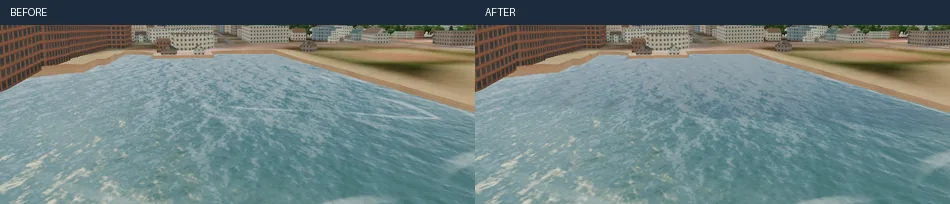

# Sheltered water appearance at Quartermaster Marina

The [mapped basin geometry](quartermaster-coast.md) stays unchanged.
The water rendering now uses the active local marina field to reduce
ripple slopes, specular glare and ocean-style breaker foam where that
field can support the effect. The darker color is an original material
interpretation of sheltered waterfront conditions, not a depth, water
quality, wind or tidal model. The old water shading remains outside the
source-supported band and whenever the optional shoreline field cannot load.

In a matched real Three.js scene at 19 m, the 16 near imagery tiles were
all identical and ready. The new effect changed 41,483 pixels by more than
four RGB levels. In a fixed interior basin ROI, mean adjacent-pixel
brightness variation fell from 3.996 to 2.161 levels (about 46%).
The open-sea foreground and upper city view remain unchanged. The scene
submitted 486,055 triangles and 172 draws in both cases. The original
terrain, collision, docks, atlas, assets and fetch budget do not change.

Use `tools/qa/quartermaster-optics-poses.py --checkout . --out /tmp/pei-marina --views quartermaster-low`
with the optional Chromium path. The fixture uses a fixed camera and
water phase, not a camera registered to a real photo.
