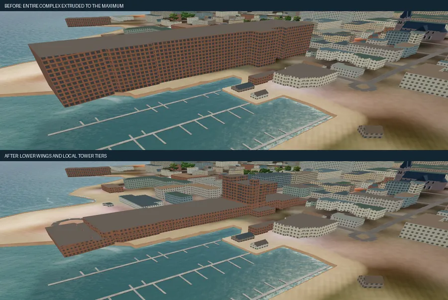

# Charlottetown waterfront: measured roof silhouette



The initial Quartermaster waterfront model applies one maximum-height return, 40.51 m above the simulator's local ground anchor, to the entire merged 11,429 m² footprint. The result is a tall blank wall along the harbour where surveyed data show low connected wings and several smaller higher towers. This correction keeps the exact original surveyed outline and replaces only that wall and roof. It does not change any neighbouring building, building pack, material shader, terrain, water or aircraft contact.

## Evidence

- The source is tile `q12000111`, feature 22 (zero-based) in the unchanged NRCan PEI 2020 building footprint pack. The whole ordered outline and pack SHA must match. The old model falls back automatically for another atlas or any changed outline.
- Native relief is from the co-registered [NRCan 1 m DSM/DTM item](https://datacube.services.geo.ca/stac/api/collections/hrdem-mosaic-1m/items/10_3-mosaic-1m) and the [PEI 2020 classified tile 390000 / 686000](https://canelevation-lidar-point-clouds.s3.ca-central-1.amazonaws.com/pointclouds_nuagespoints/PEI/Prince_Edward_Island_2020/pei_2020_390000_686000.copc.laz). A bounded 14-range query transferred 4.12 MB and located 151,115 unwithheld class-6 building returns in the outer query box. The one-metre census admits only the original footprint interior more than 1.5 m from its edge.
- The census includes 10,844 interior cells, 10,581 of them with three or more classified building returns. The class-6 median agrees with the DSM to 0.47 m at the 90th percentile, or 0.25 m after excluding cells with a vertical spread of at least 0.85 m. These are different representations of a related acquisition, not new construction photos or independent surveys; the largest disagreements are at steep transitions.
- Height priors identify coherent terrace families. Only stable class-6 medians within 0.65 m of the DSM and in connected blocks seed a band. There are 9,019 directly supported seeds and 1,825 unseeded/mixed/small-component interior cells. The seven fitted planes sit at 9.11, 10.58, 13.96, 14.92, 28.68, 37.09 and 42.55 m in the common survey/game vertical frame. Exact roof-edge offsets, conditions after 2020, mechanical details and façade layouts are not surveyed here.
- [July 2025 aerial photo by Quintin Soloviev](https://commons.wikimedia.org/wiki/File:Aerial_view_of_Charlottetown.jpg) (CC BY 4.0) corroborates that the facility has distinct masses. It is reference only, not used to assign factual dimensions or copied into the game.

## Model and gates

A nearest-core pass (3.75 m in native cells before the approximately 1 m generalization) reconciles narrow gaps. It uses the lowest supported terrace as a conservative filler when no nearby cell qualifies, rather than extruding unsupported areas to the old maximum. Only this one accepted original footprint is filled. Thus the interior flat plates are derived, and the generalizations at uncertain joints are explicitly not measured. Nested planes form joined outer walls and interior risers, without drawing the overlapping solid slabs, using the existing building tile's mesh and draw call.

The 10,844 sampled raster centres give a full one-metre geometry census, with edge ties resolved within a millimetre for the error calculation. In a stricter Float32 check a few centres on step edges were ambiguous: the largest gap was about 0.004 mm and the deepest second-face hit about 0.003 mm. This is not a claim of mathematically watertight CAD geometry. P90 DSM error is **31.92→1.51 m** compared with the real old 42.50-m in-game roof; a 4 m spatial-block holdout (five folds) puts p90 at **0.22 m** on stable consensus and **1.56 m** on the full interior. The 1,217-triangle complete shell is generated and drawn with the old tile, not in an extra draw. See the [machine-readable geometry gate](quartermaster-roof-gate.json) and licensed [bounded evidence census](../../data/roof-tiers/).

```sh
/usr/bin/python3 tools/geodata/bake-quartermaster-roof.py
node --experimental-strip-types --test test/quartermaster-roof.test.ts
npm run check
python tools/qa/quartermaster-roof-frames.py --checkout . --out /tmp/quartermaster-roof-frames --chromium /path/to/chromium
```

Rebuilding uses NumPy, SciPy and GDAL/OGR/PROJ plus the committed cell census. The matched-browser fixture checks the draw budget and compares every unaffected vertex attribute in the same building tile. The browser never downloads the source point cloud, DSM, DTM or cell data. Not for real navigation.

In the integrated 88 m browser view, both forms used 86 draws. The tier
model submitted 380,966 triangles versus 379,807 before, including the
current marina docks and graphics. All 208,143 compared vertex scalars
from other buildings in the same tile stayed identical. This remains a
geometry correction, not a survey of current interiors or façade fixtures.
