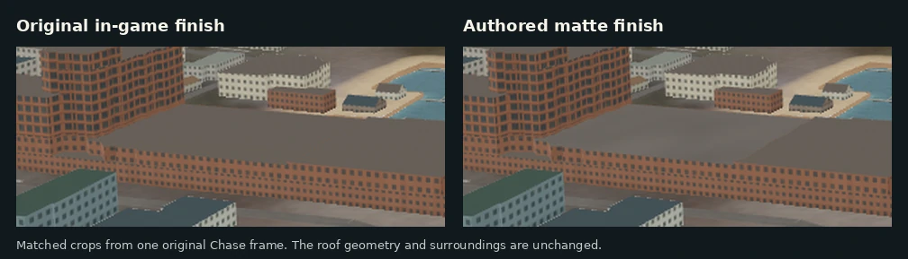

# Charlottetown waterfront: seaward roof finish

Standard uses a muted matte finish on one existing low roof of the PEI
Convention Centre complex when its exact local scenery is ready at
departure. The finish tones down repetitive bands on the seaward deck.
It does not replace or move the building, roof silhouette, adjoining
docks, neighboring facades, terrain, or aircraft.



## Find it in flight

On a freshly loaded **Standard** game (which starts in **Chase**),
select **Charlottetown waterfront · low pass** and allow the local
scenery to load in Dispatch before selecting **Begin flight**. With no
steering input, the roof comes into view on the aircraft's left about
1.27–1.38 km along the approach. There is no separate ready badge for
the roof. If you begin before the finish is ready, or begin in another
camera view, you keep the original roof for that flight. Waiting or
switching to Chase mid-flight does not enable it.

For a fresh attempt, reload, or return to **Chase** with **V** while
flying, then use **Pause → Choose departure** and start a new flight
after the local scenery loads.

To compare the original finish with the same departure, replace the
game address's query with `?departure=harbour-low&stockQuartermasterSeawardRoof`
and reload. That switch does not select a different waterfront,
vehicle, or flight model. Incompatible render settings, a changed source,
missing owner, or a different departure retain the original material.

## What is real, and what is authored

The existing authenticated geometry supplies all 30 selected roof
triangles: 90 original positions and normals at the same level, with
the same sorting, opaque coverage and depth. The original stock pack
range is reused; no roof imagery, extra geometry, or second request
is installed. The added relief-like variation is material response in the
existing coordinates, not registered seams, vents, parapets, damage
or standing water. The invited view is a scoped visual refinement, not
a replacement façade reconstruction.

The [IKO project profile](https://www.iko.com/comm/wp-content/uploads/sites/7/2024/03/MM5L933_IKO_Project_Profile_PEI_Convention_Centre_FR_0619.pdf)
documents historical roofing systems used on the complex. It does not
identify this exact plane or its current finish. No image pixels from
the reference appear in the simulator.

## What was checked

The [same-frame optical trial](quartermaster-seaward-roof-optics.json)
used native 4× output for two ordinary Chase checkpoints and two
negative states. It holds the original camera, scene, draw order and
roof geometry constant. Positive checkpoints show 5,515 and 15,517
strong RGB changes within the authenticated roof role, zero RGB changes
outside it, and no alpha changes. Restoring the original on the same
frame is byte-identical. An outside-range view and an offscreen-roof
view also remain byte-identical.

Independent ordinary **packaged** flights verified the finish with
the same existing Founders scene and floating docks at two nearby
approach distances (1200 × 760, native 4×):

| Ordinary flight | Approach checkpoints | Submitted the new finish |
| --- | --- | --- |
| Standard, scenery ready | 1270.70 m, 1376.61 m | Yes, both |
| Original-roof comparison | 1273.05 m, 1377.79 m | No, both |

These are route-matched, not identical camera matrices or per-pixel
diffs. Manually choosing the departure also admitted the ready finish
at 1024 × 640. A separate actual early flight retained the original
roof after the healthy scenery response arrived. Each check reused the
single existing local building tile response and ended with Cockpit
and Pause working normally.

The four rejected product paths also passed: the actual Souris
waterfront departure leaves the variant inactive and never requests the
Charlottetown roof range; Detail and a real 0× framebuffer keep the
original finish; and an altered but still decodable compressed receiver
does not enable the authored finish. Those flights also retained the
normal camera and Pause controls.

The versioned original position streams and failure paths can be
checked from the project root:

```sh
node --experimental-strip-types --test test/quartermaster-seaward-lease.test.ts
```
