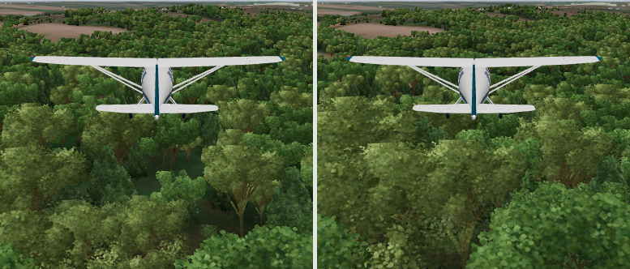

# Mapped woodland heights for the low Queens County flight

In Standard Dispatch, select **Queens County · woodland view pass**. If
**Survey-based woodland sizes ready** is showing when you click **Begin
flight**, the nearby trees already in the scene use sizes from PEI's
existing forest inventory layer. You can also begin while it checks; that
flight retains the old sizing for those cached trees. Later source arrival
does not retroactively change that launch. Regular streaming into new
areas is unchanged.

The panels are unscaled crops at the same frame, with no exposure or colour
adjustment. Look below and to either side of the plane for the change in
canopy height and silhouette. This is an adjustment to existing trees,
not a photogrammetric forest model or a new survey of tree locations.
Terrain, flights, aircraft and existing materials are unchanged.

## Source and scope

Contains information licensed under the
[Open Government Licence – Prince Edward Island](https://www.princeedwardisland.ca/en/information/finance/open-government-licence-prince-edward-island).
The provincial [Enhanced Forest Inventory 2020](https://data-princeedwardisland-peigov.hub.arcgis.com/datasets/8a7638bdc09648358e0b6fd14be6117a)
represents dominant and co-dominant stand heights on a 20 m source grid.
See [how the existing stream was prepared](forest-height-stream.md).
Tree origins, estimated pilot clearance, and current conditions are not
observed from this source. The trees remain at the simulator's existing
inferred locations.

The menu uses only original authenticated tile **13-13**, from
**heights-04.pack**, inclusive bytes 212212–248768 (36,557 of 520,308
bytes). The decoded 324×324 R8 SHA-256 is
`ff1d9badde7c036815956fedd778820f7647399baff8afac3f59a7bc46d74c26`.
No new download, art, GIS coverage, trees, shader, physics model or flight
route is added. The width estimate follows the sim's original seeded
height-to-width rule rather than an independently measured crown width.

This menu action is separate from the restored high Queens regional grove.
It preserves that grove's entire protected crown and shadow envelope and
all 1,081 original peer submission entries. It cannot authorize a
regional request or reuse for another location. The existing bookmark
is a separate launch history. To compare the old manual behavior while
leaving the normal woodland stream enabled, use `?stockDispatchWoodland`.

## Native moving frame comparison

The isolated QA flight used the actual camera, art, physics and native
clock, neutral controls, and the original Three.js renderer. The
diagnostic drew both measurements in the same frame at the same pose.
These numbers describe changed original submissions, not an extra tree
count or a hardware benchmark.

| Actual Chase movement | Original slots with signed size change | Pixels changing by >2 RGB codes | Changed exterior role pixels | Changed fully opaque aircraft pixels |
| --- | ---: | ---: | ---: | ---: |
| 29.906 m | 16,226 | 48,984 | 0 | 0 |
| 95.714 m | 16,226 | 104,667 | 0 | 0 |
| 195.045 m | 15,197 | 270,644 | 0 | 0 |
| 343.494 m | 14,322 | 166,464 | 0 | 0 |

All four checkpoints retained the same draw and triangle totals, exact
alpha, and the unchanged 1,081-entry peer packet. The native proof used
4× raster coverage. Aircraft edge pixels can contain both an opaque
aircraft sample and visible ground or trees. The original propeller
shutter also transmits background. An earlier broad aircraft silhouette
test refused to distinguish these cases and did not pass. This independent
proof measured literal full opaque coverage separately, accounted for
every changed broad intersection with real partial coverage or the
existing shutter, and restored the exact frame.

The [native receipt](queens-dispatch-woodland-native.json) records image
and packet hashes. Each submitted float32 height and width change was
independently recomputed from the authenticated input, not inferred from
a screenshot or a GPU buffer readback. The native flight reached Cockpit
and Pause with no new incompatible layer warnings.

## Cached source and a no-op launch

The original loader sometimes authenticates the Queens height tile before
a manual site selection. In that case the original live rows may already
have the mapped dimensions, so there is nothing for the menu handoff to
replace. The standard menu keeps its original-sizing message; that
message is not a statement that the signed heights are absent.

One [native warm-cache observation](queens-dispatch-woodland-warm.json)
verified 16,226 signed-sized original slots, none with only the generic
size pair, 3,213 separate unsupported slots, and zero mismatched cache
or live slots in the tested scope. The 1,081 protected peer entries had
the existing signed roster hash exactly. The menu performed zero
replacements. Cold and warm results are separate observations.

## Uninstrumented flight checks

The [ordinary ready launch](queens-dispatch-woodland-product-ready.json)
selected Queens through the real menu, received the signed original bytes
while still in Dispatch, and started with 16,226 existing tree size updates.
At 125.037 m of neutral Chase flight it had 15,193 affected live slots.
The changing number is the visible roster moving, not a new tree count.

An [early launch](queens-dispatch-woodland-product-early.json)
used the normal Begin button programmatically on the first real Queens
Dispatch frame while its source was still outstanding. After Begin, the
unchanged source decoded normally; already-cached tree sizes did not
switch during the flight. It still reported zero menu replacements at
128.626 m, and Cockpit and Pause worked. This is a programmatic ordering
check, not a measurement of network or input latency.

A [wrong checksum](queens-dispatch-woodland-product-corrupt.json)
left the original launch intact even though the local server sent the
expected HTTP range size. On the [actual single-sample context](queens-dispatch-woodland-product-no-msaa.json),
the source was healthy but the handoff still remained off. Both flights
used the normal camera controls and paused normally.

The original [low bookmark](queens-dispatch-woodland-product-bookmark.json)
and [higher regional route](queens-dispatch-woodland-product-high-regional.json)
each retained their independently installed 364-crown pass with one original
asset request and zero new manual replacements. The former had a positive
partial fade; the higher case reached its original full gain. These are
separate flights, not pixel-equality comparisons across sessions.

The [explicit stock comparison](queens-dispatch-woodland-product-stock.json)
used the original stock switch in both builds. Authentic height data was
already available before changing departures. Neither flight enabled the
new menu handoff, and both independently drew the original 364-crown
regional grove with one original asset request. The switch does not
disable the existing grove or original woodland stream.
