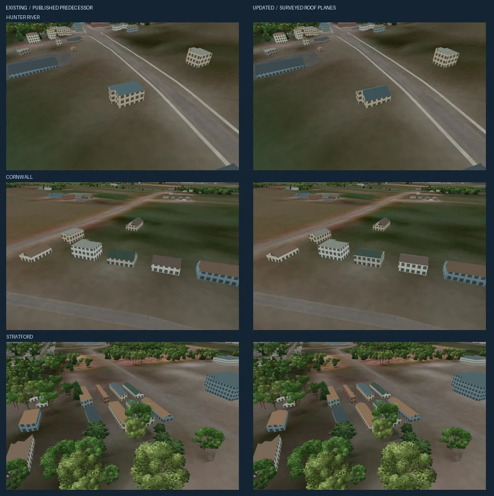

# Surveyed roof silhouettes in Queens County

The Standard atlas now fits measured roof surfaces over **29 existing
buildings** in Charlottetown (1), Cornwall (9), Hunter River (4),
North Rustico (3), and Stratford (12). This preserves the original
outlines, exterior materials and nearby features. It does not assign
a style, business or address to any roof.

The earlier [Kings](kings-neutral-roofs.md) and
[Prince](prince-neutral-roofs.md) sets remain. Together the three cohorts
now cover 107 verified roof replacements in 17 communities. This is
selective architectural coverage, not a claim that the province has
entirely surveyed or individually modelled buildings.

## How it was checked

The footprints and height cells come from
[Automatically Extracted Buildings](https://open.canada.ca/data/en/dataset/7a5cda52-c7df-427f-9ced-26f19a8a64d6)
and the [NRCan 1 m HRDEM mosaic](https://datacube.services.geo.ca/stac/api/collections/hrdem-mosaic-1m/items/10_3-mosaic-1m).
A model must match the exact atlas, tile, row and every coordinate of
the ordered outline. A significant disagreement between the surveyed
and rendered ground keeps the legacy shell.

From 144 geometrically selected plans, 46 passed the native fit.
Seven were left unchanged for too little improvement, three were
already covered by authored assets, and seven failed the absolute
runtime threshold. The [actual Three.js mesh check](queens-roof-mesh-gate.json)
used 629 spatially withheld same-survey cell centres:

| Per-building absolute p90 | Existing mesh | Fitted mesh |
| --- | ---: | ---: |
| Median across the screened buildings | 0.863 m | 0.136 m |
| 90th percentile across the screened buildings | 1.395 m | 0.361 m |
| Worst screened building | 2.205 m | 0.405 m |

All 143,466 unrelated vertices in the actual participating building
batches remained byte-exact. The [three matched scenes](queens-roof-pixel-gate.json)
have the same draw counts and keep all 994,169 pixels outside the
projected target geometry unchanged. These tests are not device frame-rate
measurements.

An independent check used the actual optional adaptive terrain packs,
including a real refinement elsewhere as a control. All 4,479 tested
ground or surface observations under the roofs remained exact through
activation and withdrawal. Existing distant coarse terrain and
foundations are outside this roof pass.

Contains information licensed under the
[Open Government Licence – Canada](https://open.canada.ca/en/open-government-licence-canada).

## Reproduction

The [canonical candidate archive](../../data/queens-neutral-roofs/candidate-shells.json.gz)
pins the exact 144 outlines and initial axes, and the
[registered samples](../../data/queens-neutral-roofs/sample-plan.json.gz)
preserve their native cells. Use the same [shared acquisition and
replay procedure](prince-neutral-roofs.md#reproduction), with
`data/queens-neutral-roofs/`, and pass `QUEENS` to the final ray
report command. Use the [Queens pose schedule](../../data/queens-neutral-roofs/review-poses.json)
with `tools/qa/kings-frames.py --poses` for both checkouts.
