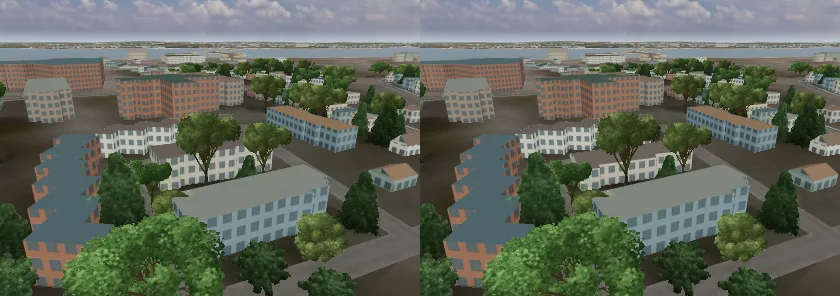

# Measured roof on one Charlottetown building

One existing flat game cap in Charlottetown (`q120010`, ordinal 152) now
follows a low gable fitted to the recorded 2020 roof. It is a modest silhouette
correction, not a named landmark or a redesign of the surrounding block. The
original outline, lower walls, wall and roof material programs, road, terrain,
water and flight behavior are unchanged. Only the cap and the meeting ends of
its own walls are redrawn. No new asset transfer, scenery switch or draw call.



## Source and acceptance

The ordered outline is from [NRCan Automatically Extracted Buildings](https://open.canada.ca/data/en/dataset/7a5cda52-c7df-427f-9ced-26f19a8a64d6).
The fitted planes use the original [PEI 2020 1 m HRDEM project](https://datacube.services.geo.ca/pgstac/api/collections/hrdem-lidar/items/PEI-Prince_Edward_Island_2020-1m)
(EPSG:3979; orthometric CGVD2013). The catalogue date is 15 September 2020,
not a claim about the time of an individual roof scan or today's appearance.
Coefficient fitting, topology ranking and evaluation use disjoint native
2.75 m spatial blocks. The 35 evaluation centres are in blocks unused by both
fitting and ranking. On the actual streamed Three.js mesh their absolute p90
error drops from **1.877 m to 0.297 m**. A separately rebuilt same-survey
rim sample has 26 full-cell-safe centres; p90 **0.315 m**, max **0.494 m**.

An independently examined [original LiDAR tile](https://canelevation-lidar-point-clouds.s3.ca-central-1.amazonaws.com/pointclouds_nuagespoints/PEI/Prince_Edward_Island_2020/pei_2020_390000_688000.copc.laz)
corroborates both slopes without relying on a raster-only residual. Its 1,739
non-withheld inboard class-6 points are from swath 27075 in the same survey;
per-plane p90 is **0.321 / 0.290 m**. There is no 1 m inboard cell with at least
three such returns and absolute signed median residual above 0.40 m. Isolated
returns can differ by about 1 m, so the fit is not a construction drawing or a
model of every surface detail. Several other roofs initially fitted against the
raster were excluded because their near-edge or raw point evidence indicated
real unresolved secondary structures. This change does not touch them.

The existing renderer admits the roof only for the same atlas stamp, exact
slot, the complete ordered simple outline and a compatible base datum.
Build checks verify the source archive and exact compressed chunk; no new
runtime loader was added. A real mesh comparison keeps **40,857** vertices
outside the intended row byte-for-byte across all six original attributes
(2,001,993 bytes). The old and new wall bottoms coincide; measured contact
into the original near ground is about 0.511 m. No underlying terrain was
changed, including its inherited coarse geometry. The [test receipt](queens-survey-roof-gate.json)
records the actual game projection, source and mesh bounds. In the game lock
112,216 pixels outside the projected target were identical, with 16 extra
triangles and unchanged draw count. These are scope checks, not performance
claims. The [compiled flight check](charlottetown-q152-flight-check.json)
records normal Standard dispatch, flight and cockpit operation.

Contains information licensed under the [Open Government Licence – Canada](https://open.canada.ca/en/open-government-licence-canada).

## Reproduce the geometry gate

From the updated repository with locked npm dependencies, pass a checkout of
`d1c7b4a3e26e9b675a2d8741b14238594da226ef` as the before case:

```sh
scratch=$(mktemp -d)
gzip -dc data/queens-survey-roof/holdout.json.gz > "$scratch/held.json"
node --experimental-strip-types tools/qa/kings-roof-rays.cjs \
  /path/to/before . "$scratch/held.json" "$scratch/rays.json"
```

The historical QA command name is retained; it accepts this exact Queens
owner fixture. The [machine-readable receipt](queens-survey-roof-gate.json)
records the bounded raster window, raw source tile, tested roof coefficients
and original atlas identifiers.
