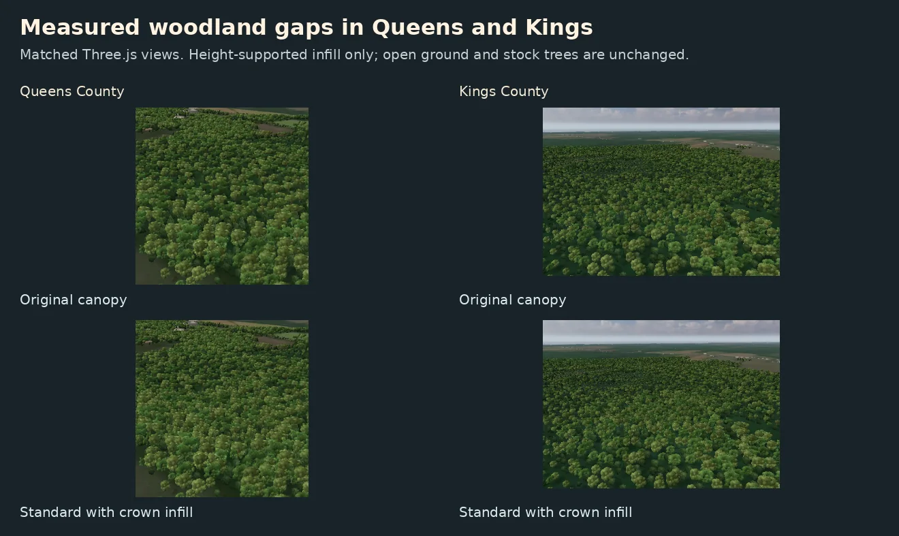
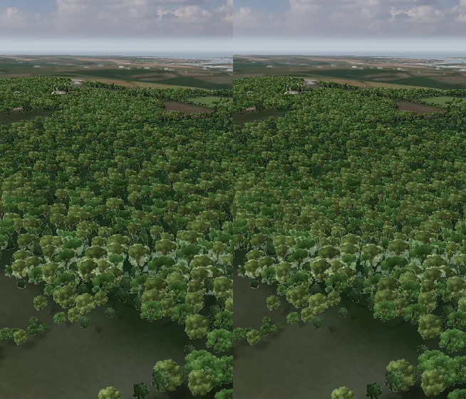
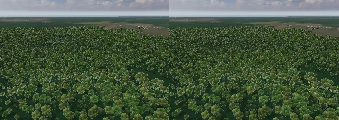

# Regional woodland density studies

Two independent woodland studies add inferred crown cover inside mapped
stands in Queens and Kings counties. This extends the approach tested at
[Miscouche](miscouche-canopy.md), where the rendered mature canopy had
more gaps than the 2020 height field. The three sites do not stand in for
the rest of PEI. None of the studies consumes building budget, changes
terrain, moves a real tree, or asserts a present-day forest inventory.

The exact [PEI CLUI2020 source polygons](https://gis.princeedwardisland.ca/server/rest/services/Hosted/CLUI2020_OpenData/FeatureServer/0)
and the [co-registered NRCan surface and ground grids](https://open.canada.ca/data/en/dataset/0fe65119-e96e-4a57-8bfe-9d9245fba06b)
establish independent geographic and height constraints. We considered
public CLUI stands with high interpreted crown closure, tested their tall
and low 1 m native fractions near intended virtual flight tracks, then
rejected stands where short structure disagreed with simply drawing
more crowns. The chosen exact field IDs are **0911576** (Queens) and
**1900486** (Kings).

Only original, inferred forms within the conservatively measured canopy footprint may
enter the runtime. Every footprint clears a mapped boundary and a low
structure reserve. Output must also remain within the existing atlas
woodland class even when the native 2020 tall-structure mask extends
across that class boundary. That additional constraint removed five
Queens proposals. Widths vary inside their already qualified envelopes.
The distribution draws broadly on the documented hardwood/conifer mix,
not a diagnosis of the species occupying individual patches.

Contains information licensed under the
[Open Government Licence – Prince Edward Island](https://www.princeedwardisland.ca/en/information/finance/open-government-licence-prince-edward-island)
and the [Open Government Licence – Canada](https://open.canada.ca/en/open-government-licence-canada).
No vendor artwork or raw elevation tiles are included in the new runtime.

## Compare the two woodland flights

Choose **Queens · woodland pass** or **Kings · woodland pass** in Standard.
No extra flag is needed. Add `?stockRegionalCanopy` for a stock comparison;
the two departure locations stay in the list in Detailed. The earlier
`?regionalCanopyStudy` setting still selects the explicit comparison.
Both 112 m starts are virtual views, not airstrips or navigation guidance.

| Site | Stock occupied pixels | Study occupied pixels | Inferred forms |
| --- | ---: | ---: | ---: |
| Queens 0911576 | 51,365 of 78,522 (65.42%) | 61,730 (78.61%) | 364 |
| Kings 1900486 | 19,269 of 35,021 (55.02%) | 24,622 (70.31%) | 201 |

The same 2020 height grid both selected and fenced these forms. This
is not a separate held-out survey or a count of individual trees.
The above results are canopy-only observations from the actual
renderer, not interchangeable with the 1 m source height percentages.
No old canopy pixels were lost, and no added ones crossed the source
polygon or the native short-structure protection zone. The oblique
views in both counties protected the frame outside the independently
projected crown boundaries; the Queens example shows more visual
change than the Kings example.

Matched oblique views: stock on the left and the same renderer with the
inferred crowns at right.

## Runtime boundaries

This is a canopy layer seen from above, not new near-ground tree
geometry. It needs the validated existing terrain, exact land-cover
mask and the real emitted local woodland roster. The layer fades in
only from an eligible flight camera above the conservative crown
envelope. It never changes the terrain, aircraft physics, old canopy
buffer, hedges, shadows, or the trees at other sites. Each installed
cohort submits a single instanced draw with 728 triangles in Queens
or 402 in Kings. For the old foliage the atlas texture is retained
and shared. These are renderer geometry counts, not a hardware
performance promise.

A request started while the view was eligible can finish after leaving.
The late result cannot attach offsite. Cold distant and incompatible
settings do not start the optional pack.

The [verification receipt](regional-canopy-gate.json) records all eight
compiled flights. Both enabled runs traveled beyond 120 m, reached their
whole selected canopy, switched to Cockpit and paused. Stock, distant,
Detail and wrong-cover checks did not request a pack. Corrupt and withheld
files kept the original scene. The original explicit release passed 379 tests, the
TypeScript/Vite production build and world data checks. For a replay, run
`tools/qa/regional-canopy-flight.py` against the production build with
Chromium and Playwright.

The [Standard verification](regional-canopy-standard-gate.json) repeats
both routes with no optional flag, the stock and Detailed profiles, a
distant run, and failure controls. The current paired render retains the
existing directional foliage lighting on both stock and added crowns.
Neither scene changes the terrain or field boundaries.
