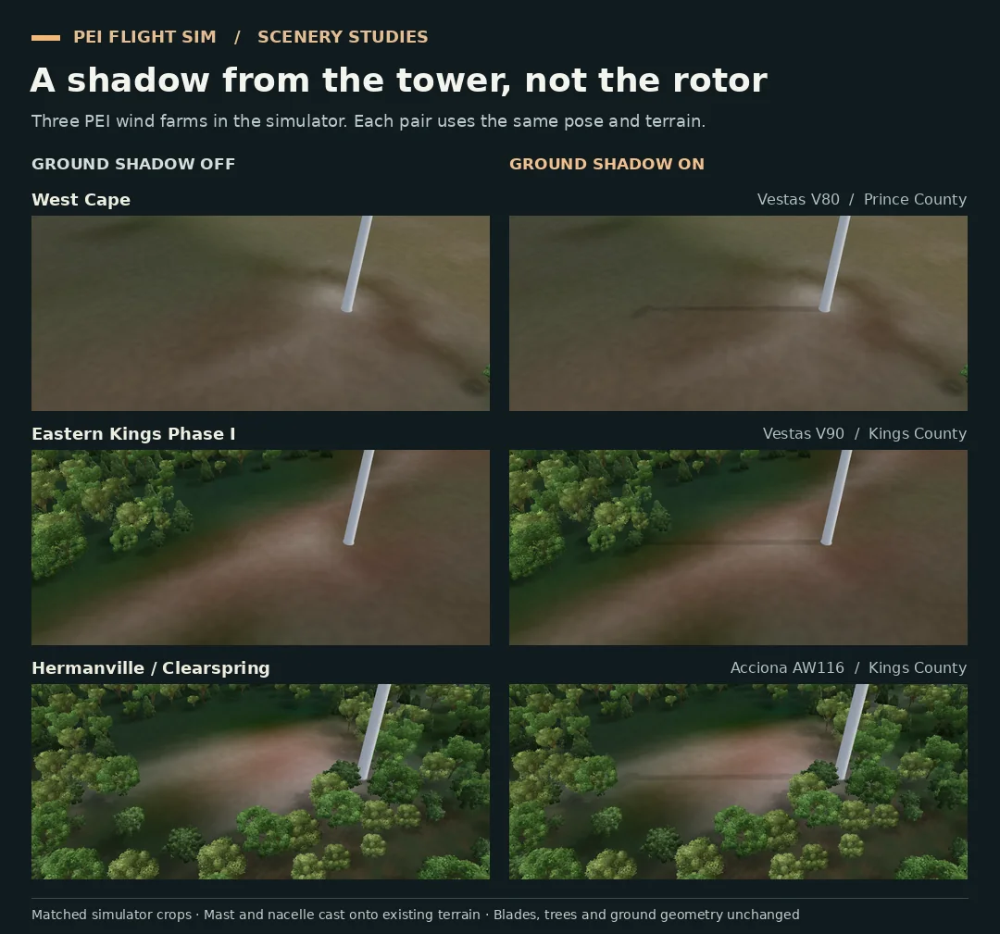

# Wind-farm ground shadows

In Standard, the base of a West Cape turbine now joins a narrow shadow on the existing field. The tapered shaft casts a long stripe; the wider nacelle leaves a broader end. The same effect uses the different machinery at Eastern Kings Phase I and Hermanville/Clearspring. **Compare it:** use `?stockRegionalWindLight` to keep the wind farms in place and switch off only their ground shadows. [Where to fly and which machines are installed](regional-wind.md).



## What casts and what receives light

The source is the **actual near-detail model**: the socket, steel mast and closed nacelle. A ray from the existing terrain towards the simulator’s fixed sun must pass through this geometry for the ground to lose direct sunlight. The soft border widens modestly with the distance between caster and receiver. The terrain retains its original colour, ambient illumination and shape. Trees and buildings still occlude the shaded ground normally.

The blades and spinner are deliberately excluded. This does not reproduce blade flicker, time-of-day sun, operating conditions, service yards or cleared land. It does not change vegetation placement, collisions or aircraft handling. North Cape belongs to [a different scenery package](north-cape-turbines.md).

## Rendering cost

The light reaches full strength at close range and fades between **370 and 570 m from the eye to the ground fragment**. No distant shadow geometry is drawn. Each of the three farm models has a signed, compressed field derived from its own rigid triangles: 8,080 bytes for West Cape, 7,959 for Eastern Kings and 9,421 for Hermanville. Nearby, eligible terrain uses one additional texture sampler and at most ten current caster positions. The field is not a photograph or a flat shadow painted at each location.

Only mounted, unmodified 112-subdivision terrain within the seven known tiles can receive the effect. If the caster, sun, graphics budget or signed field fails its checks, the existing turbine and scenery remain. The matched tests kept the same terrain geometry, draw calls and triangle counts. The close fragment programs used **7 / 10 / 7 samplers** at West Cape / Eastern Kings / Hermanville. These are measured program costs, not a hardware FPS guarantee. See the [compiled player checks](regional-wind-light/player.json) and the [4 m-step approach and retreat test](regional-wind-light/range-transition.json).

## What the comparisons establish

| Held camera | Pixels darkened by more than 2/255 | Outside original geometry and its bounded, softened edge |
| --- | ---: | ---: |
| West Cape WCW27, close reverse view | 3,588 | 0 |
| Eastern Kings EKW6, close reverse view | 3,592 | 0 |
| Hermanville HCS3, close reverse view | 4,109 | 0 |
| Eastern Kings EKW6, distant control | 0 | 0 |

All 12,412 pixels that changed at **any** level across the three close views were on the original, visible terrain within that footprint. No pixel brightened. Switching the light off and back on at the same simulation tick restored the original frame byte-for-byte. The [full camera and linked-program evidence](regional-wind-light/independent-views.json) includes receiver geometry checks, draw counts and per-case limits. A [separate West Cape capture](regional-wind-light/west-first-pass.json) compares two independent application starts with the turbine art retained.

An independent [finite-mesh ray comparison](regional-wind-light/finite-ray-census.json) checked the classifier at multiple receiver heights, including above the nacelle. A further [896,882 genuine simulator terrain samples across all 74 stations](regional-wind-light/all-stations.json) found 87,166 hard-shadow intersections with the original triangle models. The compact field produced 170 false positives and 92 false negatives; the least-matching individual footprint still had 99.298% intersection-over-union. Very sharp depth boundaries can differ locally by about 1.4 m; the field is not a survey, and model edges are not hardware-independent exact centimetre measurements.

## Reproduce

After `npm ci`, run the following from the repository root with Node 22.12+ and Python with NumPy/SciPy. The asset rebuild takes the triangle and index buffers from the same factory that renders each turbine; no remote service, map token or imagery is required.

```sh
mkdir -p /tmp/pei-wind-light
node --experimental-strip-types tools/geodata/regional-wind-light/extract-original-casters.mjs /tmp/pei-wind-light/source
python tools/geodata/regional-wind-light/bake-static-depth.py /tmp/pei-wind-light/source /tmp/pei-wind-light/packed
for f in west-cape east-point-i hermanville; do
  cmp "/tmp/pei-wind-light/packed/$f.wrg.gz" "public/world/regional-wind-light/v1/$f.wrg.gz"
done
node --experimental-strip-types tools/qa/regional-wind-light/caster-transition.mjs . /tmp/pei-wind-light/transitions.json
node --experimental-strip-types --test test/regional-wind-static-light.test.ts
```

The [rebuild receipt](regional-wind-light/rebuild.json) lists each source buffer, decoded texture and transfer hash. The included packs were reproduced byte-for-byte with Python 3.12 and 3.13; gzip timestamps and the OS header byte are normalized. For the actual on/off, fragment-budget and ray-to-pixel verification, use the [Chromium audit instructions](../../tools/qa/regional-wind-light/README.md).
