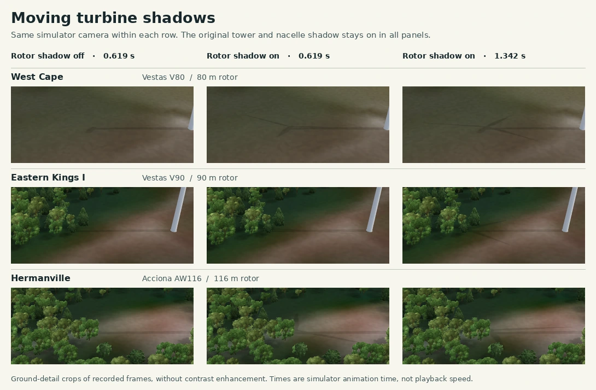

# Moving turbine shadows

Fly low past a turbine at West Cape, Eastern Kings Phase I or Hermanville/Clearspring. At the end of the tower’s stationary shadow, three narrower shadows rotate across the field. Look through the gaps: the ground between the blades stays lit. The rotor in the sky and its shadow use the same simulation clock.



| To compare | Use |
| --- | --- |
| Switch off just the rotating blade and spinner shadows | `?stockRegionalWindRotorLight` |
| Keep the turbine models but switch off all their ground shadows | `?stockRegionalWindLight` |
| Remove the three regional turbine arrays | `?stockRegionalWind` |

The [farm guide](regional-wind.md) lists the 74 registered turbine locations, machine types and sightseeing directions. North Cape is a separate scenery package. The light and shaft yaw follow the simulator; they do not report current wind, power generation, actual sunlight or real-world shadow flicker.

## What the player sees

Only the existing, detailed blade and spinner models cast this moving shadow. A local depth pass draws those triangles from the sun’s direction. Terrain uses that depth to test whether sunlight can reach it. The soft edge accounts for the finite solar disc. Where the [stationary mast and nacelle shadow](regional-wind-light.md) overlaps the moving shadow, the stronger obstruction wins. That is a conservative approximation of the combined penumbra, not two shadows multiplied together.

Close terrain receives the effect at full strength, fading between **370 and 570 m** from the camera to the ground point. Trees, roofs and aircraft are not new shadow receivers. Nothing is added to the ground geometry, collision model, vegetation, service yards or roads.

## Verification

The eight low-camera phase pairs changed **9,303 pixels at any level**; **7,284** darkened by more than 2/255. Every changed pixel lay on the original visible terrain within the independently ray-tested blade/spinner footprint or its finite soft edge and raster allowance. None brightened. Switching off only the moving receiver and restoring it at the same tick reproduced each original framebuffer exactly. The [image and program evidence](regional-wind-rotor-light/independent-views.json) also includes an Eastern Kings distant control: the ordinary rigid light remained available, but the moving pass made no submission and changed no pixels.

| Matched reverse view | Darkened >2/255 at 0.619 s | Darkened >2/255 at 1.342 s | Changed between the two shadow patterns >2/255 |
| --- | ---: | ---: | ---: |
| West Cape WCW27 | 603 | 953 | 1,460 |
| Eastern Kings EKW6 | 600 | 805 | 1,356 |
| Hermanville HCS3 | 1,106 | 1,143 | 2,143 |

The last column compares the isolated moving-light changes at the two times, not pixels changed by the visible turbine spinning. [One additional West Cape pose](regional-wind-rotor-light/west-first-pass.json) supplies a separate matched capture at 0.42 s.

Across **36 registered farm/clock combinations**, the [original-triangle ray audit](regional-wind-rotor-light/moving-source.json) compared actual 16-bit GPU depth with the unchanged three-dimensional source at level and sloped receivers. The least-matching hard silhouette had 94.51% intersection-over-union, and the worst per-case 95th-percentile outline difference was 0.20 m on the evaluation grid. The finest blade tips are not pixel-perfect: the lowest outer-blade coverage recall was 86.98%. The source and depth attachment agreed at both tested 600-second wraps. These are checks against the simulator models, not surveys of physical shadows in PEI.

## Cost and fallback

An active farm adds **one offscreen instanced draw** on an updated clock, not one draw per turbine. The reverse-view West/East/Hermanville cases used 4/4/2 casters respectively, at 1,520 source triangles per caster; the maximum allowed per farm is 10/6/5. A stopped clock can reuse an unchanged allocation. There is no new terrain draw or downloadable shadow-image pack.

The active close terrain programs used 8/11/8 fragment samplers respectively, one more than their rigid-only versions. The local depth-map cells are allocated at **0.15 m per texel**, with a two-metre guard around the complete swept source shape. The [source and allocation table](regional-wind-rotor-light/source-extents.json) gives each family’s dimensions. Dedicated depth and unused colour attachment storage is approximately 4.45/3.30/5.18 MB, excluding driver overhead; a warm target may remain cached beyond the fade. No real-hardware frame rate is inferred from a software WebGL test.

The new receiver requires an eligible, unmodified near terrain tile, the authenticated original rotor, the simulator’s matching sun, and enough graphics capacity. Failure leaves the existing turbine and eligible rigid light alone. [Renderer state and injected failures](regional-wind-rotor-light/renderer-state.json), [final ground-image parity](regional-wind-rotor-light/v2-parity.json) and [compiled player checks](regional-wind-rotor-light/player.json) cover that release behaviour. Rebuild the source bounds locally with:

```sh
npm ci
npm run check
node --experimental-strip-types tools/qa/regional-wind-rotor-light/layout-census.mjs . /tmp/pei-rotor-layout.json
```

For the actual native-depth readback and 36-case triangle test, see the [independent reproduction guide](../../tools/qa/regional-wind-rotor-light/README.md). The [additional camera and plate instructions](../../tools/qa/regional-wind-rotor-light/layout-and-phases.md) describe how the images above were made.
