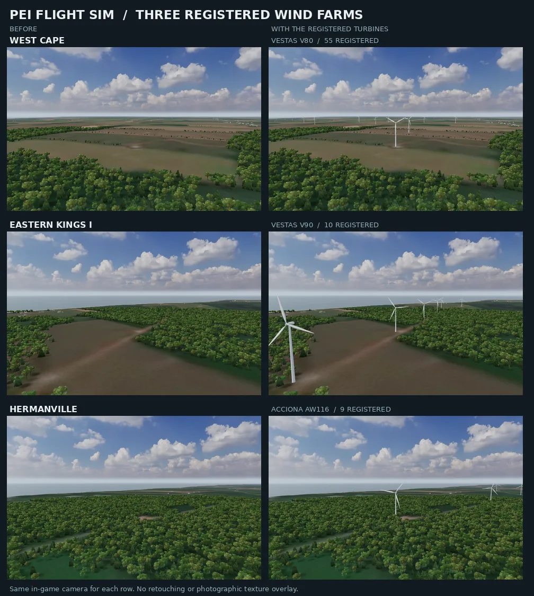

# Wind farms in western Prince and eastern Kings

Standard scenery places **74 turbines at their federal register coordinates**. West Cape is a long, north–south array in Prince County; the two Kings County projects use different machines and have visibly different rotor spans.

| Farm and county | Units shown | Installed model | Hub above local ground | Rotor diameter |
| --- | ---: | --- | ---: | ---: |
| West Cape, Prince | 55 | Vestas V80-1.8 | 80 m | 80 m |
| Eastern Kings Phase I (East Point), Kings | 10 | Vestas V90-3.0 | 81 m | 90 m |
| Hermanville/Clearspring, Kings | 9 | Acciona AW116/3000 | 92 m | 116 m |

**Fly there:** in Standard, depart **West Point · lighthouse pass** and turn north along the west coast for West Cape. From **East Point**, turn west for the Phase I array. Hermanville lies farther west at about 46.45° N, 62.30° W. These are sightseeing directions for the simulator, not aviation guidance. Open `?stockRegionalWind` at the same position to restore the previous view. [North Cape’s 16-turbine array](north-cape-turbines.md) is a separate feature with its own switch.



## What the sources establish

- **Locations and counts:** the [Canadian Wind Turbine Database](https://open.canada.ca/data/en/dataset/79fdad93-9025-49ad-ba16-c26d718cc070) supplies coordinates, dates, model, capacity, hub height and rotor diameter. The [74 positive-capacity records and one exclusion](../../data/regional-wind/locations.json) come from one pinned workbook. Contains information licensed under the [Open Government Licence – Canada](https://open.canada.ca/en/open-government-licence-canada).
- **Which projects appear:** [ENGIE](https://www.engie-na.com/project/west-cape/) lists West Cape at 99 MW. The [PEI Energy Corporation 2025–26 report](https://www.princeedwardisland.ca/sites/default/files/f755/PEIEC%20ANNUAL%20REPORT%202025-26.pdf) distinguishes Eastern Kings Phase I from Phase II, and reports Hermanville availability against nine units from July 2025 (p. 19). The federal register marks HCS9 as decommissioned in 2024. There is no active rotor at HCS9 in this scene; that is not a claim that its steel tower has been removed. The separate seven-turbine Phase II is **not** in this model.
- **Machinery:** the [original PEI Eastern Kings installation account](https://archivenews.princeedwardisland.ca/members-government-caucus-tour-wind-test-site) confirms an 81 m hub and 90 m rotor for the ten V90s. The [Vestas V90 60 Hz specification, §§7.1–7.3 and 7.17–7.18](https://www.maine.gov/dacf/lupc/projects/windpower/redington/Documents/Section01_Development_Description/Development_Electric/E_Pro_Reports/Appendix%20A%20V90%20General%20Spec%20950010R1.pdf) gives blade length, tip chord, root-to-tip twist, shaft tilt, coning, tower and nacelle dimensions. The [V80 product sheet](https://www.pse.com/-/media/PDFs/Vestas_turbine_facts.pdf) informed the smaller West Cape model. The [Hermanville project fact sheet](https://www.princeedwardisland.ca/sites/default/files/publications/hermanvillefactsheet.pdf) records five transported steel tower sections, 56.7 m blades and a 116 m rotor. The [manufacturer’s AW3000 description](https://mediacdn.acciona.com/media/koaaospc/aw3000_inusa_abril.pdf) gives the larger nacelle envelope.
- **Historical spot checks:** [six fixed locations in the 2020 NRCan point cloud](regional-wind/registered-mast-spots.json) have elevated returns near the nominal hub. The two West Cape checks have small gaps at their outer search margins. These are six historical checks, not a new survey of all 74 machines. The operator’s [dated site photographs](https://www.peiec.ca/uploads/6/6/6/4/66648535/easternkingspublicmeetingpresentation_170615.pdf#page=10) are reference only; they are not textures.

## What is rendered

Each model has its own tapered mast, closed nacelle, spinner and three twisted blades with finite thickness. All three detail levels keep the installed sweep diameter. Daylight acts on the actual surface normals. The model sets a consistent scenic wind direction, individual rotor phases, and representative speeds of 15.5, 16.1 and 12.3 RPM; **none is live operating data**. Small panel shapes, paint, taper and wear are original artwork rather than measured local finishes. The scene does not recreate service yards, access roads, cleared pads or the entire PEI wind fleet.

The feet are seated against the existing visible terrain. Each station and eight probes around its socket must be dry and finite before the farm can appear. [All 666 probes](regional-wind/ground.json) passed on the signed terrain and cover. The [decoded infrastructure check](regional-wind/ground-clearance.json) found no mast on a mapped building, road, sidewalk or parking surface. These checks do not survey a real foundation.

Five existing **simulated** tree roots intersect the cylindrical steel on WCW8, WCW9, WCW46, WCW49 and HCS1. While those turbines are mounted, only those exact root coordinates are omitted from the shared tree-and-shadow roster. Their slots remain reserved against the old quota. Other trees, neighbouring crowns and hedges stay; returning to stock restores the five. [Same-camera footing checks](regional-wind/footing.json) cover two conflicts and two nearby nonconflicting controls. No survey is used to infer clearing, and the new turbines do not project a ground shadow in this version. The update does not change ground height, collision, the flight model or other structures.

## Rendering cost and verification

The local code and roster load near the three farm bounds. A farm has three detail levels, with up to six instanced draws (tower and rotor per level); there is no separate draw for each turbine. Rotation is a shader uniform, not a per-turbine CPU matrix rewrite every frame. Within range, nearby blades use more geometry. Between 9 and 11.15 km of 3D viewing distance, a fixed screen-space threshold gradually reduces the area covered before the geometry is retired at 11.4 km. The threshold has no animation-clock noise; that is not a claim that a moving subpixel blade can never shimmer. The [mesh audit](regional-wind/geometry.json) records vertex/index hashes, sweep radii, per-level triangle counts and unchanged instance-buffer versions over 120 stationary updates. The stock switch skips the regional art. The [matched camera evidence](regional-wind/matched-views.json) measures actual visible differences and draw submissions, not a frame-rate guarantee. The [compiled player checks](regional-wind/player.json) are separate from these photo comparisons.

### Reproduce the source checks

Run from the repository root after `npm ci`. The optional data rebuild requires Python 3 with `openpyxl` and the [original federal workbook](https://ftp.cartes.canada.ca/pub/nrcan_rncan/Wind-energy_Energie-eolienne/wind_turbines_database/Wind_Turbine_Database_en.xlsx); it rejects a different publication hash instead of silently moving a station.

```sh
python tools/geodata/extract-regional-wind.py /path/to/Wind_Turbine_Database_en.xlsx --repo .
node --experimental-strip-types --test test/regional-wind.test.ts
node --experimental-strip-types tools/qa/regional-wind-geometry.mjs /tmp/pei-wind-geometry.json

for check in ground clearance; do
  ./node_modules/.bin/esbuild tools/qa/regional-wind-$check.mjs \
    --bundle --platform=node --format=esm '--define:import.meta.env.BASE_URL="/"' \
    --outfile=/tmp/pei-regional-wind-$check.mjs
  node /tmp/pei-regional-wind-$check.mjs . /tmp/pei-regional-wind-$check.json
done
```
