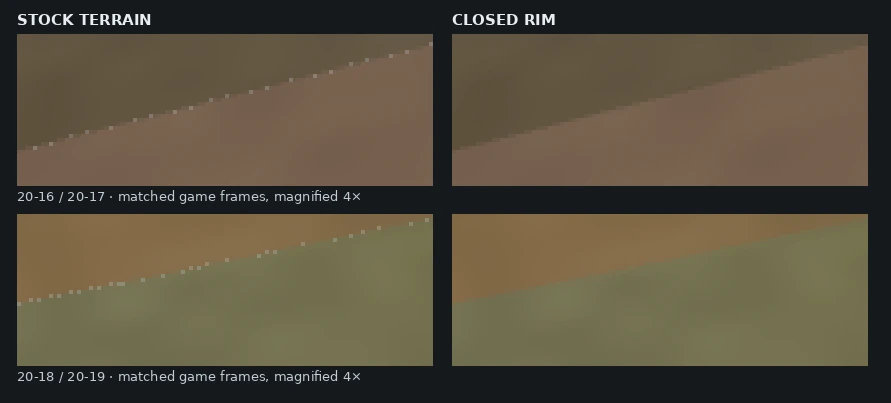

# Close two exposed terrain rims

Two near-terrain seams could show dotted sky through the fields. The
original renderer placed each tile from its own centre; Float32 rounding
left a **3.90625 mm gap** at these two shared edges. Existing level-of-detail
stitching matched the edge heights but did not close this horizontal gap.
Four-sample antialiasing could resolve one sky sample beside three terrain samples.



The repair applies only to the two authenticated regular `N112` pairs
`20-16 / 20-17` and `20-18 / 20-19` in the verified four-sample player.
The north edge is already canonical. Only 111 interior south-edge
vertices use its shared value for raster position. In this code **Z is a
horizontal map coordinate**, not elevation. Vertex buffers and atlas
coordinates, visual-height and flight-contact sampling are unchanged.
The end vertices stay stock to preserve the cross-edges. This does not
claim to repair either end taper or other province seams.

The draw matches signed terrain and cover, current co-owner identities,
and exact near-level topology. Lower-detail, overridden, or changed draws
retain their original shader. There is no new photograph, draw or mesh.
The qualified local shader still needs its first link. These are software
render checks, not a player hardware FPS result.

| Actual 840 × 540 view | Original sky pixels | Repaired sky pixels |
| --- | ---: | ---: |
| North rim of `20-17` | 52 | 0 |
| North rim of `20-19` | 72 | 0 |
| Existing zero-gap control | 0 | 0 |

The two-colour sky witness changes only diagnostic sky colour. No new
sky or alpha changes appeared. All strong RGB changes in the two positive
views were old exposed pixels; other affected terrain can differ by one
RGB level. Same-frame restore and an independently unconfigured build
recover the stock view. Fifty sampled contact and visible-height values per
view, original buffers, and draw and triangle counts remain unchanged.
Mixed and lower detail retain stock; the separate no-MSAA control retains
its original 13 visible sky pixels. The ordinary compiled checks recorded
the actual terrain draw in moving Chase, followed by Cockpit and Pause.

This change does not blend the imagery at these two geometry seams.

## Evidence and replay

[Fixed and fallback frames](regular-terrain-rim/render-checks.json) ·
[Ordinary compiled flight](regular-terrain-rim/compiled-player.json) ·
[Private corridor inputs](regular-terrain-rim/virtual-corridors.json)

```sh
node --experimental-transform-types tools/qa/regular-terrain-rim-lifecycle.mjs
node --experimental-strip-types tools/qa/regular-terrain-f32-seams.mjs
python tools/qa/regular-terrain-rim-frames.py --checkout . \
  --chromium /path/to/chromium --out /tmp/pei-terrain-rim
```

The corridor inputs are technical verification positions, not actual
navigation or new Dispatch entries. Use `--stock-only` with the
[unconfigured q346 checkout](https://github.com/cheshmakzanoon-ops/PEI-Flight-simulation/tree/968150fb493059f25fa67315cb87aafcfa9be446)
for the separate baseline; `--no-msaa --views gap17` reproduces the
measured no-MSAA fallback.
