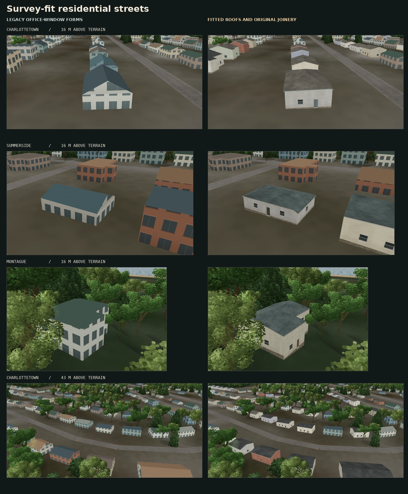

# Residential street silhouettes



Close views of PEI houses should not look like repeated office-window
blocks. This pass gives 928 specifically matched buildings real
survey-fit roof planes, small overhanging roof edges inside the original
survey plan, foundation bases, original lapped siding and residential-scale
glazing. A qualifying street-facing or adjoining wall can show an actual
recessed sash or door behind modeled jambs. The secondary walls use fewer
and simpler glazing details. The facade rhythm, door/trim colours,
window treatment and exterior materials are representative art, not a
claim about a particular present-day property.

| Coverage in this pass | Accepted |
| --- | ---: |
| Charlottetown neighbourhoods | 766 |
| Summerside neighbourhoods | 83 |
| Montague | 3 |
| Other PEI locations | 76 |
| **Total** | **928** |

Four plane families are actually used: 887 gables, 22 hips, 10
single-slope roofs and nine flat forms. Existing footprint shapes
do not change, and the yard, street, vegetation, collision and flight
data are untouched. A visual assessment can still see the gray,
coarse ground between buildings and other pre-existing blockouts.
This is not a full residential inventory, building-interior model or
photographic replica.

## Source and coverage gates

The source shell comes from
[Natural Resources Canada’s 2020 PEI building data](https://open.canada.ca/data/en/dataset/7a5cda52-c7df-427f-9ced-26f19a8a64d6).
Explicit OpenStreetMap house, detached, and semidetached types are
joined one-to-one only where outlines overlap strongly. Broad
`building=residential` is qualified separately by official
single-residential area evidence and a smaller area limit. Outside
the three prioritized towns, exact overlap with the provincial
[Corporate Land Use Inventory](https://gis.princeedwardisland.ca/server/rest/services/Hosted/CLUI2020_OpenData/FeatureServer/0)
`RES/SG` residential context is required. A land-use polygon is not
a register of individual houses. It is deliberately not required for
explicitly typed urban matches, because the provincial data is much
less specific in some developed city areas.

The reviewed November 1, 2026 regional [OSM extract](https://download.geofabrik.de/north-america/canada/prince-edward-island/)
is not a substitute for the source LiDAR geometry. When an exact
mapped object has weaker outline alignment, most of the simulator
keeps its previous appearance. This matters in Montague, where
many apparent matches are too loose. The maintained
[separate ODbL join extract](../../data/odbl/residential/) preserves
the source footprints and correspondence for verification. No addresses,
occupant information, signs, or businesses are assigned. The game
shows the existing OpenStreetMap map attribution.

The initial 4,141 strongly qualified footprints were sampled in
139 EPSG:3979 native raster neighbourhoods. Of 2,011 inspected 1 m
[CanElevation DSM/DTM](https://open.canada.ca/data/en/dataset/0fe65119-e96e-4a57-8bfe-9d9245fba06b)
windows, 928 pass the same-survey holdout, proportion, and boundary
checks. The median per-building p90 residual **relative to the
source ground datum** is 0.493 m in the prior form and 0.109 m
after fitting, on 16,669 reserved roof-interior pixels. The upper
tenth percentile of those per-building residuals falls from 1.454 m
to 0.262 m. For hips, all four plane regions must be supported;
the split plane between slope faces is not a hand-drawn crease.
High or ambiguous roofs, dormers and most compound roof plans
are left unchanged. Existing ground-anchor height errors still apply.
Lead source metadata and hashes are in the
[fit report](../../data/residential-architecture/fit-report.json).

A direct test on the [actual Three.js triangle buffers](../../data/residential-architecture/mesh-holdout-report.json)
hits every one of 16,669 withheld native points once. It independently
reproduces .493 → .109 m as the shape-relative per-building median p90.
Absolute differences retain the 47 m ground model: the corresponding
absolute median p90 improves from .683 to .455 m, but 222 roofs worsen
on that measure. The game's ground anchor is a median .325 m below
the native datum. No underlying terrain is changed.

The local original materials were informed by the Canadian Register's
examples of [clapboard and hips in Summerside](https://www.historicplaces.ca/en/rep-reg/place-lieu.aspx?id=12421),
[clipped gables and eave returns](https://www.historicplaces.ca/en/rep-reg/place-lieu.aspx?id=10073),
[gabled Montague sash and clapboard](https://www.historicplaces.ca/en/rep-reg/place-lieu.aspx?id=9665),
and [Charlottetown's hipped clapboard houses](https://www.historicplaces.ca/en/rep-reg/place-lieu.aspx?id=10848).
These are regional architectural references, not the claimed identities
of the comparison sites. No photos are streamed or copied.

## Render verification and bounds

The verified roof and all of its trim, including the sash rays,
stay inside the exact surveyed plan. A near wall aperture really
places the glass 11–16 cm behind the siding. Real joinery is
concentrated on two representative elevations; simpler glaze
panels save geometry on the other sides. The unchanged 1,435,803
vertices of the affected mesh groups, including nearby previously
surveyed farm scenery, are compared exactly across all six attributes.
The 71 affected streamed chunks add 147,052 triangles in total, worst
24,470 extra in any one chunk. The main draw count did not increase
in the tested local views. These are triangle counts, not FPS or a device
performance claim. The profile data uses about 27.5 kB when compressed
with the application, with no new runtime data request.
At the matched 16 m street views the scene submits 9,008 more triangles
in Summerside, 454 more in Montague, and 55,054 more in Charlottetown;
the matched 43 m Charlottetown view adds 55,952 triangles. The four
frames use identical camera matrices, fully loaded imagery and building
sets, five identical surface queries per pose, and identical protected
sky samples. The unmodified East Point control also matches all
655,360 pixels and the exact display counts. The comparison sheet uses
standard rendering in both halves. All four matched poses also pass
with opt-in building shadows enabled; at the denser Charlottetown pose
the optional refresh submits 82,885 depth triangles versus 27,831 before,
at four depth draws in both versions. The
[render gate](../../data/residential-architecture/render-gate.json)
separates structural scene counts from the optional depth pass. The optional
[local cast shadows](local-building-shadows.md) are the same shared
renderer, not a second residential shadow asset or special-case lighting.

## Reproduction

Optional offline geodata generation uses GDAL/OGR, NumPy and SciPy.
The Python range scripts cache exact small source windows outside the
checkout. Copy or download the dated source PBF from the audit, then
check SHA-256 and supplier MD5 before using it.

```sh
work=/tmp/pei-house-review
mkdir -p "$work"
python tools/geodata/fetch-clui-res.py --out "$work/native-clui"
cmp "$work/native-clui/receipt.json" data/residential-architecture/clui-residential-receipt.json

OGR_INTERLEAVED_READING=YES ogr2ogr -f GPKG "$work/osm-typed-houses.gpkg" \
  "$work/prince-edward-island-261101.osm.pbf" multipolygons \
  -where "building IN ('house','detached','semidetached_house','residential','terrace','apartments')" \
  -select osm_id,osm_way_id,building,other_tags -nlt MULTIPOLYGON

OPENBLAS_NUM_THREADS=1 /usr/bin/python3 tools/geodata/select-residential-candidates.py \
  --root . --scratch "$work"
OPENBLAS_NUM_THREADS=1 /usr/bin/python3 tools/geodata/house-roof-samples.py \
  --root . --scratch "$work" --max-groups 139 --jobs 3
OPENBLAS_NUM_THREADS=1 /usr/bin/python3 tools/geodata/fit-house-roof-planes.py \
  --root . --scratch "$work"
OPENBLAS_NUM_THREADS=1 /usr/bin/python3 tools/geodata/bake-house-envelopes.py \
  --root . --source "$work" --out "$work/home-envelopes.generated.ts"

cmp "$work/home-envelopes.generated.ts" src/render/home-envelopes.generated.ts
gzip -dc data/odbl/residential/matched-houses.json.gz | cmp "$work/osmdb-house-support.json" -
gzip -dc data/residential-architecture/native-window-houses.json.gz | cmp "$work/rendered-house-targets.json" -
/usr/bin/python3 tools/qa/home-native-heldout.py --scratch "$work" --out "$work/holdout.json"
node --experimental-strip-types tools/qa/home-mesh-holdout.mjs "$work/holdout.json" "$work/mesh-holdout-report.json"
npm run check
python tools/qa/residential-envelopes-frames.py --checkout . \
  --chromium /path/to/chromium --out "$work/frames" --shadows
```

The final optional render QA also requires Python Playwright and Pillow.
It hides the aircraft and freezes the camera/time only in a temporary
copy of the actual game, and waits for the same loaded world layers
in both versions.

## Dense tile budget

An independent local Node test generated the densest selected Queens
chunk in a median 42.8 ms versus 6.9 ms for the earlier mesh, adding
about 3.6 MB of vertex attributes in that chunk. This was a CPU-side
proxy, not a device frame-time measurement. In the matched 16 m
Charlottetown browser view the main pass kept 116 draws and submitted
55,054 extra triangles. With the optional local shadow pass enabled,
a refresh used 4 depth draws in either case but submitted 82,885
rather than 27,831 depth triangles. This is why local shadows remain
opt-in and why simpler distant joinery is a production follow-up.
