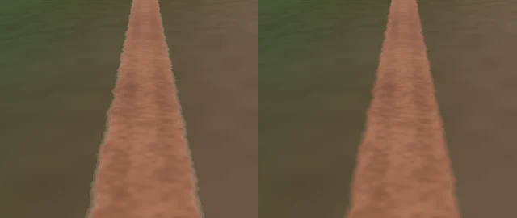

# Opaque dirt-road shoulders

An existing dirt road uses partial alpha to tell the multisample renderer
how much of a pixel the edge covers. That coverage is not transparency.
Previously the road wrote its coverage alpha into the finished world
canvas, so the browser background could show through a narrow shoulder.

The road material now keeps the underlying scene alpha on multisampled
RGBA framebuffers, while using the same RGB replacement and edge coverage.
The existing network, terrain seats, widths, shader, surface classes, and
artwork are unchanged. Contexts without multisampling or without an alpha
channel keep the prior material state. No new textures, requests, draws,
or triangles are required.

This fixed simulator crop is composited over the same slate color on
both sides to make the defect visible. It is not an end-user hardware
benchmark or a change to the road surface. Pavement and its different
materials are not recolored.

## Verification

Close fixed views of mapped dirt roads in Prince, Queens and Kings
counties restored opaque coverage in **4,226**, **4,316** and **3,986**
canvas pixels respectively, with no changed alpha outside the isolated
dirt projection and its two-pixel antialias envelope. Raw framebuffer
RGB was unchanged in the Prince and Kings pairs. The PNG export on its
own cannot show this because it unpremultiplies color using alpha. The
original material restored each complete frame exactly. All-road draw
comparisons at the paved, Victoria Row and surveyed Montague bridge
camera positions were byte-identical in raw RGBA. An ordinary Queens flight in
the compiled candidate confirmed the actual mapped road draw uses the
same four-sample edge coverage and an alpha-only preservation blend, and
a forced zero-sample flight retained the original blend path. Both flew
and paused normally.

See the [machine-readable measurements](road-coverage-alpha/verification.json).
