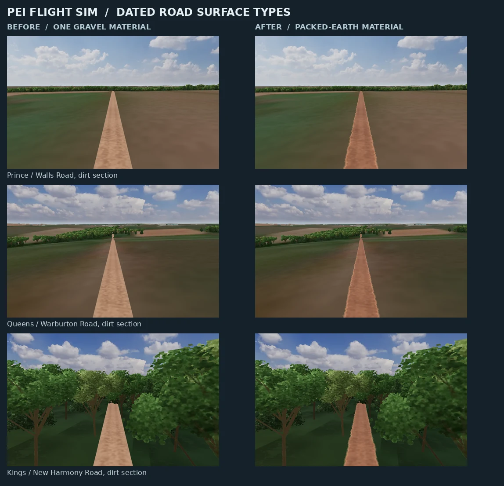

# Dirt is a distinct surface, not generic gravel

The [PEI 22_1 National Road Network](https://open.canada.ca/data/en/dataset/3d282116-e556-400c-9306-ca1a3cada77f)
distinguishes unpaved dirt from gravel. Earlier rendering sent both
through the same aggregate material. This pass gives explicitly mapped
dirt a fine compacted-earth treatment and a softened shoulder.

| Pinned source status | Non-bridge sections | Treatment |
| --- | ---: | --- |
| Unpaved / Dirt | 3,366 | Fine earth, restrained wheel wear, broken shoulder edge |
| Unpaved / Gravel | 2,651 | Original aggregate material |
| Paved | 13,262 | Original asphalt material |
| Unknown status | 2 | Original fallback |

All 184 bridges continue to use their original material. The labels
apply to the dated source geometry, not to today's conditions. The
new material is original art. It does not assert exact clay content,
pavement thickness, grading, actual rut positions, or designed width.



## Browser checks

The matching 12 m cameras retained the same road vertices, draw and
triangle counts. The three dirt examples changed 18,642, 19,561 and
18,034 pixels respectively. An independent mask confirmed no changes
in all 24,371 fully covered gravel pixels at the New Harmony control;
one distant mixed pixel belonged to a separate tagged dirt road. A
fully paved control frame was identical in all 324,000 pixels.
At Walls Road, a 25 m side view also confirmed a softened, irregular
edge with no new geometry. The visual ground and the existing road
grade are still approximations.

## Geometry and provenance

The generator replays and checks the points, ordering and flags of all
19,465 original packed road records before marking any as dirt. A
compact bitset is valid only for the exact SHA-256 of the existing
road atlas, and is carried in the client code. No substitute geometry
or road network payload is downloaded. A stale or unverified road
pack retains the original materials, and the hedgerow road guards
do not need to be rebaked.

Whole road names are **not** used as the classifier. The pinned network
contains dirt and gravel sections on Walls Road, and dirt, gravel and
paved sections on New Harmony Road. The new earth edge and soil variation
are drawn only on positively classified ribbons. No roads are widened or
moved. The existing widths and vertical geometry are still approximations.

Contains information licensed under the [Open Government Licence – Canada](https://open.canada.ca/en/open-government-licence-canada).

```sh
/usr/bin/python3 tools/geodata/bake-road-surface-types.py \
  --source NRN_PE_22_1_GPKG_en.gpkg --out src/render/road-surface-type.generated.ts
node --experimental-strip-types --test test/road-surface-type.test.ts
npm run check
python tools/qa/road-material-poses.py --checkout . \
  --out /tmp/pei-road-material --chromium /path/to/chromium
```
