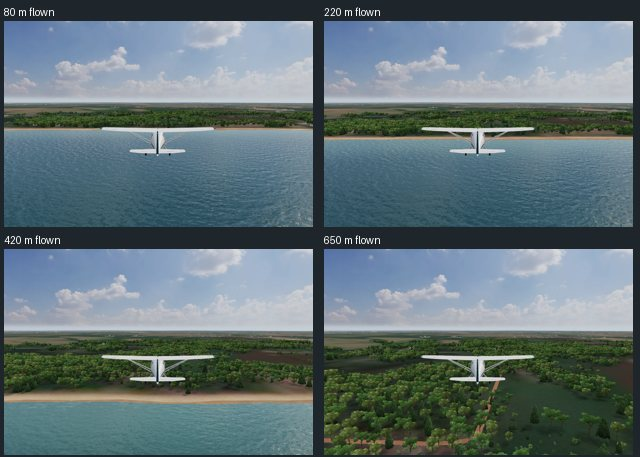

# Prince Open Shore: Round Pond coastal alignment

**Diagnosis only.** The wide pale band visible south of Tignish Harbour
in the **Prince County · open shore pass** remains unchanged. It should
not be treated as measured beach or as a verified depiction of the
current shoreline.

## What the replay found

The original land shader blends toward generic sand in a band next to
the existing land-water mask. In this reach the mask was 22–30 m farther
east (seaward) than a separately dated post-Fiona shoreline reference,
at 11 east–west transects. These are east–west offsets, not shoreline
retreat rates, and the older mask and newer mapped line do not
necessarily identify the same tidal marker.

| Distance flown | Warm pixels strongly affected by the stock blend | At least 3 m seaward of the reference | At least 3 m landward |
| ---: | ---: | ---: | ---: |
| 80.16 m | 820 | 795 | 0 |
| 221.48 m | 2,778 | 2,559 | 0 |
| 423.46 m | 9,852 | 8,794 | 0 |

The table counts candidates in an 840 × 560 Chase replay. It combines
the actual image colour with a terrain-and-water projection and the
stock blend weight. It is not a per-sample GPU material ID: overlapping
vegetation and aircraft can be counted. The
[replay receipt](replay.json) gives the image bounds and distinguishes the
pale-band check from the ordinary flight simulation trace.

Even if vegetation occlusion is ignored, the reference-qualified dry
side contains at most 28, 37 and 245 pixels with moderate tint potential
in the same bands; none reach the stronger threshold. Recolouring the
confirmed dry ground would leave the error largely intact. Moving the
water boundary without matching terrain, shoreline closure and flight
contact would trade the visible stripe for a coastal gap or bad ground.

## Source and release requirements

The provincial [2020 wetland and sand-dune inventory](https://gis.princeedwardisland.ca/server/rest/services/Hosted/Wetland_and_Sand_Dune_Inventory_2020/FeatureServer/0)
and [Watercourse layer](https://services9.arcgis.com/zow9Ot3ujGSyJI3C/ArcGIS/rest/services/PEI_Watercourse/FeatureServer)
share the same mapped edge here. They are not independent votes. The
[provincial climate hazard map](https://chris.peiclimate.ca/) provides the
separately dated line used to measure the mismatch; it is a reference,
not a new source mesh or licensed game asset. The
[post-Fiona field report](https://www.princeedwardisland.ca/en/publication/post-tropical-storm-fiona-highwater-mark-and-shoreline-erosion-field-notes)
measured two surge marks at Tignish Harbour, north of this reach. They
do not provide the missing normal-water elevation or present-day
topography at Round Pond.

A replacement needs an independently registered and reusable shore break,
vertical samples on both sides with known acquisition dates and tidal
datum, and matched checks of the actual land, water, shoreline closure
and collision queries. Until then this is a renderer/measurement issue
record, not a scenery change.
