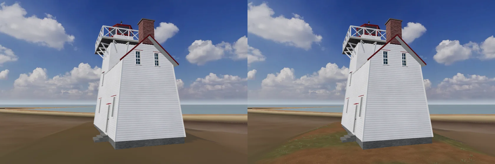

# Dry ground at North Rustico Lighthouse

The [North Rustico lighthouse study](../landmarks/north-rustico.md) includes a
local authored sandy-loam treatment around the keeper's dwelling. The terrain
coordinates, grade, dry/wet classification, shoreline, roads, building
geometry and aircraft contact all remain unchanged. It is not a description
of present wetlands, soil chemistry, planting or property access.

The input is the authenticated 2020 V33 grade. The optical material refuses
atlas cells other than grassland class 30, and fades out against the original
ground according to the small site boundary, actual slope, signed distance
from water and measured relief support. Near the ground, up to 96 original
short grass clumps use the same supported surface. The ground treatment is
not a lawn: the original aerial brightness remains visible through irregular
grass and bare soil. No reference photograph is a texture or game asset.

On a device with multisampling, the clumps use one instanced draw at close
range only. They fall away before the aerial comparison at 75.9 m, where the
surface material adds no draw calls or triangles. Use `&noRusticoTufts` in the
optional study for materials alone, or `&legacyRusticoSoil` for the prior ground
appearance. This is a geometry and draw count, not a hardware FPS claim.

## Verification

The [matched checks](rustico-dry-ground-check.json) cover fixed near and
seaward camera positions, an off-site control and a shifted angle at a
fractional device pixel ratio. The normal Dispatch route retains the
lighthouse, measured neighboring roof and verified terrain. Every tested
pixel outside the conservative physical envelope remained byte-identical
in the paired views. Native ground and the renderer's independently
checked estimate seat each added blade; the plants are not collision objects.

The author read the visible sandy patches and grass form from the dated
[Dan Bhentschel view](https://commons.wikimedia.org/wiki/File:PEI_North_Rustico_Harbor_Lighthouse.jpg)
and [Koobs view](https://commons.wikimedia.org/wiki/File:North_Rustico_Lighthouse,_North_Rustico,_PEI.jpg),
without embedding or sampling their images. The [provincial soil note](https://www.princeedwardisland.ca/en/information/executive-council-office/provincial-soil)
is palette context, not identification of this lot. Contains information
licensed under the [Open Government Licence – Canada](https://open.canada.ca/en/open-government-licence-canada).
