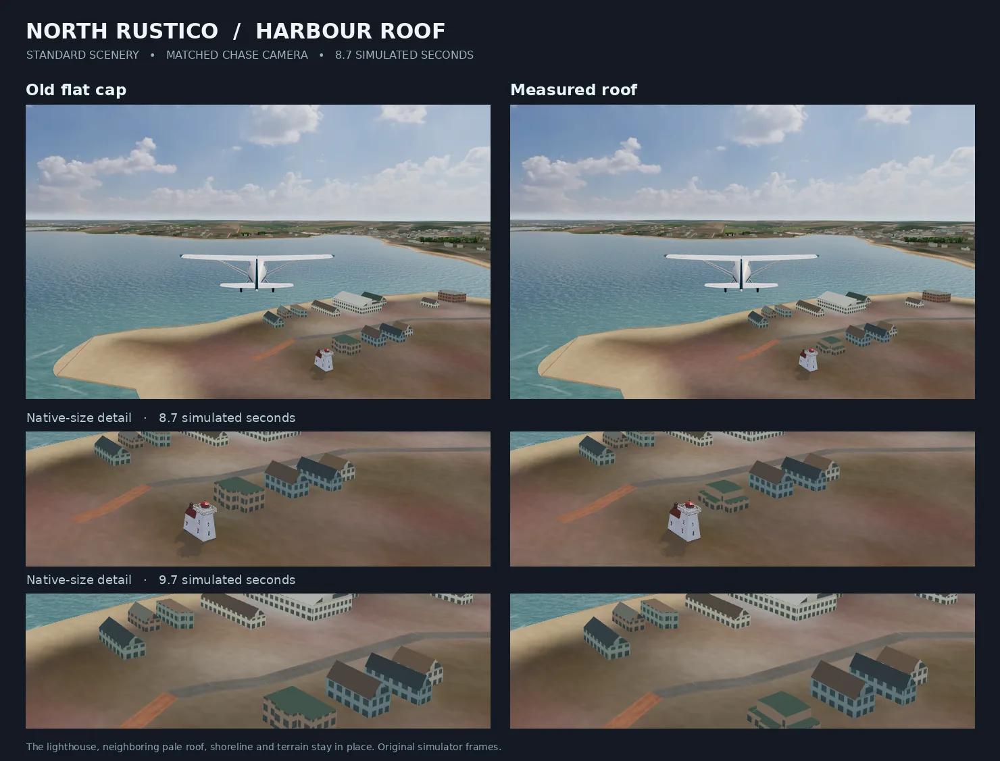
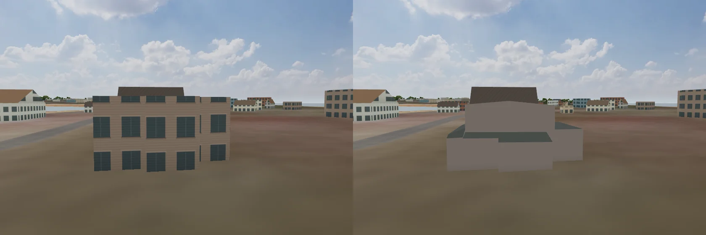

# A measured roof near North Rustico Lighthouse

In Standard Dispatch, choose **North Rustico Harbour · coastal pass**.
Wait for the surveyed roof to be ready, then select **Begin flight**.
One anonymous harbour building now has its measured upper ridge and
lower attached roofs instead of the old flat cap. The original mapped
footprint, outer wall feet, and flight contact stay in use. The colors and
façade treatment are approximate; this does not identify a tenant or
claim a contemporary survey.

Use `?departure=north-rustico-harbour-low&stockRusticoNeighbourRoof` to
compare just this roof. The separate [lighthouse and surveyed ground](rustico-standard/)
and [neighboring pale roof](rustico-harbour-roof.md) keep their own
settings. The earlier `?rusticoMassingReview` or optional lighthouse
cohort remains available; older bookmarks may still use
`&legacyRusticoMassing` to preserve their own original roof.

## Evidence

The [NRCan PEI point cloud](https://open.canada.ca/data/en/dataset/7069387e-9986-4297-9f55-0288e9676947)
and [CGVD2013 elevation mosaic](https://open.canada.ca/data/en/dataset/0fe65119-e96e-4a57-8bfe-9d9245fba06b)
describe the 2020 survey. The two flight lines observed the upper and lower
surfaces independently. Lower returns from the same laser pulse as a real
upper return are valuable evidence for height layers but cannot serve as
observations of the visible top. An inset around uncertain eaves and a cluster
of unusually high returns were held out of the reported roof fit; the model
does not attempt to identify or reconstruct those small protrusions.

In the 1,453-point held-area test away from the uncertain step/eave band, the
old model's 90th-percentile vertical error was **3.37 m**. The independently
blocked plane fit was **4.7 cm**; real engine mesh rays were **4.2 cm** against
the same evaluation cohort. These numbers do not describe the edges,
façade, interior or every point on the building.

The Standard path verifies the compressed atlas chunk from its existing
single read, its declared and actual hashes, and the exact ordered
footprint and row. It changes only that building's original batch and
retains the original tile material. The tile still uses one draw and adds
39 triangles. The other 37,884 source vertices and all six of their
attributes stay exact, including the nearby pale roof. The attached
wall tops close the measured roof; the original perimeter wall feet are
not resampled. See the [source and fit checks](rustico-neighbour-check.json)
and the [ordinary flight receipt](rustico-neighbour/standard-flight.json).

In a matched native carrier check, the existing lighthouse grade changed
the submitted terrain under this entire 142.31 m² footprint by less than
0.000002 m relative to its parent, with no intersecting positive grade
influence. That is a comparison of the current game surfaces, not a
survey tolerance. The roof changes no paths, roads, lighting, terrain,
shoreline, water or flight dynamics.

If you start before the signed source and draw are ready, that flight
keeps its original roof. Unsupported styles or unavailable data do not
replace it.

Contains information licensed under the [Open Government Licence – Canada](https://open.canada.ca/en/open-government-licence-canada).
