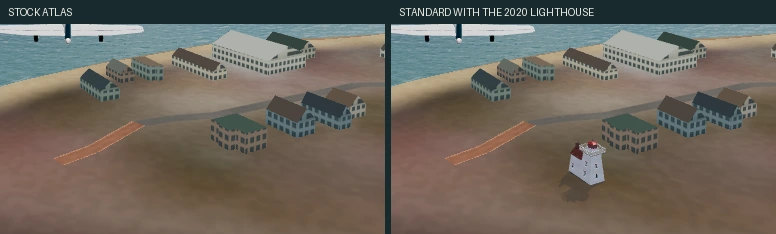

# North Rustico lighthouse: ordinary flight check

Choose **North Rustico Harbour · coastal pass** in Standard. The
2020-era authored lighthouse and keeper’s dwelling now advance with
the verified dry-ground patch. None of the later shoreline or port
works, neighboring buildings, lower-detail terrain, or game water
classifications are rebuilt.



In the [paired actual replay](matched-receipt.json), 895 and 4,916 strong
RGB changes were recorded at 306.24 and 437.08 m of travel. An independent
screen check used the convex projection of the unchanged support envelope
and the original stitched edge collar, plus three pixels of raster margin:
376,522 and 330,689 pixels outside the two supports were exact. Alpha did
not change; restoring the verified shape returned exact PNG bytes.
The two fixed scenes added 17 draws and 10,397 and 11,559 submitted
triangles. These are renderer counts, not hardware frame times.

The grade pack, rebuilt mesh and exterior cannot commit separately.
The aircraft’s contact surface and stopped pose stay consistent through a close contact stop.
A corrupt grade or incompatible renderer/terrain owner leaves stock. If
optional data misses the first 220 m of the normal departure, it waits
for a restart rather than swapping the landmark in during the close pass. In an early-Begin replay, a delayed but valid response mounted both at 100.00 m, with zero frames showing only one of the two.
The prior explicit study is separate; the new stock switch disables only
the Standard version.

The hosted browser check uses the regular flight control, stock switch and
a byte-corrupt response against the same compiled bundle. To repeat using
a built checkout and Playwright, run:

```sh
npm run preview -- --host 127.0.0.1
node tools/rustico-lighthouse-smoke.mjs
```
