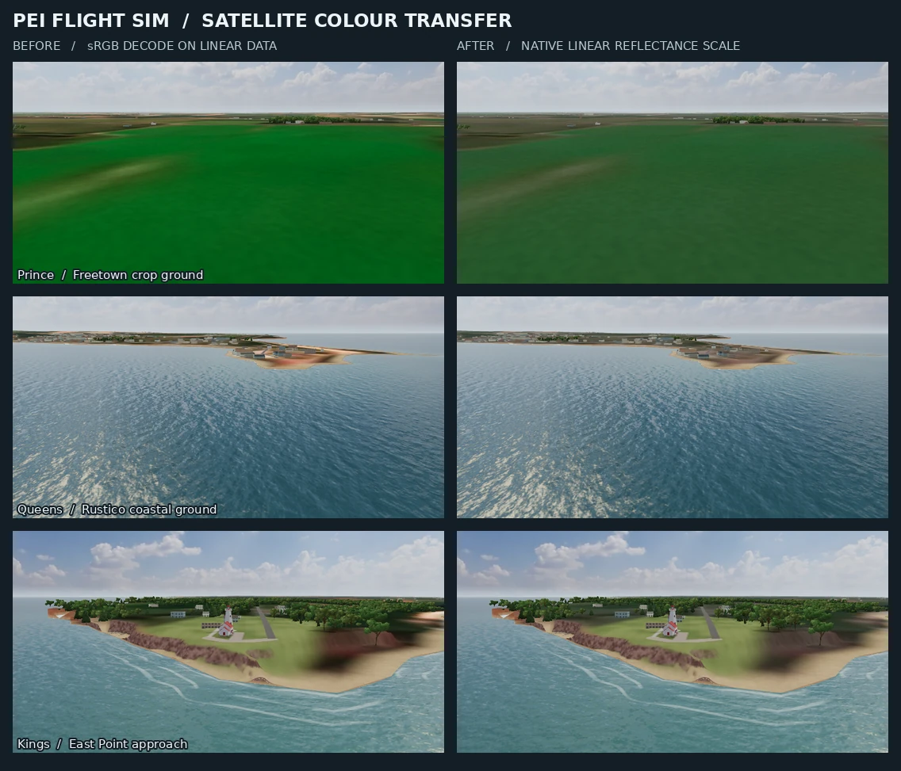

# Satellite colours follow their source transfer

The Copernicus Sentinel-2 L2A true-colour preview uses red B04, green B03,
and blue B02. Its normal, unsaturated display-byte range represents
0–25% bottom-of-atmosphere reflectance. These source bytes are not a
linearized photograph or a calibrated human colour reference. See the
[Copernicus documentation for True Colour Images](https://sentiwiki.copernicus.eu/web/glossary)
and the pinned [2025 source scenes](../../public/world/color.sources.json).

Both province terrain atlases had been interpreted as sRGB before
the renderer applied outdoor lighting and ACES tone mapping. The
additional transfer exaggerated green terrain, clipped low red
channels and compressed some dark textures. The shared land shader now
converts the sampled data to its original linear scale (`byte / 255 × 0.25`)
for both the global fallback and local tiles. The same pixels and
locations are loaded. There are no new textures, color masks, artificial
field hues, downloads or geometry in this change.

## Checks

- A source audit compared 5,043 valid same-grid pixels from three PEI
  areas with B04/B03/B02 COG measurement bands. The linear 0–25% scale
  matched the upstream preview with mean absolute error below half an
  8-bit code in each area. Neither WebP mosaic created the green signal;
  the distortion was in interpretation. No extra offset was applied to
  COGs that were already harmonized by the provider.
- Fixed camera passes show identical submitted geometry counts. A 2,240
  pixel ground sample in the matched Freetown frame changed median
  RGB from `[2, 97, 25]` to `[41, 87, 44]`. The old frame had 71 samples
  with red clipped to zero; the new frame had none in that selection.
  These are output pixels, not individual reflectance measurements.
- The upper 80 rows of all three captures and sampled water blocks at
  Rustico and East Point are pixel-identical. Sky, water, authored
  runway paint, and the separate mainland backdrop retain their previous
  sources and material paths.

This preserves source geographic texture; it does not recover optical
information clipped in the preview, invent sub-pixel structures, or
guarantee photorealistic colour.
