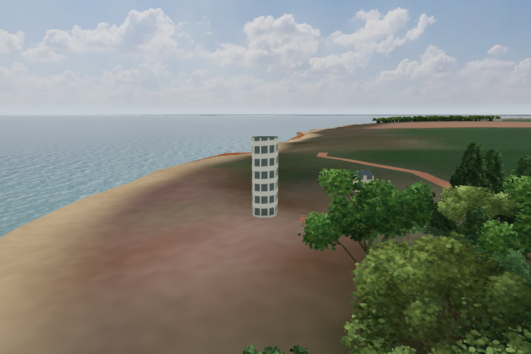
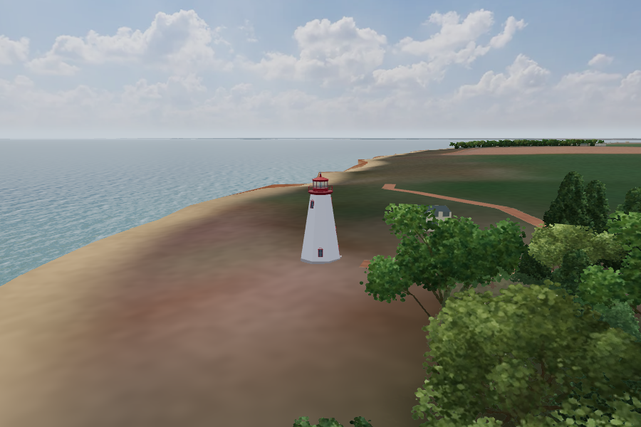

# Seacow Head Lighthouse · exterior study

At the entrance to Bedeque Bay, Standard scenery shows a tall grey building with repeated office windows. Add `?seacowExteriorStudy` to the game URL to see an original model of the lighthouse at the same site instead. The white body has eight tapering faces; the red cornice carries an open gallery around a narrower glazed lantern. Flying around the point reveals the recessed sashes, triangular window heads and low entrance. Add `&stockSeacowExterior` to compare the old building. The terrain, red-clay shore and the separate building to the north are unchanged.

**Finding it:** The original Summerside departure is about 6.7 km north of the light and starts facing away. Turn south toward the entrance to Bedeque Bay (approximately 184° from that start). The study does not move the aircraft or change its flight or ground contact.

**Stock exterior, viewed from the southeast:**



**Authored exterior, same camera and ground:**



## What the sources support

- [Parks Canada](https://www.pc.gc.ca/apps/dfhd/page_hl_eng.aspx?id=16732) identifies the tower at 198 Lighthouse Road, Fernwood, and describes its 18.3 m height, octagonal taper, pedimented openings and projecting cornice. The [Canadian Coast Guard listing, light 1018](https://notmar.gc.ca/publications/list-lights/atl/atl942-en) distinguishes the structure from its **26.8 m focal elevation above water**. This model uses the former. Its small interior optic is scenery, not a functioning aid to navigation.
- The [PEI Lighthouse Society](https://peilighthousesociety.ca/index.php/lighthouses/public-lighthouses/81-seacow-head-lighthouse) records 11 ft 3 in (3.429 m) per base side and twelve principal upper lantern faces above a round lower chamber. The [federal remediation report](https://www.canada.ca/en/environment-climate-change/services/federal-contaminated-sites/publications/2021-2022-annual-report.html) records replacement shaker-style vinyl and new window flashing. The model has an original, filtered white shingle pattern rather than exposed grain or copied distressed paint.
- Dennis G. Jarvis’s [2015 exterior](https://commons.wikimedia.org/wiki/File:Seacow_Head_Lighthouse_(22098973599).jpg) and [lantern close-up](https://commons.wikimedia.org/wiki/File:Seacow_Head_Lighthouse_top_(2015-10).jpg) were visual references from one session. Both photograph pages credit him under CC BY-SA 2.0. No photograph, traced linework or photo-derived texture is shipped. The [independent appearance review](seacow-exterior/independent-appearance.json) checks other dates separately; it does not certify exact bearings, current window details, a photoreal facade or the surrounding site.

**Placement is approximate.** The original federal building record and an independently mapped, slightly different footprint both contain the civic point; their centers differ by about 2.35 m. The chart-list locator is around 17 m from the game’s original center. A check of the native point-cloud metadata found only one acquisition line in the registered ground and roof samples. That **failed** the survey gate before any numerical point height was used. The model does not claim survey-derived shaft positioning, eave heights, exact door direction or cliff accuracy. [Source and rights contract](seacow-exterior/source-contract.json) · [Original eligibility evidence](seacow-exterior/source-eligibility.json)

## Real scene checks

Four original Three.js batches total 2,470 authored triangles. Only 22 triangles of one feature in a 272-feature building tile are suppressed. The other 271 features share the exact stock positions, normals, facade styles, colors and UVs. Local appearance is enabled only over its signed regular near-terrain owner and when all four complete draw components are present. Unsupported scenery, a changed source, missing art, a replaced component or a departing tile leaves or restores the ordinary tower.

[The initial and guarded versions](seacow-exterior/normal-source-parity.json) emitted identical body, glazing, metalwork, optic, colors, normals, UVs, and footprint. The later guard only restores the old owner if a complete draw component is lost.

The gallery stays level. The eight lower edges follow the unmodified ground through 64 short segments: all 136 independently checked points close 4.5 cm below the *visible* mesh instead of hovering. The underlying grade varies by 0.559 m. Aircraft ground contact is separate and unchanged. No new pad, flattened lot, driveway, vegetation clearing or cliff was added. [Physical contact checks](seacow-exterior/independent-contact.json)

[Matched actual flight cameras](seacow-exterior/locked-frames.json) · [Independently isolated rendered views](seacow-exterior/independent-views.json) · [Compiled player and fallback checks](seacow-exterior/player.json)

After `npm ci`, reproduce the original and optional submitted geometry from this checkout:

```sh
node --experimental-strip-types tools/qa/seacow-exterior/emit-exterior.mjs . /tmp/pei-seacow-mesh
node --experimental-strip-types --test test/seacow-exterior.test.ts
```

The extractor writes four non-indexed Float32 triangle buffers and their world transforms, with each actual base edge and threshold in `emitted-exterior.json`. For the independent original terrain rays, photographic review scope and live optical checks, see the [independent replay guide](../../tools/qa/seacow-exterior/independent/README.md).
