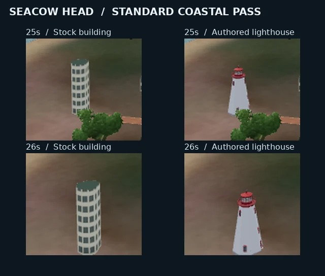

# Seacow Head Lighthouse in Standard

Choose **Seacow Head · coastal pass** and **Begin flight**. The tapered
white octagonal tower and red gallery appear on approach. The virtual route,
surrounding buildings, visible cliff, water and aircraft contact are
unchanged. This is an [approximate original exterior](../seacow-exterior.md),
not a current field survey or a navigational aid.

A [matched 900 × 600 real Three.js flight replay](render-receipt.json) used
neutral controls in the normal Chase view. At the two approach checkpoints
1,180 and 2,220 pixels changed by more than two RGB code values; no RGBA
values changed outside the projected original/new tower envelope, and alpha
stayed unchanged everywhere. Reverting the draw restored the byte-identical
image and exact original buffer. At the third checkpoint both variants
were below the viewport and the image did not change. The two visible
comparisons added four draws and a net 2,448 triangles; this is not an FPS
measurement. During unscored software-rendered transit the test cut seven
out of eight GPU submissions without skipping scene updates or flight steps.
