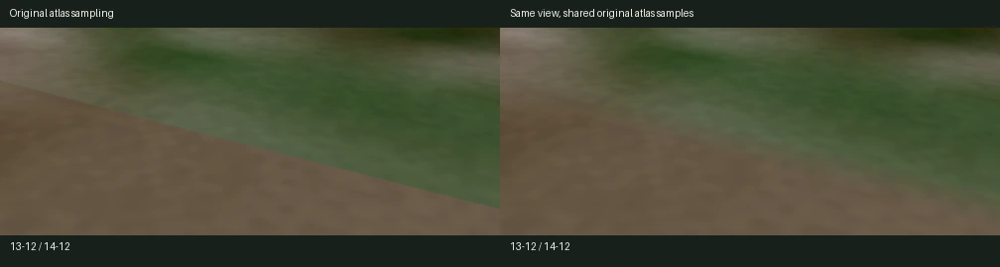

# A second central PEI field-image join

Standard scenery now removes a hard line where two neighboring aerial tiles meet over dry ground. The renderer shares existing imagery samples across a narrow strip. It keeps the original donor images, terrain, buildings, road geometry and flight contact. `?stockInlandOrtho` restores the previous sampling.



| Existing texture tiles | Source window | Median RGB8 step, near | Reciprocal |
| --- | --- | ---: | ---: |
| `13-12 / 14-12` | [592,612) north-origin rows | 19.65 → 2.28 | 20.58 → 2.50 |

Each window spans 20 along-edge texels, including two-texel end tapers, and has 2.5 texels of total cross-edge support. The [source receipt](second-central-field-image-join/source.json) pins donor WebP bytes, original sampled RGB and the entire cover support. The [geometry check](second-central-field-image-join/existing-geometry-context.json) uses the existing road centerlines and dated building footprints. It does not establish crop, fence or legal boundaries.

Matched low views had no change to alpha, draw counts or pixels outside the directly rendered effect marker. No exposed sky was found in the close views. High and off-window comparisons were pixel-exact against the previous sampling, and the same-frame restore was exact. No new image requests or geometry draws are required by the strip; the original streamed textures remain its donors. The [native receipt](second-central-field-image-join/render-checks.json) records the exact masks, sample counts and rollback.

In a separately [matched moving-Chase check](second-central-field-image-join/moving-chase.json), the strip showed a visible correction in two preregistered captures and no difference in the late view. The camera, flight physics and lighting were not overridden; the witness rendered both sampling variants without advancing that frame. The compiled check started from the normal Dispatch and used the regular controls to reach Cockpit and Pause. The [virtual corridor coordinates](second-central-field-image-join/moving-corridors.json) are QA fixtures, not new suggested routes or information for real navigation. Results are from Chromium's software renderer, not real-device performance measurements.

Reproduce the signed source check and exact native views from the root:

```sh
python tools/qa/verify-eastern-aerial-sources.py --guard-donors --window edge-13-12e --out /tmp/pei-central-source.json
python tools/qa/verify-inland-join-geometry.py --source /tmp/pei-central-source.json
python tools/qa/tracadie-frames.py --checkout . --cohort inland \
  --views edge-13-12e,edge-13-12e-reciprocal,edge-13-12e-high,edge-13-12e-outside \
  --chromium /path/to/chromium --out /tmp/pei-central-joins
python tools/qa/aerial-moving-chase.py --corridors docs/qa/second-central-field-image-join/moving-corridors.json \
  --chromium /path/to/chromium --out /tmp/pei-central-moving
```

[Source atlas screening](aerial-join-screen.md) · [Attribution](../WORLD.md)
