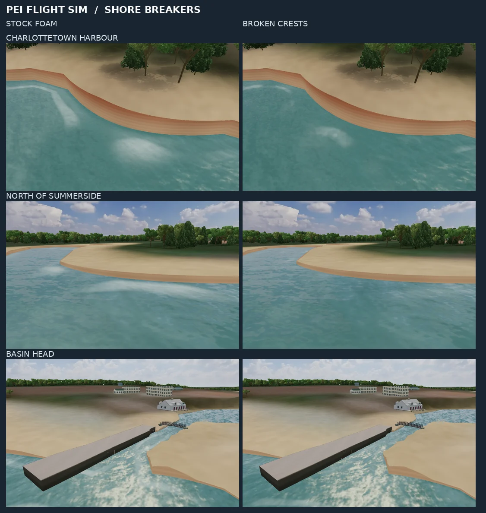

# Shore-breaker detailing

Use `?shoreFoamDetail` to preview a different coastal foam treatment.
The older effect often drew a broad, continuous white ribbon. The preview
breaks it into shorter crest segments and weaker wash, with a graded
near-camera texture that fades once the pattern becomes too small.
The default renderer remains available without the option.

The effect is original procedural art, not a wave, bathymetry, wind or
tide model. It reads the same shoreline-distance input and leaves the
water surface, draw geometry, masks and physical contact untouched.
Existing sheltered-water adjustments still apply. Shore glint, terrain
cliffs, local vegetation, buildings, and the underlying atlas are separate
systems and are not changed here.



The [matched scene record](shore-foam-render-gate.json) keeps the camera,
loaded imagery tile IDs, draw count and submitted triangles fixed in each
pair across all three counties. A separate [same-scene mask and
phase gate](shore-foam-mask-gate.json) checks the actual visible water
silhouette at two wave phases. Outside that silhouette and its one-pixel
antialiasing allowance, every RGB value matches stock at both phases.
These are optical checks in Chromium SwiftShader, not GPU performance claims.

The [controlled time samples](shore-foam-motion-gate.json) compare eight
successive shader phases at the same Queens camera. Across the visible water
mask, p99 successive RGB change was 5 levels in stock and 3 in the preview,
with an eight-level maximum in both. This measures controlled samples,
not hardware frame pacing or moving-camera aliasing. The
[compiled flight check](shore-foam-flight-gate.json) also flew and paused
both new waterfront routes with this option active.

## Replay

```sh
npm run check
python tools/qa/broken-foam-lab.py --chromium /path/to/chromium --out /tmp/pei-foam
python tools/qa/one-pass-foam-footprint.py --chromium /path/to/chromium --out /tmp/pei-foam-mask
python tools/qa/foam-motion-check.py --chromium /path/to/chromium --out /tmp/pei-foam-motion
python tools/qa/waterfront-departures.py --dist dist --chromium /path/to/chromium \
  --foam-detail --out /tmp/pei-foam-flight.json
```

The first capture compares the two compiled shaders in the actual scene.
The second supplies a temporary water-only diagnostic and phase control
in a QA checkout to compare water and non-water pixels.
