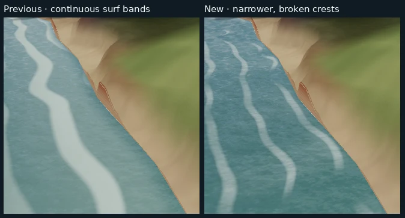

# Nearshore foam and breaker direction

Fixed-distance bright bands used to travel away from land. This pass advances
the bright crest toward land while the lighter swash and residual foam break
up independently. Narrow ripples, dynamic gaps and a derivative-based fade
reduce the continuous white stripe. Water stays behind the existing land
mask. Both open water and the shoreline continue to use the existing
Three.js draw, with no new texture request or geometry.



The material is a procedural appearance pass. The distance field is a
shoreline proxy, not modelled depth. These views do not measure a local wave
speed, model the offshore tide rip or validate the water on hardware GPUs.

## Check at the same camera and clock

The [matched appearance](shore-foam-frames.json) and
[crest tracks](shore-foam-motion.json) record real post-render pixels at
East Point, with the same 262 draws and 287,603 triangles. The bright patch
metric is the number of pixels over sRGB luma 175 in the foreground water
mask; it is a fixed regression observation, not a physical measure of foam.

With Python Playwright, NumPy, Pillow and Chromium installed, replace
`BASE` with a checkout at `9247190` and `FOAM` with the same source plus this
material (no geometry or road changes). Execute from this checkout:

```sh
Q=tools/qa/surface-appearance.py
python "$Q" capture --checkout "$BASE" --out /tmp/foam-before --views east-close
python "$Q" capture --checkout "$BASE" --out /tmp/foam-water --views east-close --mask water
python "$Q" capture --checkout "$FOAM" --out /tmp/foam-after --views east-close
python "$Q" compare --before /tmp/foam-before --after /tmp/foam-after \
  --mask /tmp/foam-water --kind water --views east-close --out /tmp/foam-frame.json
python "$Q" capture --checkout "$FOAM" --out /tmp/foam-breaker --views east-close \
  --mask breaker --phases 12 12.4 12.8 13.2
python tools/qa/shore-breaker-motion.py --views east-close --capture /tmp/foam-breaker \
  --out /tmp/foam-motion.json
```

The analysis pairs screen-row crests by proximity without assuming a travel
direction. On the 25 complete tracks, median distance to the shore fell
2.185 proxy metres over 1.2 seconds. The source time and view are held, not
the aircraft or tide.
