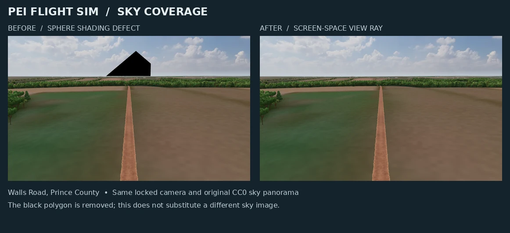

# Sky coverage at low flight angles

Fixed simulator cameras over Walls Road and Summerside could show
a pure-black polygon even though the source panorama contained no
black patch. Disabling depth testing by itself did not remove it.
The rendered shape was not part of the terrain, buildings, source
photograph or cloud model.

The backdrop now draws two screen-space triangles and reconstructs
the viewing direction from the active camera projection. It still
samples the same [CC0 sky panorama](https://polyhaven.com/a/kloofendal_48d_partly_cloudy_puresky)
with the same sky colour and horizon treatment. It does not write
depth. Ocean reflections and scene lighting still use their existing
paths and asset. This change does not introduce new weather or
photography.

## Matched checks

- Walls Road: the same locked view and sky asset had 8,827 pure-black
  pixels in the selected sky crop before and zero afterward.
  The scene retained 99 draw calls, with 1,214 fewer sky triangles
  (the distant sphere is no longer submitted).
- An independent Summerside check removed a second 7,545-pixel
  defect with the same viewing-ray approach. Away from the cut and
  horizon, changes were at most one 8-bit channel value across
  20,445 measured sky pixels. This comparison was not a hardware
  benchmark or a claim of complete still-image parity across sessions.
- The exact diagnostic magenta override remains available to the
  existing coverage fixtures.

Run `npm run check` and
`python tools/qa/sky-coverage.py --checkout . --chromium /path/to/chromium --out /tmp/pei-sky`
for the locked Walls Road view. To repeat the old case, use the same
script against the preceding checkout with `--label base`.
