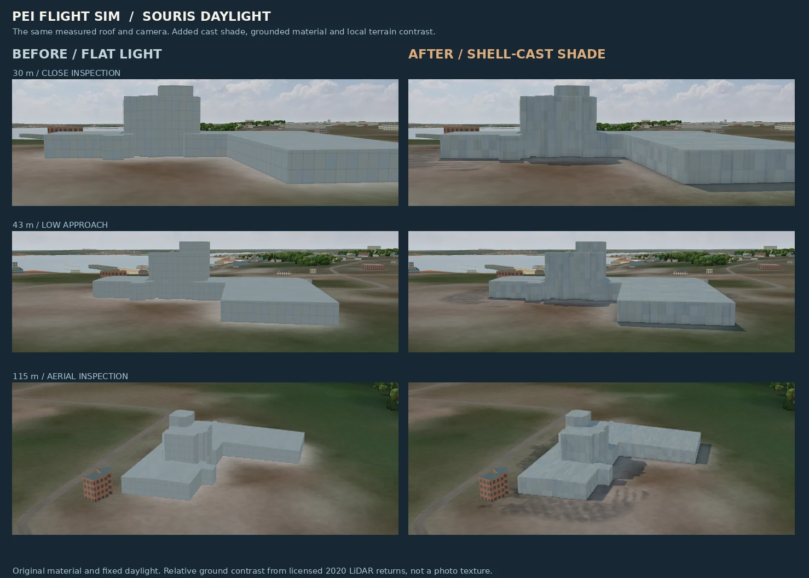

# Souris: measured contact, cast shade and surface breakup

The [fitted roof](souris-roof.md) fixes the inaccurate silhouette, but the first 30 m and 43 m views were too flat: the apron contained blurred bright imagery around the perimeter, there was no real cast shape, and the shell was largely one grey grid. This is a separately scoped lighting and art improvement for the exact streamed roof only. It leaves roof and wall vertices, the terrain mesh, the land/water test, the existing draw calls, and flight physics unchanged.



## Where the local evidence comes from

- Direct daylight is computed from the 296 emitted roof and wall triangles in the existing fixed sun frame. The exporter reuses the game's actual shell receiver heights, signed terrain and outside wall roots. The baker projects these triangles into light-space, storing the highest intercepted height on each sub-metre ray. The terrain and metal use the same depth field; a tower can shade the base and a lower wing.
- The spatial contact field decays from the exact original building perimeter. Reconstructing the existing 56- and 112-subdivision terrain triangles found adequate under-wall coverage at all 11,984 sampled footprint-edge positions per tier; the low-looking white fringe was not a physical gap in those views. The much coarser terrain tier has different relief and is not addressed by this materials pass.
- A 17-range local read fetched 4.20 MB from the [open Prince Edward Island 2020 Souris point cloud](https://canelevation-lidar-point-clouds.s3.ca-central-1.amazonaws.com/pointclouds_nuagespoints/PEI/Prince_Edward_Island_2020/pei_2020_458000_699000.copc.laz), including 141,398 unwithheld class-2 ground returns from one flight strip. Their [portable aggregate](../../data/roof-tiers/souris-ground-strip.json) contains only one-metre intensity medians and counts for cells with at least three returns. It shows relative dark/light structure near the roof that is absent from the blurred colour tile. This is **not** optical RGB, current pavement classification, surface wetness or a license to trace a neighboring business. Only relative contrast is used.
- The known imagery is not an exact ready-to-ship texture source. No third-party photo, business logo, building sign, invented window layout, precise paving material, or claim of current condition is included. The metal's lapped seams, grain, shading and weathering are original authored material.

## Runtime budget and gates

The 54,652-byte optional transfer contains two separately sampled fields: a 46 cm sun-depth/perimeter map and a one-metre premultiplied ground-return map. It is requested only after the exact Souris caster is present in the streamed building tile, not during province startup. Perimeter shade uses a quiet 13 m maximum support; observed ground uses up to 28 m before filtering and excludes the roof interior. Both are evaluated only on already visible land. Outside the lighting/appearance footprint, the baseline shader is unchanged. The normal/colour program is used only in the Souris neighbourhood and the one tagged facade. The existing mesh and Draw count are unchanged. A malformed, absent or slow pack or an evicted caster cannot project phantom shade.

The native CPU gate independently checks 36,430 blocked light rays against every fitted triangle, 10,361 empty controls, and quantization error up to 0.125 m. It verifies all 48,075 perimeter samples and 9,845 directly observed outer ground texels, plus 1,830 one-metre interpolations with at least five measured neighbours, against the authoritative footprint and source counts. Interpolation only softens small confidence holes, never expands the original 28 m evidence collar or paints through the roof. The browser paired-camera test locks the actual 30 m, 43 m and 115 m camera transforms after the province-wide colour correction. It checks unchanged scene counts and flight surface queries. A separate QA-only dispatch location flies the normal simulator with healthy, missing, corrupt and stalled responses. Good source-backed local improvements do not in themselves meet province-wide photorealism: wider aerial detail, actual equipment/openings, neighbouring structures, lighting transition and the broad scenery artwork are separate work. No hardware FPS result is claimed.

```sh
/usr/bin/python3 tools/geodata/bake-souris-light.py
node --experimental-strip-types --test test/souris-light.test.ts
npm run check
python tools/qa/souris-daylight-frames.py --checkout . --out /tmp/souris-daylight --chromium /path/to/chromium
python tools/qa/souris-daylight-flight.py --checkout . --out /tmp/souris-flight --chromium /path/to/chromium
```

Contains information licensed under the [Open Government Licence – Canada](https://open.canada.ca/en/open-government-licence-canada).
