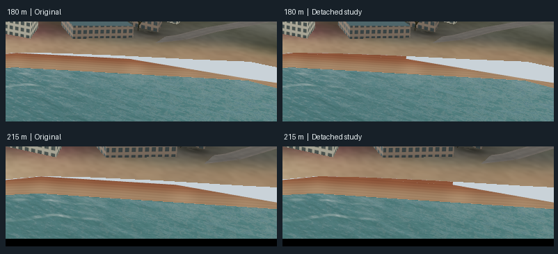

# Souris foreground: detached dry-rim experiment

**Status: held from the playable scenery.** The live Standard waterfront flight exposed a pale slit where sky was visible between the old shore face and the terrain. This experiment joins one inherited, 47.60 m dry interval at its existing coordinates. It does not rebuild the whole edge, alter water coverage, or change flight or collision. Most of the gap remains, and the end of the proposed piece reads as an abrupt step at ordinary scale.

## Survey basis

- The existing cover chord is inside the [Statistics Canada 2021 Census cartographic land boundary for PEI](https://www150.statcan.gc.ca/n1/pub/92-160-g/92-160-g2021001-eng.htm), with at least 1.7 m of clearance from the original mapped edge. This file supports the dry-side check, not a height or material claim.
- Nearby 2020 [Natural Resources Canada airborne LiDAR](https://open.canada.ca/data/en/dataset/7069387e-9986-4297-9f55-0288e9676947) supplies independent ground context, not a present-day wall survey. In the bounded 457000/700000 tile, the closest class 2 return to each sampled point along this chord was at most 0.773 m away. The closest class 9 return was at least 16.139 m away. Canada data are credited under the [Open Government Licence](https://open.canada.ca/en/open-government-licence-canada).
- The scene sample was the existing 27-14 regular terrain tile at level 112 with its real seam variant. The 10 new triangles meet the old face at its exact top and remain about 1 mm below both the reconstructed continuous surface and the corresponding packed renderer envelope. The exact original material supplies appearance; no photographic pixels or outside vector assets are bundled in this study.

## Native comparison

Ordinary neutral-input, Chase flight from Souris Waterfront Pass; 1200 × 760, Three.js r187, 4× MSAA. Each capture compared stock, the original sky marker, the detached candidate, and restored stock at the same camera and application time. “Fully sky” means the original sky marker replaced the entire resolved pixel; “mixed” means the marker changed it but did not replace the whole pixel.

| Travel from spawn | Fully sky pixels changed | Mixed pixels changed | Changed pixels outside original sky mask | Alpha changes |
| --- | ---: | ---: | ---: | ---: |
| 180 m | 396 | 124 | 0 | 0 |
| 215 m | 563 | 146 | 0 | 0 |
| 405 m (control) | 0 | 0 | 0 | 0 |

All three views restored the original RGBA image exactly; the 405 m control submitted no study draw. Each submitted one extra draw of 10 triangles, with an equal-to-clear-depth test and depth writes disabled. These resolved-image tests do not by themselves establish sample-level invariance on every device or under every later color pass.

The larger neighboring aperture remains outside this experiment. Filling it by extending the old wall would invent a bank on an unqualified profile, and no related change was made to the ferry-side shore. The playable app does not import this experiment. Reopen the live decision only with a source-backed adjoining surface or natural occluded endpoint, tests of the real later color passes, and a convincing full-size moving comparison.
