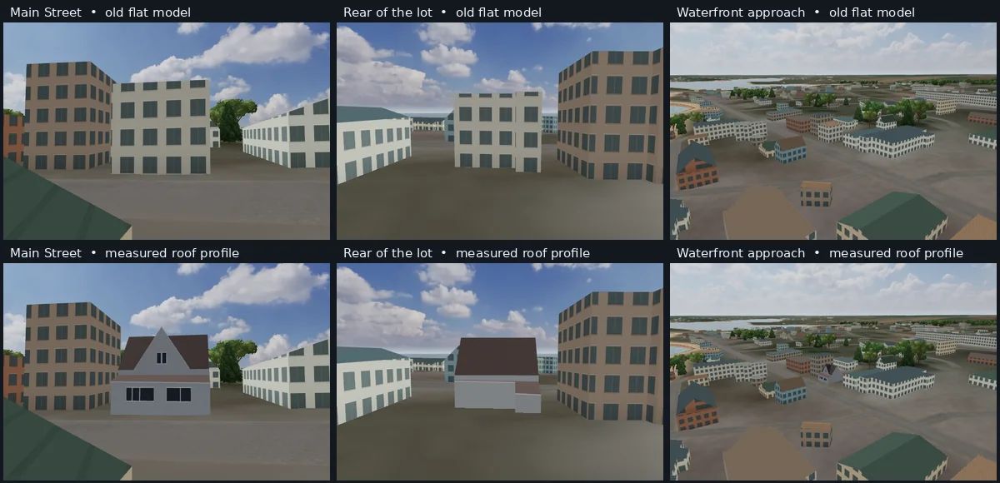
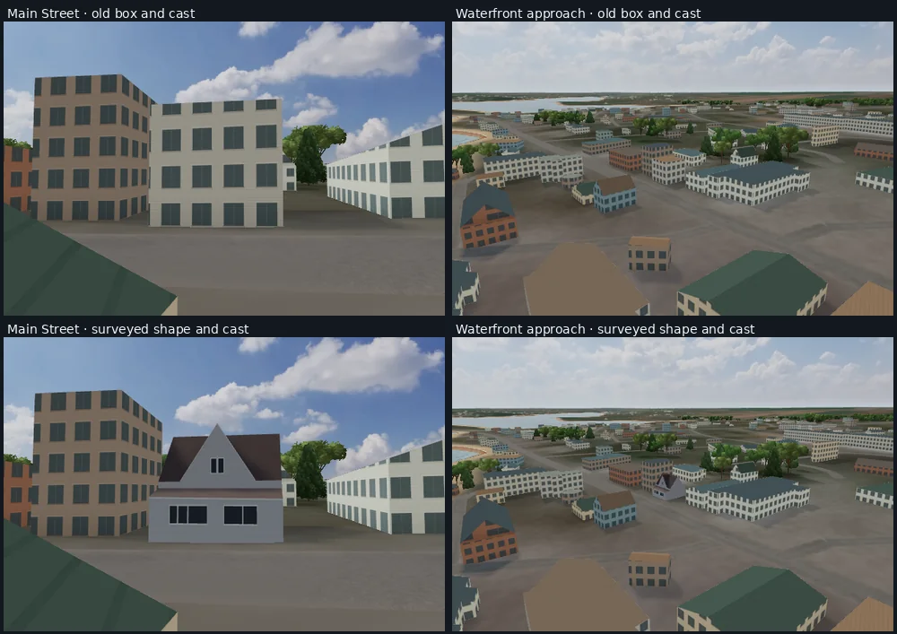

# Souris · 77 Main Street exterior

The old building was one approximately 23.43 m flat cap with a generic
office-window pattern. The near scenery replaces that single source building
with a cross-gabled main roof, a low enclosed porch roof, and a smaller rear
roof. The overlap above the porch is intentionally not a solid extrusion to
the highest return: colocated first/second pulse returns in the 2020 flight
lines show separate measured levels.

## What is measured

- [Natural Resources Canada, CanElevation LiDAR Point Clouds](https://open.canada.ca/data/en/dataset/7069387e-9986-4297-9f55-0288e9676947),
  under the [Open Government Licence – Canada](https://open.canada.ca/en/open-government-licence-canada).
  The input is the PEI 2020 [COPC tile](https://canelevation-lidar-point-clouds.s3.ca-central-1.amazonaws.com/pointclouds_nuagespoints/PEI/Prince_Edward_Island_2020/pei_2020_457000_700000.copc.laz),
  in NAD83(CSRS), UTM zone 20N, with CGVD2013 elevations. Fourteen checked byte-range
  requests read 3,739,741 bytes for this building and its west-side neighbour.
  Only measured roof regions enter the six plane fits.
- The unmodified atlas identifies owner `q130331/99`. Its six-vertex plan and vertex
  order, height, minimum height, compressed tile SHA, manifest and unpacked
  ground data are separately pinned. Only that existing draw span is omitted.
  The other 34,203 vertices and their attribute values stay exactly the same.
- The six separated roof roles were checked against 232 retained nominal
  1 m-block LiDAR observations. Aggregate absolute vertical error p90 dropped
  from **6.247 m** for the flat cap to **0.114 m** on the actual model. These
  are tests of supported faces, not an as-built tolerance for every join.
  An independent whole-plan sweep of 86,494 rays found no missing roof
  projection or spill and resolved the deliberate two-layer overlap.
- Near terrain is checked against 18 matched land/contact/elevation probes.
  The exterior does not change the terrain, road or flight physics and does
  not provide a navigable or enterable interior.

## What is modelled

The broad porch glazing and two attic windows are simplified original geometry.
The [Island Archives historic record](https://islandarchives.net/islandora/object/cap%3A1416)
identifies the former Crockett House; the image is undated and used for visual
reference only. The broad frontage arrangement is also visible in the
[2024 aerial view](https://commons.wikimedia.org/w/index.php?title=File:Souris,_PEI_aerial_view_(2024).jpg&oldid=1139621478)
([CC BY 4.0](https://creativecommons.org/licenses/by/4.0/)). Neither photograph
is part of the asset or used as a texture. Cladding colour, thickness and
joins are approximate. Current use, steps, door hardware and exact sash are
not reconstructed. The Souris Town Hall on the adjacent lot is a separate
asset and is not enabled by this change.

## How to see it and what falls back

In Dispatch choose **Souris · waterfront pass** and look toward Main Street
from the coast. The asset loads only near the authenticated owner in
Standard scenery, including the Town façades option. At distant or otherwise
unqualified ground levels, on a mismatched input, or in the Detailed preview,
adaptive/inland terrain, or if the requested building-shadow renderer is not available,
the source tile stays in use. No new public world asset is required; the small Three.js
module loads only for the verified local tile. Five shared-material draws
replace the 16-triangle stock owner at close range.

The comparison above uses the same camera poses, time of day and render
configuration in Chromium with SwiftShader, not target-device frame-rate
measurements. The foreground town remains approximate.

For a repeatable check, run `npm test`, `npm run build`, and
`python tools/qa/souris-east-flight.py --dist dist --chromium /path/to/chromium --out results.json`.
The three matched poses add 318 submitted triangles and five main-scene
draws, with every ready building tile still in place. Only the projected
area of the one facade/roof or the background it previously occluded changes
in those matched Standard frames.

## Close building shadows

With `buildingShadows` enabled, the exact measured exterior now supplies
its own directional shadow. Old buildings on the same tile retain their
exact attributes and order. When the original near terrain withdraws or
the tile leaves the stream, both the visible exterior and its caster turn
off together and the stock tile takes over. The ordinary Standard scenery
does not load the optional shadow shader.

The two Chromium poses retained the same tiles, with one added submitted
depth draw and 318 added depth triangles. A separate light-direction ray
test of this one owner at the simulator's fixed sun angle found roughly
50.1 m² less shade outside its footprint versus the tall old box. This
compares the two geometries under the current lighting preset, not a
survey of real-world shadows or a performance benchmark.
