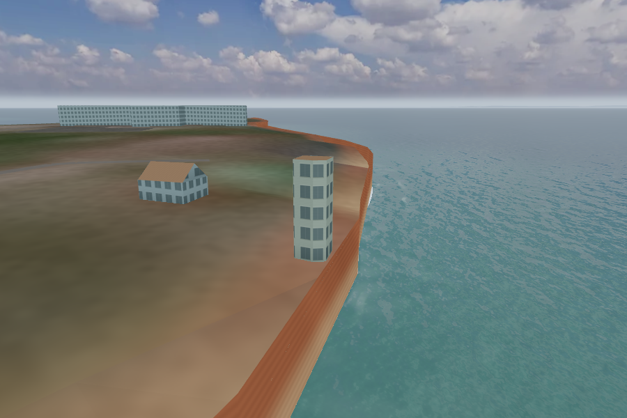
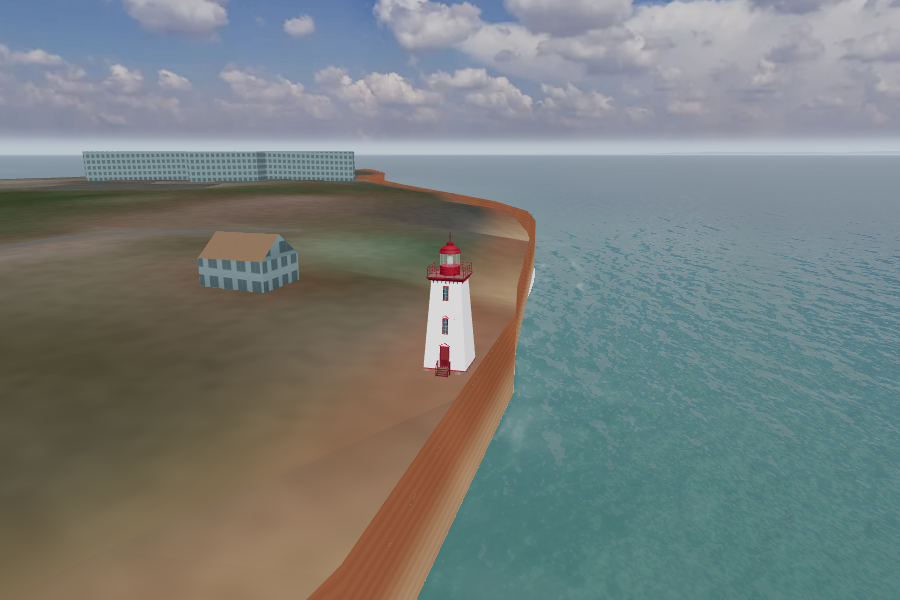

# Souris East lighthouse · Knight Point

This optional exterior replaces one five-storey box on Knight Point with an original
white square tapered tower, open red gallery and domed glazed lantern. It does not
replace East Point Light, the separate Souris breakwater beacon, the neighboring
building or the headland. Select Standard and add `?sourisKnightExterior`; add
`&stockSourisKnight` for the original. From **Souris · waterfront pass**, turn east
to see Knight Point. This is an exterior study, not real navigation.

**Before, looking southeast across Knight Point:**



**After, same game camera and intact surrounding ground:**



[Close view of the entrance and stacked sash windows](art/souris-knight-entry-detail.png). The existing cliff still uses coarse scenery and is not part of this reconstruction.

## Model and evidence

The [Canadian Coast Guard station 947 / H0922](https://notmar.gc.ca/publications/list-lights/atl/atl942-en)
puts this white tower on Knight Point, with a 14.4 m structure field and a
separate 27.2 m optical focal elevation above water. [The operator](https://www.shai.ca/harbour-authority/historic-lighthouse/)
reports 14.3 m, the nominal overall size used here. The [provincial heritage
entry](https://www.historicplaces.ca/en/rep-reg/place-lieu.aspx?id=18696)
gives 18.5 m without published measuring endpoints; the simulator does not
reconcile the difference as a survey. The [federal heritage description](https://www.pc.gc.ca/apps/dfhd/page_fhbro_eng.aspx?id=4672)
provides the tapered square body, multipane sash, bracketed gallery and projecting window caps. The rendered modern red cap and its ring transitions follow
a qualitative read of [Dennis Jarvis’s dated 2015 exterior](https://commons.wikimedia.org/wiki/File:Lighthouse_PEI-00352_-_Souris_East_Lighthouse_(22287743005).jpg)
(CC BY-SA 2.0). No photo pixels, tracing or source textures are included.

The three documented wall roles are modeled separately: the gabled entrance
and its two stacked sashes, a different wall with two hooded sashes and no
door, and a neighboring wall with one high sash. The short, open entrance
landing is an original approximation. Independent photos indicate an upper
red-trimmed opening on the other side of the entrance; that opening is not
modeled in this version. The exact bearing, proportions and current finish
of each wall are not surveyed. The [Tourism PEI property photos](https://www.tourismpei.com/attractions/souris-historic-lighthouse)
and the [separate doorless face photographed in the same Jarvis session](https://commons.wikimedia.org/wiki/File:Souris_East_Lighthouse_(22099959118).jpg)
support that distinction. No source photographs are included.

The light has four original material batches: painted timber, detailed red
brackets/frames/dome and redstone foundation, a static internal optic, and
separate translucent lantern panes. The layout on the less-documented faces,
full roof internals, glass and trim dimensions are authored approximations.
The tower does not signal or reproduce real-world operation.

## What stays unchanged

A tightly matched provincial footprint corroborates the existing federal
q131/33 center within 1.36 m, but those shapes do not agree enough to call
their dimensions an exact foundation. The chart locator and the civic point
are not substituted for the stock tower socket. The signed existing grade
under the measured simulator perimeter sample is dry; the new landing also
has a separately guarded 81-point dry check. The base uses the original
near terrain, leaving the current aircraft ground contact, red shore surface,
water, road, neighboring owner and unrelated parts of q131 unchanged.
The model is admitted only when its authenticated tile, complete draw set and
original Standard ground are available. Otherwise the whole old tile stays
or reappears. It removes 13 stock model triangles, not any coast geometry.

[Source and model contract](souris-knight-exterior/source-contract.json) · [Independent exterior review](souris-knight-exterior/independent-appearance.json)

## Simulator checks

In both locked ordinary game views, all eight requested building tiles were
ready and the existing Souris water correction remained active. Switching
back to stock reproduced the original southwest image byte-for-byte. With the
new lighthouse still active but lying behind the camera, the neighboring
building's entire comparison image was also byte-for-byte unchanged.
[Registered render checks](souris-knight-exterior/registered-views.json)

The [compiled flight receipt](souris-knight-exterior/player.json) uses the real
Dispatch, flight, camera and Pause controls. It covers normal operation,
one deliberately unavailable art module, and the explicit stock choice.
To repeat from the repository root after installing dependencies and building:

```sh
node --experimental-strip-types --test test/souris-knight-exterior.test.ts
python tools/qa/souris-knight-exterior/compiled-flight.py --dist dist \
  --out /tmp/pei-souris-flight --chromium /path/to/chrome-headless-shell --mode active
```

The other browser modes are `missing` and `stock`.
