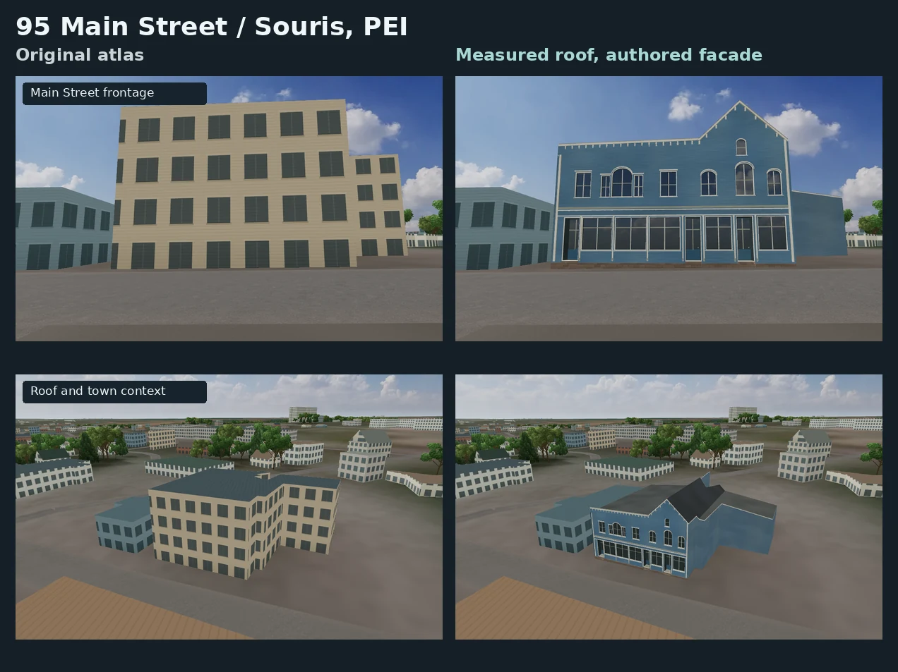

# Matthew and McLean Heritage Building, Souris

At **95 Main Street**, the original flat, repeated-window facade is replaced
by the measured roof outline and an original two-storey shopfront. It is
part of the normal scenery, with no separate preview download or setting.
On a Souris pass, look to the town at about **46.35475°, −62.25336°**.

## Evidence and scope

- The [Canadian Register of Historic Places](https://www.historicplaces.ca/en/rep-reg/place-lieu.aspx?id=5983)
  and the published [provincial designation](https://www.princeedwardisland.ca/sites/default/files/publications/royal_gazette/20060826.pdf)
  identify the building at the civic address. The register describes its
  street-facing gable, western parapet, bracketed eaves, large shop
  windows, transom openings and ornamental upper sash.
- The [Town of Souris April 2026 newsletter](https://sourispei.com/wp-content/uploads/2026/03/Mousetales-Digital-APRIL-2026-.pdf),
  page 17, corroborates the distinct west and east facades and blue siding
  with pale painted trim. The publication date does not date the photo or
  fix the present paint scheme. No reference photograph, branding,
  business information, interior or shop contents are embedded.
- The original [NRCan AEB footprint](https://open.canada.ca/data/en/dataset/7a5cda52-c7df-427f-9ced-26f19a8a64d6)
  remains intact, including the rear wall outline. Four connected planes fit
  the [NRCan 1 m HRDEM](https://datacube.services.geo.ca/stac/api/collections/hrdem-mosaic-1m/items/10_3-mosaic-1m):
  a shallow western roof, both gable pitches and a lower eastern roof.
  The roof follows the original AEB polygon, not the conflicting OSM shape.
  In 66 spatially withheld native cells, the actual roof mesh's 90th-percentile
  error fell from **3.61 m to 0.18 m** (largest residual 0.28 m). These cells
  were excluded from coefficients, not a new survey.
- Opening dimensions, stone entry steps, brackets, roof shingles and a
  shallow parapet face are authored detail within the retained plan. They
  are not a structural, access or present-day occupancy survey. No
  adjacent shop, sidewalk, terrain or flight contact has changed.

Contains information licensed under the
[Open Government Licence – Canada](https://open.canada.ca/en/open-government-licence-canada).
Sources and exact input hashes are in the
[registration record](../../data/souris-main/mclean-source.json).
The in-engine and image checks are summarized in
[the review receipt](souris-mclean-review.json).

## Reproduction

- From the project root, run `python tools/geodata/bake-souris-mclean.py --verify`
  with NumPy and GDAL Python bindings. It reads only the pinned 76 × 77
  native HRDEM window and the local AEB pack. Use `--window` for an already
  downloaded local data window of the same registration.
- Run `npm test` for the streamed-record selection, plan and real
  Three.js roof ray controls. Run
  `node --experimental-strip-types tools/qa/souris-mclean-mesh.mjs PREDECESSOR_ROOT REPORT [PROJECTION]`
  for both actual building batches; the projection checker independently
  computes missing, overlapping and out-of-outline plan area from the
  renderer's Float32 triangle buffer.
- Run [the fixed scene capture](../../tools/qa/souris-mclean-frames.py) on both
  versions with the same `--chromium`; use `--pose-baseline` for the
  candidate so pose and fully streamed map IDs match.
- [The compiled flight rehearsal](../../tools/qa/souris-mclean-flight.py)
  temporarily adds a local dispatch entry only to its detached test copy.
  It uses ordinary app input, compiling and streaming the real scene.
