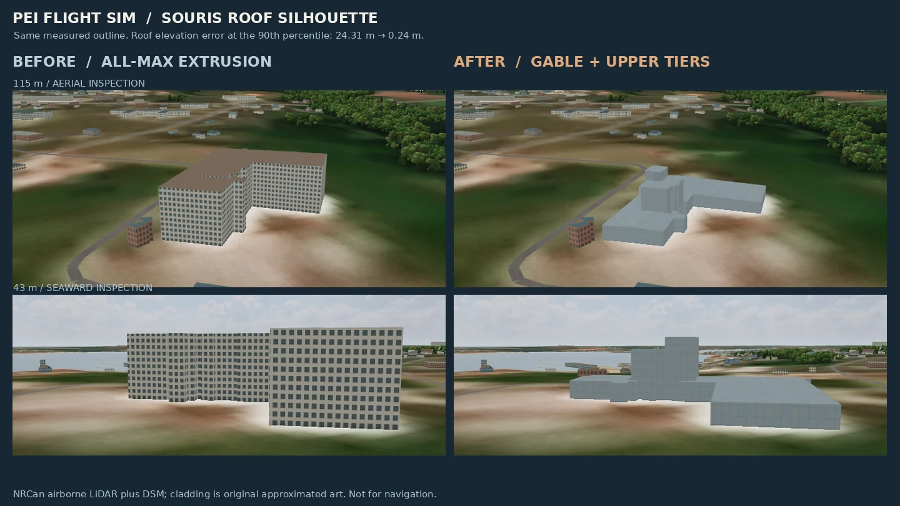

# Souris: measured industrial roof silhouette

The prior Kings County scenery put the **maximum** recorded building height across all 6,149.28 m² of one large Souris industrial footprint. A broad, shallow gabled roof and a localized stepped upper mass are separable in the survey. This release corrects one building, preserves its complete original survey outline and all neighbouring buildings in the tile, and does not modify the rest of Souris, the coastline, aircraft physics, collision or route guidance.

## Independent checks within the same survey

- Original [NRCan PEI 2020 building footprint atlas](https://open.canada.ca/data/en/dataset/7a5cda52-c7df-427f-9ced-26f19a8a64d6), tile `q131`, feature 221 (zero-based). The exact ordered outline and pinned atlas digest must match; a changed atlas or different footprint retains the baseline building path.
- Co-registered [CanElevation 1 m DSM and DTM, item 10_3-mosaic-1m](https://datacube.services.geo.ca/stac/api/collections/hrdem-mosaic-1m/items/10_3-mosaic-1m) and [point cloud 458000 / 699000](https://canelevation-lidar-point-clouds.s3.ca-central-1.amazonaws.com/pointclouds_nuagespoints/PEI/Prince_Edward_Island_2020/pei_2020_458000_699000.copc.laz) provide the measured elevations. A bounded 12-range query transferred 2.27 MB and returned 42,869 unwithheld class-6 building points. The independently processed one-metre census is derived from these **related measurements**, not a separate flight.
- Of 5,595 surveyed cell centres screened at least 1.5 m inside the original boundary, 5,583 have three or more class-6 points. Class-6 median-to-DSM absolute p90 is 0.13 m (0.07 m when excluding the widest within-cell vertical returns). Thresholds reject ambiguous roof walls or equipment: at least 3 samples, p90−p10 span below 0.8 m, class-6 median within 0.5 m of DSM and connected upper support. 396 cells do not directly seed a modeled surface.
- In five spatial 4 m holdout folds on the 4,772 qualified main-roof cells, one shallow asymmetric gable produced p90 **0.082 m**, versus **0.492 m** for one tilted plane and **1.800 m** for a single flat roof. The gable crest is about 27.18 m with 4.05% and 4.54% slopes in the source coordinate frame. Two local upper surfaces have class-6 medians of 41.86 m and 47.85 m in the same survey/game vertical frame. Unqualified cells are not used to pick either upper height.

## Matched approaches



This is a massing correction. The bright source-image halo and the
simplified lighting and cladding still limit the close-up appearance.

## Model and checks

The shell uses the original shape as an exact clipping domain. A bounded 3.15 m nearest-source inference fills narrow contacts before a roughly 1 m generalization; unsupported areas retain the shallow base ridge. The ridge splits both roof triangles and wall bases at the crest to avoid interpolating across a fold. Existing tile streaming batches all 296 required shell triangles in the existing draw. A neutral original cladding pass avoids the baseline's repeated apartment-style windows, but does not claim true materials, wall openings, exact equipment or current conditions.

The actual emitted Three.js planes, sampled with a local coordinate witness accurate within 1.04 mm, improved DSM p90 from **24.31 m to 0.24 m** across all 5,595 cell centres. Reprojecting exact native centres against the actual streamed Float32 mesh found the same p90 and no dual-height hits. One numerical boundary sample was within 0.078 mm of a ceiling; the projected area disagreement is below 0.02 m² out of the 6,149.28 m² envelope. This does not claim CAD-exact topology. Exact Quartermaster geometry and order retain their previously published digest after sharing the shell renderer. Fixed 115 m and 43 m camera pairs verify no new draw calls, 214 additional triangles as rendered, and all 378,768 unaffected tile vertex-attribute values bit-identical.

```sh
/usr/bin/python3 tools/geodata/bake-souris-roof.py
node --experimental-strip-types --test test/souris-roof.test.ts
npm run check
python tools/qa/quartermaster-roof-frames.py --site souris --checkout . --out /tmp/souris-roof-frames --chromium /path/to/chromium
```

Offline bake uses NumPy, SciPy and GDAL/OGR/PROJ. The browser uses only the small derived mesh plan. No town or business photograph, source point cloud or raster is shipped to players. Contains information licensed under the [Open Government Licence – Canada](https://open.canada.ca/en/open-government-licence-canada). Not for navigation.
