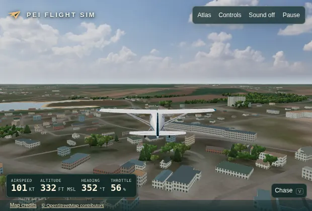

# Souris waterfront pass

Choose **Souris · waterfront pass** in Dispatch, or open the simulator
with `?departure=souris-waterfront-pass`. This simulated approach begins
offshore, at 98 metres above the starting water surface, and heads north
over the waterfront toward town. It uses the existing aircraft, controls,
scenery and flight dynamics. The flight is not an official departure,
approach or training procedure.

The start is at 46.34910° N, 62.25370° W, with heading 352.2° true.
The existing 2021 land mask places the starting point offshore; the
unchanged flight model crosses the shoreline roughly eight seconds
later. With neutral inputs in the locked 29-second replay, the aircraft
passes about 33 horizontal metres east of the centre of the mapped Town Hall outline
and stays at least 78 metres above the sampled terrain contact surface. These are
results for the frozen test, not promises for other controls or aircraft.

This adds a way to reach the town quickly without authoring landmarks
or changing buildings, terrain, the shoreline, water, maps or scenery
options. The current Town Hall in the default atlas is still a generic
shell, not the separate exterior under development.

The [compiled Chromium replay](souris-waterfront-pass-fixture.json) began
flight from Dispatch, flew 826 metres and switched to Cockpit before
pausing. Eight of eight streamed building tiles were ready at the closest
observed point. No world or building warning was reported. The
[deterministic flight test](../../test/souris-waterfront-pass.test.ts)
checks the shoreline crossing, lateral offset, and terrain clearance.
