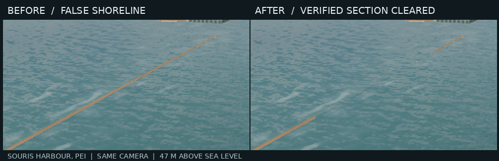

# Souris: remove a false shoreline line

On a low pass over Souris Harbour, the stock terrain could draw a thin orange line across open water. This correction removes the
verified water-only part of that old vertical shoreline surface. It does **not**
rebuild Knight Point's breakwater or remove genuine adjoining shore.
The remaining shoreline, aircraft contact, and water surface all stay
on their original paths.

## What was changed

- The original orange line came from the depth-writing stock shore mesh,
  not from a road, satellite image or animated wave. One complete
  directed span and one partial span, about **93 m** altogether, are
  independently confirmed as water. A short section at the end of the
  partial span and all neighbouring, unqualified spans remain in place.
- The [2020 NRCan CanElevation classified point cloud](https://canelevation-lidar-point-clouds.s3.ca-central-1.amazonaws.com/pointclouds_nuagespoints/PEI/Prince_Edward_Island_2020/pei_2020_457000_699000.copc.laz)
  supplies water-class returns, not merely blank or interpolated terrain.
  Across the complete span a quarter-metre position check never
  needed a water return farther than 0.84 m, reached no ground return
  closer than 9.4 m, and stayed at least 12.72 m from the separate
  provincial shoreline used as a location guard. The partial span stops
  before its ambiguous western end. One adjacent stock span stays in
  place because removing it exposed a few pixels of the sky through
  the coarse land/water mask. No map image, original point
  archive or external vector data is shipped for this correction.
- The live code matches the exact local Float32 geometry and both
  original duplicates. It retires four submitted triangles, clips the
  two partial copies, preserves every other vertex and UV, and adds no
  draw or download. A different source or existing owner keeps stock.
  For a direct in-app comparison, add `?stockSourisShoreline` to the
  simulator URL (or `&stockSourisShoreline` after a query).

## Checks

Two [matched in-game frames](souris-wet-curtain/matched-camera.json)
changed only the projected old line plus one antialiasing pixel. No
sky was exposed in the corrected span from either angle. This is a
scenery correction, not a change to flight or collision physics. A
compiled cockpit flight covered at least 280 m with the correction active
and replayed with the stock toggle, using the normal cockpit and pause controls.
Contains information licensed under the
[Open Government Licence – Canada](https://open.canada.ca/en/open-government-licence-canada).

### Southwest water-coverage check

A separate southwest view revealed a one-pixel opening through the
existing ocean and land masks. The correction lets the simulator's
existing level ocean cover that near-zero mask region within the
already-cleared, fully surveyed span. It does not extend the shoreline
cut or change any terrain or flight physics. An independent
2,392-position check found an original water-class return within
1 m throughout the 1.1 m-wide validation strip. The [matched replay](souris-wet-curtain/water-coverage.json) changes that one pixel only; the original low view remains unchanged.
