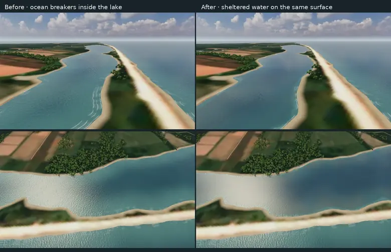

# Sheltered water at South Lake

The renderer formerly treated the sheltered lagoon's shoreline like the
open coast, with bright shoreward breaker bands inside the barrier. The
optional 9,229-byte mask now dampens ripple slopes, suppresses ocean-style
foam and cools the water color where the lake is supported by source data.
The roughness and color are visual choices, not measurements of wind,
depth, tidal motion or sediment. Some unchanged old shading remains in
the narrow unsupported rim.

The boundary source is the [National Hydro Network, work unit 01CD000](https://ftp.maps.canada.ca/pub/nrcan_rncan/vector/geobase_nhn_rhn/shp_en/01/nhn_rhn_01cd000_shp_en.zip),
feature `d0615df188d74a048e076d40d206ab61`. Its geometry validity field is
**1987**, not its 2017 naming date. Contains information licensed under the
[Open Government Licence – Canada](https://open.canada.ca/en/open-government-licence-canada).
The visual reference is [Hayden Soloviev's July 2025 aerial photo](https://commons.wikimedia.org/wiki/File:South_Lake,_Prince_Edward_Island_in_2025.jpg),
[CC BY 4.0](https://creativecommons.org/licenses/by/4.0/). It corroborates
the sheltered appearance but is not a modern shoreline survey or runtime
texture. The views compare game frames from matched cameras, not a fitted overlay
on the photo.

Coverage is conservatively inset from that old ring and intersected with
the existing rendered-water mask. The render and flight terrain definition
do not change. The independent check found identical RGB values on all 195,486
sampled open-water pixels and all 819,589 pixels projected beyond the source
boundary, and identical render geometry and draw calls. Adjacent-pixel color
contrast within the lake fell 52.6% and 58.4% in the two captures; this
measures visual clarity, not wave height. Terrain and water contact matched
at 40,247 surface probes and over 4,050 fixed simulation steps. A corrupt
optional body restored all 600,000 pixels of the unmodified reference view.
