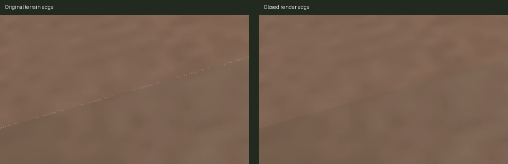

# South21: close one exposed terrain-rim segment

Fixed native and separate ordinary compiled flight checks are complete.

The otherwise dry field where terrain tiles `24-20` and `24-21` meet showed a short dotted line of sky. Their regular `N112` edges already had identical X and height values. Independent Float32 translations left a **3.90625 mm horizontal gap**: `24-20` used `Z = +56388.984375 m`, and `24-21` used `Z = +56388.98828125 m`. Z is map distance, not elevation.

Only the south tile `24-21` changes in this candidate. Four of its north-row vertices, indices **37–40**, use the unchanged north tile’s packed Z only for raster projection. This closes the three segments k37–39. One adjacent segment on either side tapers back to stock. The original indexed mesh, Y values, physics and stock ground/visual-height sampling are untouched. The source imagery, texture coordinates and colour blending are unchanged. This repairs a sky gap, not an image seam or a larger stretch of field.



## Actual fixed native renders

| Matched 840 × 540 view | Stock pixels with a sky contribution in the paired render | Candidate |
| --- | ---: | ---: |
| Direct, exact regular pair | 209 | 0 |
| Reciprocal, exact regular pair | 159 | 18, all unchanged at the adjacent taper |
| Nearby k30 on the same loaded pair | 79 | 79, exact RGBA |
| Source-primed fixed view, `N112`/`N56` | 196,104 | 196,104, exact RGBA |
| Actual unmultisampled default framebuffer | 53 | 53, exact RGBA |

Changing only the diagnostic sky colour established these pixel contributions, not individual hardware sample counts. No new sky or alpha changes appeared. All RGB changes bigger than one 8-bit level occurred in pixels that originally contained sky. The independent raw comparison found all changed colour centers within 0.357 px of the projected old/new boundary support of the nine original affected triangles. Both paired marker frames and the regular scene were byte-identical at k30 even with an actual `24-21` draw. The mixed capture was first confirmed with an actual `24-21` draw, then moved to a fixed `N112`/`N56` view where the lease stayed stock. Its count includes open sky, not just a defect. The actual 0× profile also retains the stock gap and submits no candidate draw. Draw counts, triangle counts, rollback, both original terrain buffers, and 50 tested contact/visual-height values per fixed view remained exact.

[Native 4× fixed receipt](south21-terrain-rim/fixed-native-rgba4.json) · [Native 0× stock receipt](south21-terrain-rim/fixed-native-rgba0-stock.json) · [Frame, source and comparison hashes](south21-terrain-rim/comparison-inputs.json) · [Independent projected-role check](south21-terrain-rim/independent-projection.json)

## Limits and reproduction

The detached lease requires the authenticated `24-20`/`24-21` regular draw pair, a local ordinary perspective camera and full default viewport in Three.js r187, and the native four-sample RGBA depth profile. Pairs with mixed detail, missing or changed owners, foreign hooks or draw contexts, and unsupported sample profiles stay stock. A successfully submitted draw or a Vite build alone is not optical proof. The first eligible draw may link a new vertex variant; there is no new draw, texture, geometry, sound or flight-physics pass. Existing West2, earlier east rims and Borden paths are unmodified. These checks are not terrain-survey or hardware-FPS claims.

```sh
node --experimental-strip-types --test test/south21-rim-custody.test.ts
node --experimental-transform-types tools/qa/south21-rim-lifecycle.mjs
```

The input is the existing signed NRCan CanElevation terrain atlas and original signed Land Cover. Both sides of the exact five-quad guard use 32 original bilinear taps, all finite and dry in the signed game atlas. The independent offline mesh reconstruction matches all 226 stored original rim XYZ triplets from the retained renderer receipt.

## Ordinary compiled flight

The compiled player used the real Begin button, ordinary Chase camera and ordinary timing. The test fixture added only one private virtual departure, not a public route. The verified south `24-21` draw was recorded after **17.837 m** of genuine movement at **61.039 m** ground clearance. Chase continued across the shared edge for **154.252 m**; Cockpit and Pause then worked without errors in the actual four-sample RGBA depth canvas. This proves the normal player submission, separately from the fixed optical pixel counts. The private position is not real navigation guidance.

[Ordinary compiled flight receipt](south21-terrain-rim/ordinary-flight.json)

Optional native replays use a local Chromium and Python Playwright, NumPy,
and Pillow. The fixture appends one QA departure outside the real checkout.

```sh
python tools/qa/south21-rim-frames.py --checkout . \
  --chromium /path/to/chromium --out /tmp/pei-south21-fixed
python tools/qa/south21-rim-frames.py --checkout . --views south21 \
  --no-msaa --expect-msaa0-veto --chromium /path/to/chromium --out /tmp/pei-south21-noaa
python tools/qa/inland-aerial-joins-fixture.py \
  --corridors docs/qa/south21-terrain-rim/ordinary-corridor.json --out /tmp/pei-south21-player
(cd /tmp/pei-south21-player && npm run build)
python tools/qa/south21-rim-flight.py --dist /tmp/pei-south21-player/dist \
  --corridors docs/qa/south21-terrain-rim/ordinary-corridor.json \
  --chromium /path/to/chromium --out /tmp/pei-south21-player.json
```
