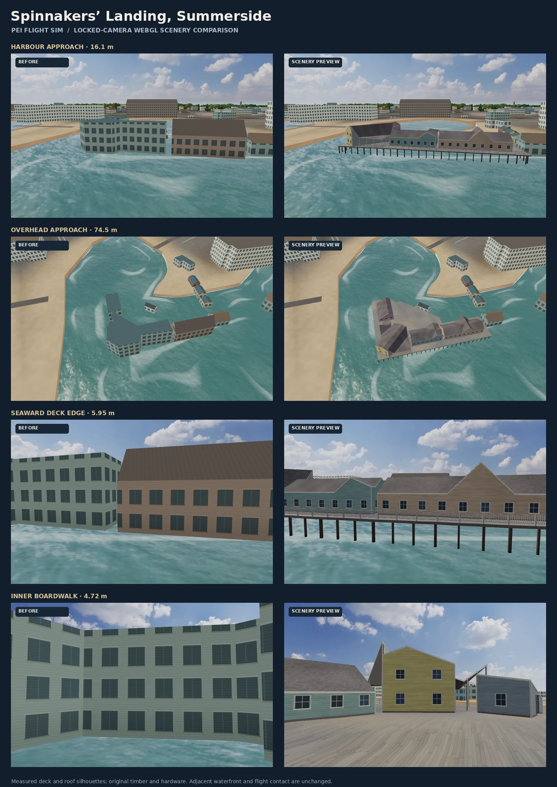

# Summerside: Spinnakers’ Landing

Add `?spinnakersPreview` in the simulator and fly to **46.38913° N, 63.78736° W**. This preview replaces two stock building records that rendered as tall boxes in the water. It shows a raised wooden boardwalk with an upper and lower platform, seven fitted adjacent roof sections, and original aged timber, roofing, glazing and trim. The rest of the downtown waterfront remains base-atlas scenery.

## Registration and measurements

- The pier perimeter is OpenStreetMap way **544428847**, tagged as a wooden pier. Seven nearby building outlines follow similarly scoped mapped ways. The [separate adapted source database](../../data/odbl/spinnakers) is © OpenStreetMap contributors, [ODbL 1.0](https://opendatacommons.org/licenses/odbl/1-0/), based on the Geofabrik 1 November 2026 PEI snapshot. Field and roof evidence, not an OSM address, drives the 3D shapes. Names, businesses, colours, and exact contemporary storefronts are not inferred from these shapes.
- NRCan [1 m HRDEM](https://datacube.services.geo.ca/pgstac/api/collections/hrdem-mosaic-1m/items/10_3-mosaic-1m) and [PEI 2020 classified elevation returns](https://canelevation-lidar-point-clouds.s3.ca-central-1.amazonaws.com/pointclouds_nuagespoints/PEI/Prince_Edward_Island_2020/pei_2020_339000_704000.copc.laz) are in EPSG:3979, under [Open Government Licence – Canada](https://open.canada.ca/en/open-government-licence-canada). The boardwalk uses stable near-deck returns grouped into 1 m cells, screened outside the mapped and stock roof envelopes. It fits both visible grade zones (near 2.0 m and 2.6 m) and transitions where supported; under covered areas, grade is interpolated. An exact clipped plan triangulation prevents the detailed surface from changing the existing shoreline.
- Robust planes are fit to class-6 roof returns grouped into stable 1 m cells. Gabled and cross-gabled sections come from their actual measured slopes. They are simplified, continuous roof envelopes, not full architectural drawings. Roof furniture, individual dormers, small porch transitions and other unresolved details can differ from the world.
- The [City’s resource plan cover](https://cdnsm5-hosted.civiclive.com/UserFiles/Servers/Server_4499283/File/Residents/Electricity/Capacity%20Resource%20Plan%20Final_05_19.pdf) and [Robert Linsdell’s dated photo](https://commons.wikimedia.org/wiki/File:Spinnakers%27_Landing,_Harbour_Dr,_Summerside_(471202)_(9447935719).jpg) (2011, CC BY 2.0) show the elevated pile silhouette, weathered deck hardware and distinct wood-sided buildings. The [2026 Tourism PEI guide](https://www.tourismpei.com/sites/default/files/2026-03/TPEI2026Guide_FRENCH_web.pdf) also shows the boardwalk and exterior types. These are factual art references. No photographs, signage, people or storefront graphics are included. Pile layout, deck thickness, rail details, windows and paint are authored interpretations, and not measurements.

No new shoreline classification, water level, depth model or collision surface. The existing water under the pier remains water for flight contact. This is not a navigation aid and does not recreate present-day tide, business occupancy or structural information.

## Matched simulator views



The [render gate](spinnakers-landing-render-gate.json) holds camera and
18 imagery tiles fixed in each pair. The [compiled launch check](spinnakers-landing-launch-gate.json)
uses the real Summerside departure, cockpit toggle, and pause with
the flag absent, the exact package, and a corrupt package. A second
[compiled departure](spinnakers-landing-combined-flight.json) activates
the Basin Head, Montague and coastline options together with this model.
The water
under the pier stays unchanged, and default and corrupt cases preserve
the base exterior. Triangle counts are not device performance.

## Reproduce the local geometry checks

```sh
node tools/qa/spinnakers-deck-mesh.mjs
node tools/qa/spinnakers-shell-roof.mjs
npm run check
python tools/qa/spinnakers-launch.py --checkout . --chromium /path/to/chromium \
  --out /tmp/pei-spinnakers-launch.json
```

The decoded boardwalk is 56,204 B (42,282 B transfer). It is only requested with the preview flag. The cover fingerprint and wet placement must match; both legacy building records must also match the registered atlas/tile, exact rings, and source heights. These replacements enter and leave with the existing city tile. A failed, corrupt, or incompatible pack leaves the old atlas intact.

| Actual submitted mesh check | Result |
|---|---:|
| Boardwalk retained XY probes | 114, all hit |
| Boardwalk retained vertical p90 | 0.075 m, vs 2.695 m if substituting old fixed water |
| Old roof and new roof at the same 100 source probes | 5.191 m → 0.220 m absolute vertical p90 |
| All 106 retained roof probes | 0.205 m absolute p90; 2.376 m worst unresolved local detail |
| Unchanged neighbouring triangles in the same building tile | 8,891, six renderer attributes byte-exact |

Retained cells are excluded from the coefficient fits but were used to compare configurations; they are not a blind independent accuracy survey. Source-year and modelling limitations apply throughout.
