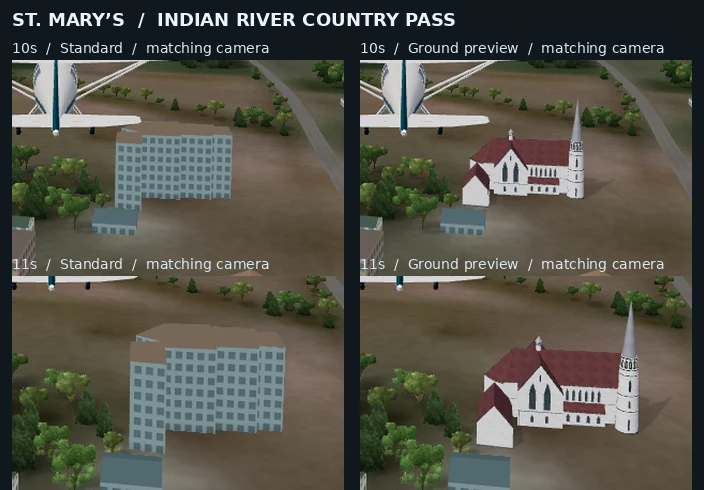

# St. Mary’s and the measured ground · Indian River

In Standard, choose **Indian River · country pass** and **Open ground
preview** in Dispatch. Begin the flight normally. This shows the
[survey-informed St. Mary’s exterior](../st-marys-indian-river.md) on the
matching dry ground, with the original trees and correctly seated local
shadows. It changes simulator ground contact inside the signed 2020
survey patch. It is not a real-world navigation aid or a current survey.
Use **Close ground preview** before flying again to restore the regular
view. The older **St. Mary’s exterior** study in Optional scenery studies is
still available as a separate profile.

The preview does not activate in Dispatch and does not begin while the
aircraft is stopped, on the ground, or within 24 m of the ground beneath
it. The replacement building, terrain, cast and four locally reseated
tree-shadow receivers appear together or stay stock. The grounded
replacement raises some contact points by up to 1.65 m; the neutral route
does not fly through those changed contact points. Unrelated Standard
scenery settings are preserved.

The [real renderer replay](render-receipt.json) compares two matched
Chase frames at 10 and 11 seconds. The full preview changed 10,403 and
20,211 RGB pixels by more than two code values, respectively. Reverting
and restoring the entire local group reproduced the exact image and
contact sample. Separate passes identified the ground, cast, receiver and
church changes. At the second pose eight partial-coverage pixels changed
when the opaque new spire crossed the old hedge silhouette. The change
was proven by real old/new silhouette markers and did not occur in the
ground, cast or receiver comparisons. The original hedge itself is
unchanged. Independently projecting the affected building, terrain and
shadow geometry and adding a two-pixel antialias margin found no changes
elsewhere in either frame.

Every flight step ran. During unscored transit the test reduced WebGL
submissions in the software renderer; both scored frames were rendered
at 900 × 600. These are matched image and ownership checks, not frame-rate
measurements.

## Current native coverage recheck

After the shared canopy draw was changed to preserve destination alpha,
the same optional route was replayed at 900 × 600. The [recheck
receipt](current-alpha-replay.json) records zero alpha changes across
both full frames, including the 11-second spire/hedge overlap. Original
geometry and masks for the hedge were not changed. Separating the
artwork, ground, cast and tree-shadow receivers again found zero alpha
changes in each component, and restoring the preview repeated its
images byte for byte. This is a validation of the existing preview, not
activation in Standard.
