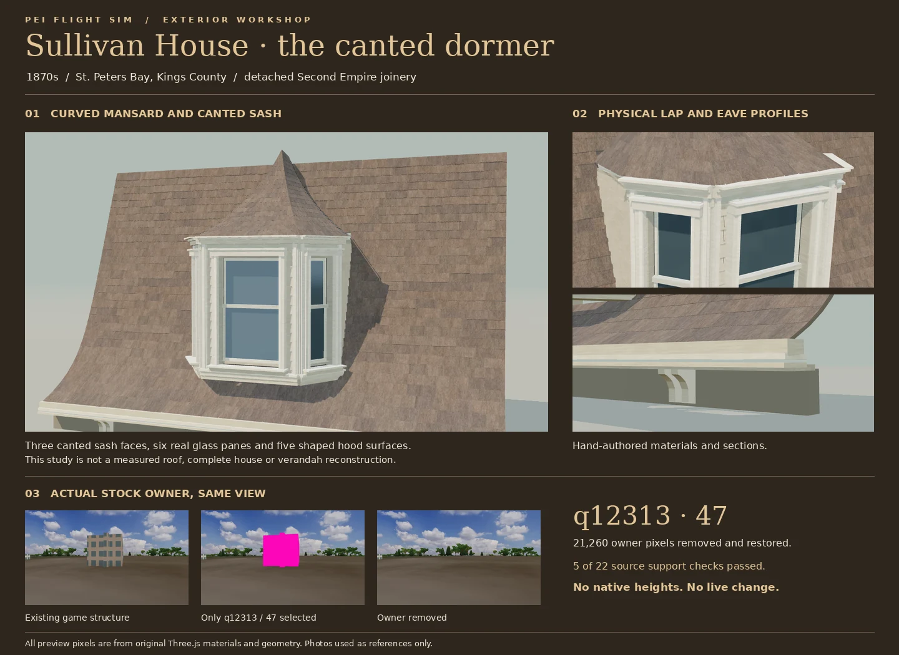

# Sullivan House, St. Peters Bay

**Original exterior work, not a scenery replacement.** The historic main inn is well identified; available survey coverage does not establish its defining mansard and dormer geometry or a safe ground contact.

| Work | Result |
| --- | --- |
| Identify the exact property | **q12313 / ordinal 47**, with 223.649234 m² of extracted outline wholly within parcel 119743. Three stock frames isolate 25 triangles and restore exactly. The 2025 lofts and neighbouring church are not the house. |
| Recreate an identifiable detail | The close study separates three canted sash faces, six physical panes, shaped sills, individual lapped shingles, a short ridged hood and two backed pairs of decorative eave profiles. These are normalized examples, not measured exterior dimensions. |
| Why leave the live terrain and building alone? | Only **5 of 22** roles met horizontal support: **three disconnected upper-roof regions**, whose combined rectangles cover at most **15.49%** of the extracted outline, and **two ground controls**. None of the roof regions establishes the dormers or front interface. No survey height was opened, and no live geometry or terrain was changed. |

[Original Three.js workshop and dated sources](../../tools/art/sullivan-house-study/README.md) · [Exact owner evidence](../../tools/art/sullivan-house-study/evidence/fixed-stock.json) · [Independent anatomical and browser checks](../../tools/art/sullivan-house-study/evidence/independent-dormer-result.json) · [Independent survey hold](../../tools/art/sullivan-house-study/evidence/independent-xy-hold.json)
