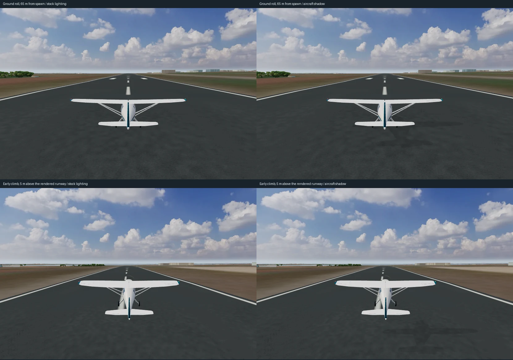

# Summerside: aircraft shadow on the runway



Start **Summerside · runway 05** in Standard and look beneath the aircraft
as you roll down the runway. The fuselage, wings, tail and gear now shade
the actual sloped runway surface from the simulator’s existing sun. Add
`stockAircraftRunwayCast` to the departure URL to compare with the old
lighting.

The cast uses the existing aircraft’s opaque exterior geometry, including
the five articulated surfaces. The cockpit interior, glazing, propeller
blur and cosmetic trim are not included. One local 256 × 256 depth pass
submits those surfaces as a single 7,184-triangle draw. It does not enable
global shadow maps or add a mesh to the main scene. When the aircraft and
its control surfaces are stationary, the valid local depth result is reused.

The shadow reduces only the direct sunlight on eligible runway fragments.
It does not modify the pavement, original paint, terrain mesh, ground
contact, aircraft geometry or flight dynamics. Painted lines can receive
the same natural shade as the adjacent asphalt. The effect is bounded to
authenticated terrain at Summerside, starts its rendering fade at 13 m above the rendered runway and returns
to stock at 22 m. Unsupported canvases and review settings never enable
the effect.

## Browser and geometry evidence

The native WebGL2 check replays the ordinary keyboard roll and initial
climb. It captures matched stock, shadow, scope and restored frames against
the same simulation state and camera. At each capture the main-scene draw
and triangle counts were unchanged between stock and live. The local
depth draw is counted separately; this is not a hardware FPS measurement.

The independent geometry check projects the original caster triangles,
true terrain triangles and the same sun direction through the recorded
WebGL camera. It does not use the shading masks to establish the expected
footprint. This validates local visual coverage, not real operating,
navigation or training accuracy.

The close Chase replay showed five on-runway shadows, including both
rendered terrain tiles and the crossing between them, and another just
after takeoff. The independent screen projection found no changes
outside the modeled footprint in any visible pose. At 16 m and 20 m the
stock Chase camera looks above the runway footprint, so those frames
check the simulated fade value rather than visible contrast. A separate
downward inspection rotates only the camera to inspect the same kind of
real climbing aircraft state; it is not a new gameplay camera mode.
In that inspection, a frame at 16.02 m had 6,920 changed RGB pixels,
all within the independent footprint, with the cast at about 74% of
full strength. In the original Chase run the gain fell to about 12%
at 20.07 m and reached zero above 22 m.

The effect uses a 4-sample WebGL2 canvas. Explicit stock, unmultisampled
canvases and unrelated departures do not enable the shadow. At 23 m above the actual
rendered runway the original Chase output was byte-identical.

### Reproduce

With Node 24, Python 3 and Pillow, install the repository and local
browser QA dependencies. Use a local Chromium with WebGL2; these replay
modes are intended to run one at a time.

```sh
npm ci
npm install --no-save --package-lock=false playwright@1.62.1 pngjs@7.0.0
python tools/qa/summerside-runway-shadow/stage.py --out /tmp/pei-shadow-chase --chromium /path/to/chromium
node --disable-warning=ExperimentalWarning --experimental-transform-types \
  tools/qa/summerside-runway-shadow/projection.mjs /tmp/pei-shadow-chase \
  roll65 roll160 roll980 roll1005 roll1050 air5 off23
```

The same wrapper has separate `--mode controls` and `--mode inspection`
modes. It builds a temporary copy after checking source hashes and leaves
the real checkout untouched. Use a different output directory for each
mode.

See the [native render and source receipt](summerside-aircraft-shadow-proof.json).
