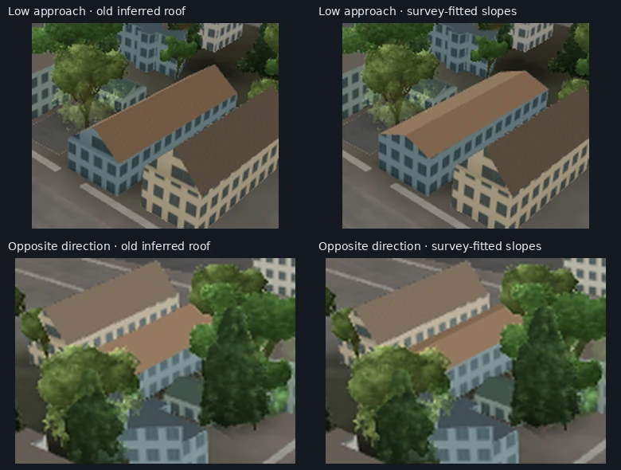

# Summerside · surveyed Water Street roof

The low waterfront pass now shows one corrected gable in the Water Street
area. The old roof used an inferred symmetric ridge. The replacement fits
two separate roof slopes from the 2020 laser survey and joins the wall
tops to the same measured outline. The footprint, apparent materials,
neighboring buildings, road and ground are unchanged. This does not
identify the business or reproduce its current façade.

## Measurement and acceptance

The source is [Natural Resources Canada CanElevation LiDAR point clouds](https://open.canada.ca/data/en/dataset/7069387e-9986-4297-9f55-0288e9676947),
PEI 2020, source tiles `pei_2020_339000_704000` and
`pei_2020_339000_705000`, under the
[Open Government Licence – Canada](https://open.canada.ca/en/open-government-licence-canada).
The existing building outline is from the same pinned province atlas.
The measured owner is exactly `q032001/383`: the ordered ring, atlas and
compressed tile SHA-256 must all agree. Source horizontal coordinates
are NAD83(CSRS) UTM 20N and elevations are CGVD2013.

Before fitting, full 3 m geographic blocks and a surrounding 0.25 m collar
were withheld. Another check then compared the frozen two planes with 573
raw Class 6 points from the same survey that had not entered the fit.
The [small replay fixture](../../data/summerside-roof/held-roof.json) uses
138 medians, weighted equally by small cell and flight line:

| Roof surface | Stock absolute p90 | Surveyed absolute p90 |
| --- | ---: | ---: |
| First slope, 78 observations | 1.046 m | 0.095 m |
| Second slope, 60 observations | 0.896 m | 0.074 m |

The separate held rim check found all 103 raw returns within 0.145 m.
The other candidate stayed stock: it looked flat in the first fit but
its held points exposed a raised section the fit would have erased.
The same public source survey underlies all these checks; they are not a
second survey or a guarantee about the current property.

The actual Three.js changes add four submitted triangles with no extra
draw. The 69,852 vertices of the other buildings on this tile, excluding
this one owner, match byte-for-byte under both Standard and Town façades.
Matched Chromium views retained the same streamed tiles, and all 683,360
pixels outside the projected old and new owner masks stayed byte-exact.
The normal flight test loaded all 29 local building tiles and verified
that the existing railway station and Baywalk still load in their own
profiles. These are renderer checks, not device frame-rate measurements.

## In the simulator

Choose **Summerside waterfront · low pass** in Standard. The roof is
also active in Town façades. Detailed scenery, the authored station and
waterfront presets, standalone building shadows, and alternate terrain
modes keep the existing roof while those paths retain their exact source
layouts. This first Water Street roof is a local accuracy pass, not a
claim that downtown Summerside is fully reconstructed.

To verify the source and reproduce the playable checks, run
`npm test`, `npm run build`, then
`python tools/qa/summerside-measured-roof-flight.py --dist dist --chromium /path/to/chromium --out results.json`.
