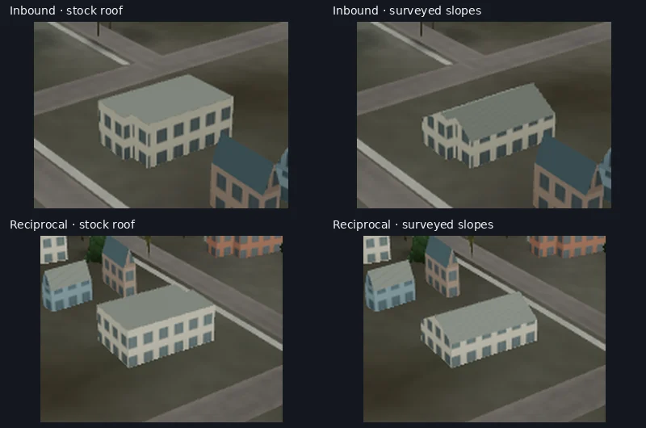

# North of Water Street · measured Summerside gable

This pass replaces a single flat roof on the north side of downtown
Summerside with two measured slopes. It preserves the exact existing
six-vertex outline and its wall bottoms. It leaves the
[earlier Water Street roof](summerside-measured-roof.md), the railway
station, the waterfront and all nearby shapes intact.

## What is supported

The source is [Natural Resources Canada CanElevation LiDAR point clouds](https://open.canada.ca/data/en/dataset/7069387e-9986-4297-9f55-0288e9676947),
PEI 2020, tile `pei_2020_339000_705000`, under the
[Open Government Licence – Canada](https://open.canada.ca/en/open-government-licence-canada).
The roof uses the original signed atlas owner `q03200300/139`.
The atlas generation, packed tile and the original ring must all
agree. This is laser-survey geometry, not photography or a claim about a
tenant, façade or the building’s present condition.

Raw points in complete 3 m blocks were kept out of the fit. The
[small offline replay fixture](../../data/summerside-roof/held-north-roof.json)
contains 157 spatially held-out cell-by-flight-line Class 6 medians
in simulator coordinates. It is not an export of the LAS cloud.

| Position in roof | Observations | Old absolute p90 | New absolute p90 |
| --- | ---: | ---: | ---: |
| Interior | 95 | 1.770 m | 0.092 m |
| Inboard perimeter | 46 | 2.260 m | 0.138 m |
| Near edge, still inside plan | 16 | 2.411 m | 0.146 m |

The two slopes were separately supported. Another candidate lacked enough
independent blocks on one slope and was not added. A new wall vertex along
the roof split follows the existing wall’s straight bottom edge rather
than resampling and moving the base. The model was checked against
the near and middle submitted terrain surfaces and preserved both land
contact and surrounding roads, paths and buildings.

## View and rendering

Start at **Summerside waterfront · low pass** in Standard, then fly north
over downtown. This roof sits outside the automatic close-wall core;
the optional **Expanded town façades** can change its generic wall finish
without changing the outline. Detailed scenery and the conflicting
station, Baywalk, building-shadow and terrain presets keep the existing
roof, just as with the [Water Street pass](summerside-measured-roof.md).

The authored roof adds ten triangles to a draw that already exists. The
16,140 other vertices in this tile and all 69,906 vertices of the earlier
Water Street tile remain byte-identical in the underlying renderer
comparisons. From two matched actual views, all 685,938 pixels outside the
projected roof and wall envelopes remained byte-identical. There are no
extra draws. These are source and renderer measurements, not device
performance numbers.
