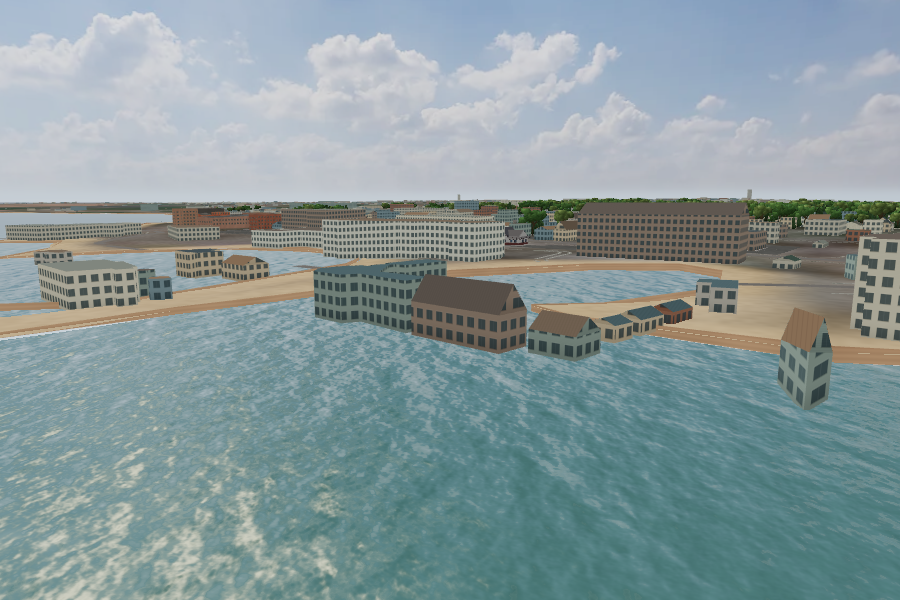
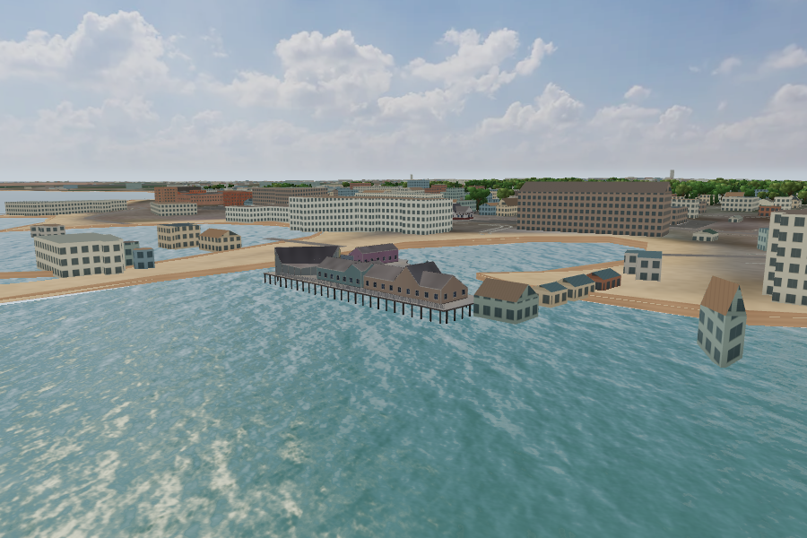

# Summerside waterfront in Standard

Use **Summerside waterfront · low pass** in Dispatch. Near Spinnakers’ Landing,
two generic stock shells give way to the already measured boardwalk and seven
roof sections. The authored rail station, Water Street storefront clearing and
fitted downtown roofs can all remain visible on the same flight. Compare
`?stockSpinnakersDeck` to restore only the old pier shells. The independent
`?stockStationExterior` restores only the station's old shell. Other potentially
over-water buildings are not part of this replacement.

[Source surveys, dating and credit](spinnakers-landing.md) still apply. This
pass adds no imagery or new survey data. Window placement, paint, piles and
hardware remain authored interpretations. The boardwalk is visual only:
shoreline classification, sea level, terrain, road and aircraft contact remain
unchanged. The [city council packet, PDF page 127](https://cdnsm5-hosted.civiclive.com/UserFiles/Servers/Server_19514871/File/City%20Governance/Council%20Chambers/2026/10-27-2026%20Monthly%20Meeting%20Package.pdf#page=127) records mid-August 2026 shoreline remediation at Heather Moyse Drive and Queen Street. This pass is not an as-built record of that work or of any separate boardwalk project. The explicit old `spinnakersPreview`/North Baywalk path retains its
existing separate behavior.

## Bounded flight and tile ownership

The signed 42,282-byte deck package is not requested during a distant flight
or before an intact source tile is resident. Initial admission is within
1,750 metres and below 460 metres in the local altitude datum, with bounded
draw hysteresis to 2,100 metres/510 metres. No request starts once the flight
leaves the admission window. A request already underway can finish, but its
late art does not replace either stock shell unless the near lease is still
valid. An absent or corrupt deck retains both old wharf shells independently
of the railway. Stock visibility does not await either transfer. The registry
uses the full source chunk hash, exact row rings, stock draw count, and both
stock position slices. The existing shore-seat validation confirms every
signed deck node still falls over water.

The unmodified q032001 stock position buffer contains 69,906 vertices.
The station and the two old wharf shells are three exact non-indexed spans.
Independent model groups use a shared index view of the immutable stock
attributes. No neighbor geometry, UV, color, normal, facade, or roof attribute
is regenerated by the switch.

| Active replacements | Submitted stock q032001 triangles |
|---|---:|
| Neither | 23,302 |
| Railway station | 23,286 |
| Wharf | 23,221 |
| Both | 23,205 |

The local wharf art itself adds 10 material/mesh draws and 21,444 triangles
before view culling. This is a fidelity trade-off, not a performance result
for a player's device.

## Matched views

| Old generic shells | Boardwalk and the station together in Standard |
|---|---|
| [](summerside-standard-wharf/wharf-close-stock.webp) | [](summerside-standard-wharf/wharf-close-standard.webp) |
| [County approach before](summerside-standard-wharf/county-approach-stock.webp) | [County approach with the pier](summerside-standard-wharf/county-approach-standard.webp) |

The [native four-pair result](summerside-standard-wharf/native-frames.json) recorded
23,455 changed pixels in the two waterfront views and zero of 1,579,747
protected pixels across the four poses. The entire station-street frame and
3 km distant pair matched pixel-for-pixel. The distant pair made no pier
requests. The disabled county view reproduced the preceding stock PNG
byte-for-byte. Four measured roofs, storefront-ground coverage and the default
water/air optics remained enabled in both close ensembles.

The [compiled flight result](summerside-standard-wharf/compiled-flight.json) covers
all four combinations of the two models, a missing and a corrupt deck, a
corrupt station bundle, the cold distant launch, and the historical preview.
The eight waterfront or historical launches flew about 292–300 m before the
cockpit/pause checks. With a forced missing deck (HTTP 404), only the station
activated and the previous shoreline scene stayed intact; corrupt rail art
failed independently in the other direction. The [capped 1.5 device-pixel-ratio run](summerside-standard-wharf/compiled-flight-1p5.json) also flew 296.45 m with both models and no WebGL error.

[Exact indexed owner proof](summerside-standard-wharf/exact-stock-spans.json) ·
[Independent loader/lifecycle checks](summerside-standard-wharf/candidate-audit.json) ·
[Pre-candidate view lock](summerside-standard-wharf/registered-composition-gate.json)

## Reproduce

```sh
npm run check
node tools/qa/summerside-wharf-owner-proof.mjs . /tmp/summerside-wharf-owner.json
node tools/qa/summerside-wharf-project-scope.mjs . > /tmp/summerside-wharf-scope.json
python tools/qa/summerside-wharf-standard-flight.py --dist dist --chromium /path/to/chromium \
  --out /tmp/summerside-standard-flight.json
python tools/qa/summerside-wharf-standard-frames.py --checkout . --chromium /path/to/chromium \
  --scope docs/qa/summerside-standard-wharf/signed-projected-scope.json --out /tmp/summerside-standard-frames
```

The first test uses the compiled production simulator's actual dispatch,
cockpit and pause controls. The second uses a detached camera-only harness,
holding the view and water clock fixed. It checks pixel differences against
boxes projected from the independently frozen old triangle bounds and the
already shipped pier mesh. Geometry counts and software WebGL captures do not
establish contemporary architectural accuracy, end-user FPS, or complete
waterfront coverage.
