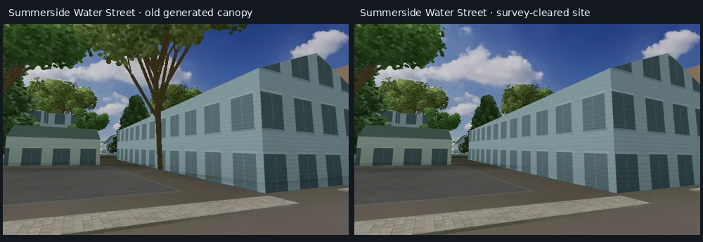

# Water Street · one survey-cleared canopy

A large automatically placed tree used to block the view of a building
along Water Street. The 2020 survey registers open ground at this one
exact simulated root position. Standard and Expanded town façades now
leave that sampled location open. The [surveyed roof](summerside-measured-roof.md),
pavement, other plants, shadows and footprint stay in place. This does not
reclassify the block or claim what has been planted since the survey.

## Evidence and scope

- [Natural Resources Canada CanElevation point clouds](https://open.canada.ca/data/en/dataset/7069387e-9986-4297-9f55-0288e9676947),
  original 2020 survey, `pei_2020_339000_704000`, under the
  [Open Government Licence – Canada](https://open.canada.ca/en/open-government-licence-canada).
  Within 6 m of the fallback root the cropped original source has 317
  ground (Class 2) returns and 334 low unclassified (Class 1) returns,
  but no vegetation Class 3, 4 or 5. The highest non-building return is
  3.898 m CGVD2013. Structure returns are checked separately so the
  nearby roof is never counted as foliage. The model’s removed tree was
  approximately 16.37 m tall.
- The placement rule matches one inferred canopy in one exact generator
  slot only: stock terrain, packed road data, decoded land-cover bytes,
  and the signed Water Street building must agree. Another position,
  size or alternate forest/ground profile keeps the existing roster.
  These are conditions for authenticating a fixed atlas, not a
  requirement that roof and trees be visible at the same time.
- In the matched WebGL scene every one of the other 3,256 canopy,
  shape and hedge-ground records is byte-identical. Only the nominated
  canopy and its own shadow change, removing four triangles and adding
  no draws. All 145,368 pixels outside their projected scope are
  byte-identical. There are no new world downloads. If the cover bytes
  have not already been checked, entering the local area triggers one
  asynchronous checksum over 22,282,240 bytes already in memory.

Use `?stockSummersideFrontage` for the original comparison while keeping
other settings. The optional authored railway and alternate forest or
ground studies keep their existing behavior. The
[compiled flight check](../../tools/qa/summerside-water-open-ground-flight.py)
exercises the exact fallback and the regular departure UI.
