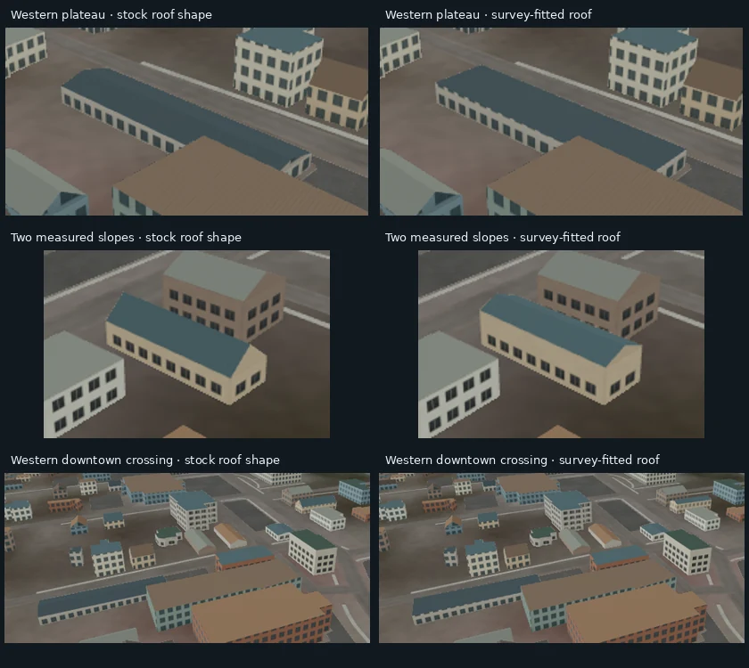

# Western Summerside · two measured roofs

Two buildings in western downtown now use their measured roof forms in
Standard. A wide roof that used to have an inferred peak is now nearly
level. A second building receives two measured slopes. The roofs are
about 128 m apart. The buildings retain the original outlines, the
bottoms of their walls and their existing generic materials.

## Survey check

The source is the original [PEI 2020 CanElevation point cloud](https://datacube.services.geo.ca/pgstac/api/collections/hrdem-lidar/items/PEI-Prince_Edward_Island_2020-1m),
under the [Open Government Licence – Canada](https://open.canada.ca/en/open-government-licence-canada).
The signed owner tile remains `q032001`. Source holdout reserves were
chosen as full 3 m blocks before fitting. The
[compact renderer replay](../../data/summerside-roof/held-west-roofs.json)
stores equal cell-by-flight-line first Class 6 medians, not original LAS
points. Fit and holdout come from the same dated survey.

| Source owner | Shape | Plan area | Raw-held interior p90, before → after |
| --- | --- | ---: | ---: |
| 328 | Measured near-level roof | 434.18 m² | 0.618 → 0.242 m |
| 371 | Two measured roof faces | 169.90 m² | 1.112 → 0.043 m |

Four late returns just inside one edge of /371 are about 2.6 m below the
roof. Their paired first returns hit the measured roof. The lower
structure is not reconstructed. Two other proposed roofs stayed on the
stock atlas because the held points revealed additional real surfaces
that the proposed models would have erased. Neither replacement claims
a particular address, storefront, cladding or present condition.

## In play

These roofs are visible in Standard and **Expanded town façades**.
The authored station, Baywalk, building-shadow, Detailed scenery and
alternate terrain modes retain their compatible stock geometry. The
earlier [Water Street](summerside-measured-roof.md) and
[north Summerside](summerside-north-roof.md) models are unchanged; the
[survey-cleared tree slot](summerside-water-open-ground.md) still works
independently.

Four triangles are removed from the first roof and four added to the
second. The existing draws stay the same. The source replay retained
69,822 non-target vertices in the same tile and all 16,218 vertices in the
other downtown tile, across the ordinary and both wall-detail modes.
Three actual matched local flight views kept 1,019,507 pixels outside the
projected old and new roof owners byte-identical. Both roofs are visible in
the crossing. These counts are not hardware frame-rate measurements.

The [compiled flight check](../../tools/qa/summerside-measured-roof-flight.py)
covers Standard, Expanded, station and Baywalk on the existing waterfront
departure. To see these models, continue west at low altitude across
downtown.
