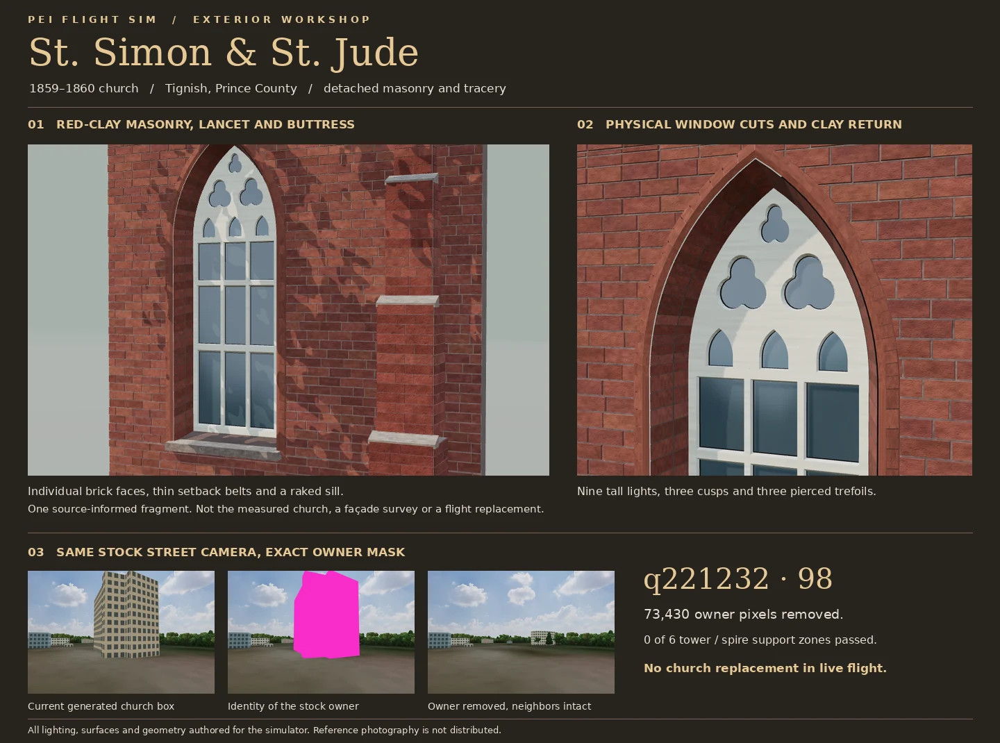
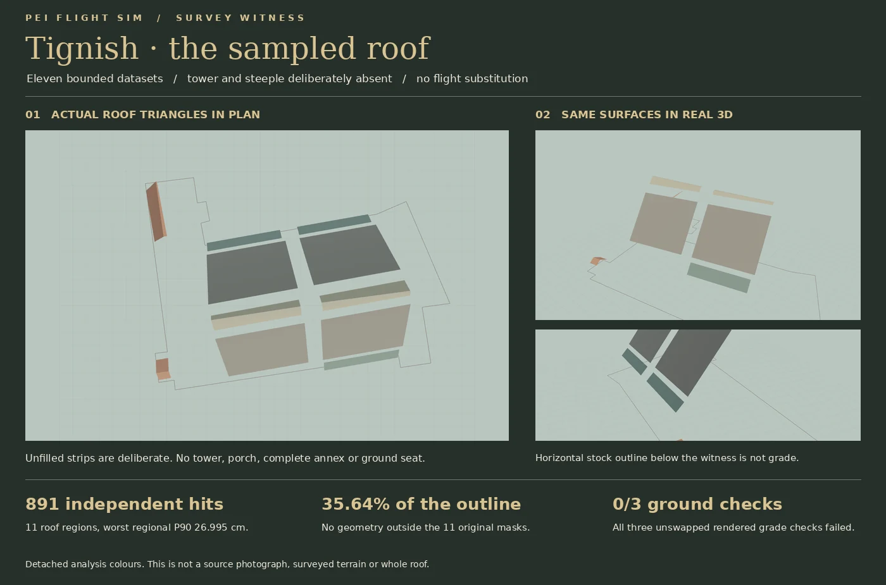

# St. Simon & St. Jude, Tignish

**The church detail is offline.** The stock scene still substitutes a block with rows of tan windows and no spire. The real church’s masonry, porch roles and spire cannot be recovered by adding generic storeys or lifting the stock height.

| Work | Observed |
| --- | --- |
| Exact existing owner | **q221232 / 98**, a 932.007580 m² extracted outline on parcel 6726. Three stock views restored exactly after isolating the one owner. East street removed 73,430 pixels. Separate ordinals 84, 278 and 43 remain unchanged. |
| Original digital art | One normalized projected lancet with 15 physical openings, a separate stepped red-brick buttress vocabulary, porous clay, a gently raked sill and jointed splayed masonry. Five fixed studio angles reproduce. Neither the room behind it nor the whole façade or roof is included. |
| Partial roof, separately | **891/891** withheld physical Three.js roof rays, all 11 in-scope regions. Worst regional 90th-percentile absolute error **0.269953 m**. These detached patches cover **35.64%** of the extracted outline. |
| Why no whole replacement | Independent XY support met just **14 of 24** declared zones, including **0 of 6** tower/spire zones. The entire spire remained unsupported. The untouched rendered ground also failed **all three** controls: the median height was too low by **42.4 cm** east, **19.1 cm** south and **19.0 cm** west. Nothing here uses the historical 185-foot figure as a vertical datum. |

[Workshop, source register and local preview](../../tools/art/tignish-simon-jude-study/README.md) · [Original XY role diagram](../../tools/art/tignish-simon-jude-study/evidence/xy-plan.svg) · [Detached metric roof witness](../../tools/art/tignish-simon-jude-study/nave/README.md) · [Independent scope restriction](../../tools/art/tignish-simon-jude-study/evidence/independent-native-xy-hold.json)

