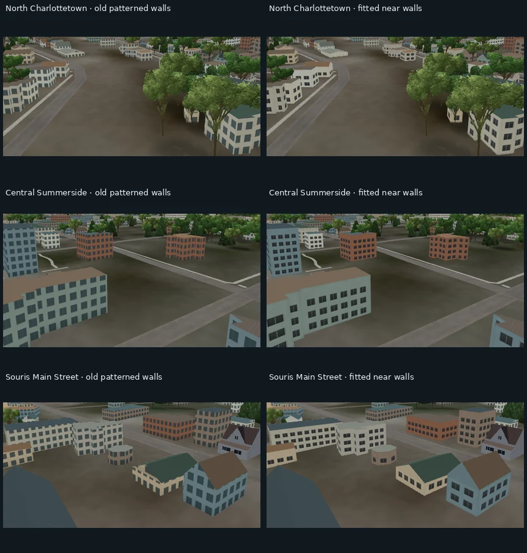

# Close façades in Standard

Ordinary near buildings in north Charlottetown, central Summerside and
Souris Main Street now use the bounded close-wall treatment automatically
in Standard. It fits whole windows inside each building's rendered wall
span, leaving small returns, corners and eaves clear. The wall finish and
reflected sky are optical detail, not a map of actual windows or cladding.
The underlying footprint, silhouette, roof, terrain and roads stay put.

## Range and options

- Standard uses three 250 m core areas contained in the independently
  tested [expanded study](town-wall-study.md), with the same 255 m camera
  distance fade. The area test uses a building’s centre, so wall segments
  can extend beyond its circle. The three areas are in north Charlottetown, central
  Summerside, and just southwest of Souris Main Street.
- **Expanded town façades** (`?townWallStudy`) still selects the original
  wider areas. `?stockTownWalls` disables both applications for comparison.
- Detailed scenery and incompatible shadow, mapped ground, station,
  Baywalk, church and Cavendish presets do not implicitly gain the new
  core treatment. Intentional existing expanded combinations retain their
  original behavior. Other villages and more distant walls use their
  existing materials.

## Renderer checks

Actual camera-matched WebGL frames changed 30,009 pixels in north
Charlottetown, 47,014 in Summerside and 31,686 in Souris. All 527,664
pixels outside the independently projected eligible wall surfaces in
those views remained byte-identical. Each pair had the same number of
draws and triangles, and the same building tile and terrain-detail state.
A separately locked rural control kept all 347,800 pixels identical, with
the same nine ortho tiles and seven building tiles.

The additional integer wall attribute totals 1,192,356 bytes across the
six participating chunks. Only local chunks are resident. The maximum for
one is 419,436 bytes. There are no new data or panorama downloads. An
eligible close window can still take an extra sample of the existing sky
texture, and the active mixed-mesh shader uses the study's wall-screen
derivatives. These are not GPU frame-rate measurements.

See the [source and original study](town-wall-study.md) for the NRCan
building footprint atlas, the CC0 panorama, and approximation limits.

The [flight check](../../tools/qa/town-wall-core-flight.py) verifies
Standard, Expanded, legacy comparison, and the existing railway study
through the compiled waterfront route.
