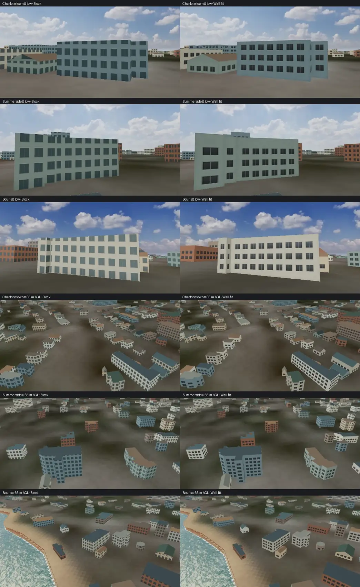

# Wall fitting study in three PEI towns

In Standard, select **Town façades** under **Optional scenery studies** in Dispatch and apply it, or use `?townWallStudy`. It changes the appearance of ordinary
stock walls in small review areas in north Charlottetown, central
Summerside, and Souris. Outside the option, or in Detail, the previous
material is used. It does not change any footprint, roof, contact
height, door, building use, or named business.

The previous stock window bands repeat every 2.62 m along a wall and
3.08 m up it. They can be cut off at corners, buried beside the footing,
or touch the roof. We measured actual rendered wall-face pairs from the
existing building atlas, not assumed frontage photographs:

| Review area | Ordinary wall pairs checked | Stock aperture touches right side | Touches the eave |
| --- | ---: | ---: | ---: |
| North Charlottetown | 1,653 | 1,057 | 1,114 |
| Central Summerside | 1,358 | 865 | 815 |
| Souris Main Street area | 152 | 90 | 123 |

The right-side and eave counts can overlap. They sample the unfiltered
stock window intervals slightly inside currently emitted triangles and
are not a count of actual windows, buildings or screen pixels. All 243
stock face pairs shorter than 1.4 m in this sample still admitted part
of the old repeated aperture.

An ordinary wall now uses its full mapped side span and the minimum
height along its actual upper rim, even when fitted roof planes split
the wall. Casings use whole rows above a shared horizontal datum and
reserve the corners and eaves. No aperture is painted on the narrowest
returns or on generic gable triangles. The angle of view can make a
painted reveal look deeper, but the pane is opaque rendering art; it
does not cut any holes or reveal invented interiors. The mineral-grain
finish is a restrained treatment of the existing colours rather than
an inferred real cladding type.

The footprint and current triangle sources remain the same:
[Natural Resources Canada, Automatically Extracted Buildings](https://open.canada.ca/data/en/dataset/7a5cda52-c7df-427f-9ced-26f19a8a64d6),
PEI 2020 LiDAR, under the [Open Government Licence – Canada](https://open.canada.ca/en/open-government-licence-canada).
The broad reflected light reuses the installed
[CC0 Poly Haven panorama](https://polyhaven.com/a/kloofendal_48d_partly_cloudy_puresky)
by Greg Zaal and Jarod Guest. No street imagery, donor material pixels
or new texture downloads were added.

## Scope and verification

- Eligible ordinary buildings have centroids inside the initial 390 m,
  390 m and 375 m review radii. Walls can extend outside those radii
  because the filter uses building centres. Materials fade to stock by 255 m
  eye distance. Shipped farm, home, main waterfront and custom
  architectural material families retain priority. Roof shading is
  unchanged even where a measured roof has ordinary walls below it.
- Each opted owner has one extra three-component signed centimetre
  attribute, 6 bytes per existing vertex, used only for the wall
  envelope. Seven eligible owner chunks together use 1,237,302 bytes
  of additional CPU-side attribute arrays, with the same logical
  vertex-data total for GPU upload. The largest is 419,364 bytes.
  The three towns are not simultaneously resident under stock streaming.
  Widths round inward and heights round toward greater clearance.
  The atlas manifest must declare the known generation; normal building
  streaming is unchanged and this does not add per-chunk checking. No
  additional render draw. Enabled window pixels can sample the same
  panorama once; this is not a device performance claim.
- [Checked renderer and source receipt](town-wall-study-fixture.json).
  Mesa proof uses the actual world/building meshes, shaders, and
  settled terrain textures but omits vehicles, vegetation, and road props.
  It checks actual antialiased eligible geometry, not just a rectangle.
  At neutral gain, all compared frames are exact to their separate
  stock builds. All seven loaded-source mesh checks leave every existing
  vertex attribute byte-identical.

The full-game WebGL check used three additional exterior views and a
far-distance control. At the three close views, more than 11,000 pixels
in each frame visibly changed and every pixel outside the isolated wall
role, including roofs, was exact. The distant frame was unchanged. In
the production bundle, the same Summerside flight passed 500 m with and
without the option, then switched to Cockpit and Pause. Both runs
requested the same world files. An unrecognized atlas-generation
identifier left the option inactive, and it was unavailable in Detail.

The game continues to show approximate massing and generic art where the
source does not provide real exterior detail. Better-aligned optical
windows do not turn these structures into architectural reconstructions.
