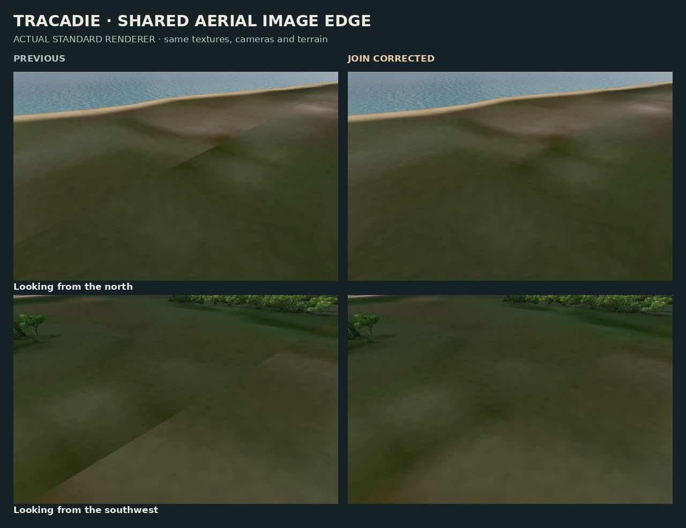

# Tracadie aerial-image join

The low view across Tracadie Bay had a straight colour line through the
land. The two sides used adjacent portions of the same Sentinel-derived
mosaic, but each tile clamped its texture at its own last pixel. From
close to the ground, that looked like a terrain seam even though there
was no gap in the terrain.

Standard now blends the two exact source edges at this join. Both
streamed textures must be authenticated, resident at the near terrain
tier, uploaded and fully faded in. The renderer copies two native rows
from each texture into a single temporary 640 × 4 strip. This is 10,240
base-level GPU bytes with no extra imagery request, draw call, or
geometry. Missing or damaged source imagery leaves the normal fallback.
The correction tapers over the texture footprint, away from the row
and tile corners, and by 330 m from the eye. The prior multi-site
`orthophotoSeamStudy` and Detail graphics setting are unchanged. Use
`?stockTracadieOrtho` to compare Tracadie alone; the [three other close
imagery joins](county-aerial-joins.md) have their own switch.



The exact manifest pair is **18-12 / 18-13**, north and south of line 13
at approximately **46.41454545° N**. The fix changes only near imagery
sampling and does not alter shorelines, terrain vertex heights, roads,
buildings, or aircraft contact. It does not invent sharper source imagery.
See [world source provenance](../WORLD.md) and the existing
[shared-edge technique](orthophoto-edge-study.md).

## In-engine evidence

Diagnostic object colours mark the actual corrected texels including a
one-pixel antialiasing fringe. No changes escaped the mask. Across
independent pairs of points on opposite sides of the join (RGB8
Euclidean difference), the median went from **10.50 to 2.15** looking
one way and from **8.29 to 1.72** from the other. The 90th percentiles
fell from **28.93 to 6.85** and **29.87 to 4.17**. The views changed
8,069 and 26,276 pixels by more than 2/255, respectively. Draw counts,
triangle counts and same-frame stock repeat were exact. These are
browser render checks, not hardware performance figures.

[Machine-readable gates](tracadie-aerial-join-gate.json). To reproduce,
run from the repository root after installing the listed dependencies:

```sh
npm run check
python tools/qa/tracadie-frames.py --checkout . --out /tmp/pei-tracadie \
  --chromium /path/to/chromium
python tools/qa/tracadie-flight.py --dist dist --out /tmp/pei-tracadie-flight.json \
  --chromium /path/to/chromium
node tools/verify-world.mjs
```
