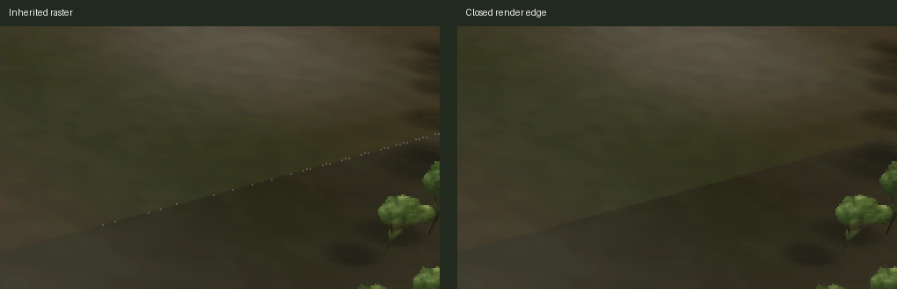

# West2: close one exposed northwest field rim

Fixed-view and independent ordinary compiled flight checks are complete.

A short run at the shared edge of terrain tiles `5-1` and `5-2` showed dotted sky through an otherwise dry field. Equal-detail stitching already agreed on height. Two tile-centred Float32 transforms put their sides **3.90625 mm apart horizontally**: north-bank `Z = −54974.2109375 m`, south-bank `Z = −54974.20703125 m`. Here Z is south along the map, not elevation.



Only the four north-tile `N112` south-edge vertices `12723–12726` (edge positions 67–70) reuse the unchanged south tile’s packed Z for projection. They close three shared segments, with one partial taper on each side. Both corners and every other vertex stay original. This is not a claim about the tapers in other views, the entire `5-1/5-2` boundary, or other provincial seams.

## Native fixed results on V1

| Actual 840 × 540 view | Stock pixels with a sky contribution in the paired render | With the candidate |
|---|---:|---:|
| Direct, exact north/south `N112` | 93 | 0 |
| Reciprocal, exact north/south `N112` | 134 | 0 |
| Same owners, outside the four-vertex patch (near edge index 59) | 141 | 141, exact RGBA |
| Source-primed fixed view, north `N112` / south `N56` | 194,608 | 194,608, exact RGBA |

The paired diagnostic changes only sky colour; these are pixel contributions, not a count of individual hardware samples. The mixed view count includes open sky and is a scope control, not a measurement of a defect. No new sky or alpha changes appeared. All RGB changes stronger than one 8-bit level were confined to previously sky-containing pixels. Small colour differences elsewhere stayed within one level and within subpixel distance of the original or corrected adjacent triangles. The outside-window control stayed byte-identical even though the same north tile was submitted with the scoped lease. Geometry/index/UV/normal bytes, draw and triangle counts, rollback and 50 sampled contact/visual-height values per view were exact.

[Fixed V1 receipt](west2-terrain-rim/fixed-v1.json) · [Exact source, raw frame digests and comparison inputs](west2-terrain-rim/comparison-inputs-v1.json)

## Exact V2 fixed and unsupported-profile controls

The final camera and viewport guards leave all six direct comparison PNGs and all six same-owner outside-window PNGs **byte-identical to V1**. V2 directly reproduces 93→0 and 141→141. The reciprocal 134→0 and source-primed mixed exact figures above are the separate unchanged-shader V1 evidence, not additional V2 captures. An actual ordinary RGBA unmultisampled canvas (0×) retains 16→16 old sky-contributing pixels, with an exact full-frame restore and no candidate draw. The earlier i20 paths retain their own independently documented profiles.

[V2 4× receipt](west2-terrain-rim/fixed-v2-rgba4.json) · [V2 0× stock receipt](west2-terrain-rim/fixed-v2-rgba0-stock.json) · [Exact V2 frame identity and hashes](west2-terrain-rim/comparison-inputs-v2.json)

## Ordinary compiled flight

The separate compiled player used an ordinary Begin, unmodified Chase camera and real flight timing. The only fixture source difference added one private departure for this aperture; it adds no public departure. The verified north `5-1` draw was recorded after **16.111 m** of actual movement at **61.033 m** ground clearance. Chase continued for **158.857 m**, then ordinary Cockpit and Pause controls worked without errors in the four-sample RGBA depth canvas. This check establishes the regular player submission, not a second pixel count. The test position is not real navigation guidance.

[Ordinary compiled flight receipt](west2-terrain-rim/ordinary-flight.json)

## What is actually guarded

The leased draw is valid only for the authenticated regular pair and the original opaque co-submissions in the current Three.js r187 default framebuffer. V2 additionally requires the ordinary unparented perspective camera within 1 km of this small patch and a complete stock viewport; the check includes normal device-pixel rounding. Mixed or lower-detail geometry, a render target or renderer mismatch, unsupported sample/depth states, or a lost owner give stock. Only this pair’s ordinary RGBA depth **four-sample** profile is admitted. The previously independent eastern rim work is unchanged. No new source, renderer pass, or draw is added; the local vertex variant may link the first time it is used.

Signed sources are the existing NRCan CanElevation atlas (`terrain.json`, decoded SHA-256 `661f78b0ede8782741231e4b58196c138a8a3d5d8076da5cfce4106c350f925d`) and the existing signed Land Cover (`cover.json`, decoded SHA-256 `e5055290c88d844b7ec655d33b1336e5ce446cd6a460f7fddd28c81b7d989ea9`). The exact five-quad star and reference strip use 32 original bilinear atlas taps, all dry without a terrain NoData cell. Nothing adjusts physical ground, gameplay contact, roads, trees, water, land-cover or imagery blending. This is a local rendering correction, not a new survey or a performance claim.

```sh
node --experimental-strip-types --test test/west2-rim-custody.test.ts
node --experimental-transform-types tools/qa/west2-rim-lifecycle.mjs
```

The offline fixture authenticates the original files, checks the near geometry and same-frame lease rules, and tests stock fallback and reentry.

Optional native replays with an installed Chromium and the existing Python
Playwright, NumPy and Pillow dependencies. Build the private corridor
fixture outside the real checkout; it appends one replay-only departure.

```sh
python tools/qa/west2-rim-frames.py --checkout . \
  --chromium /path/to/chromium --out /tmp/pei-west2-fixed
python tools/qa/west2-rim-frames.py --checkout . --views west2 \
  --no-msaa --expect-msaa0-veto --chromium /path/to/chromium --out /tmp/pei-west2-noaa
python tools/qa/inland-aerial-joins-fixture.py \
  --corridors docs/qa/west2-terrain-rim/ordinary-corridor.json --out /tmp/pei-west2-player
(cd /tmp/pei-west2-player && npm run build)
python tools/qa/west2-rim-flight.py --dist /tmp/pei-west2-player/dist \
  --corridors docs/qa/west2-terrain-rim/ordinary-corridor.json \
  --chromium /path/to/chromium --out /tmp/pei-west2-player.json
```
