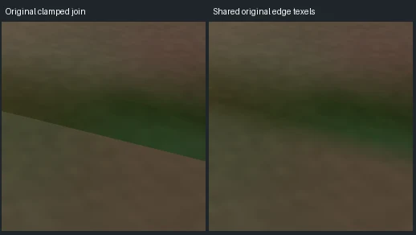

# Western Prince County aerial joins

Two low-flight grassland and cropland windows now sample neighbouring original aerial texels across the atlas edge. This reduces a conspicuous clamped line instead of adding an image, changing land use, or flattening real terrain.

The two source-owner pairs are `2-6 / 3-6` and `4-7 / 4-8`. Each signed 20-texel section includes two-texel end tapers and a 2.5-texel-wide cross-edge treatment. The [original pack, donor RGB and cover receipts](western-aerial-joins/source.json) retain all source classifications. The [province’s exact envelope query](western-aerial-joins/county-scope.json) assigns both entirely to Prince County. No signed road centreline or dated building footprint intersects the narrow applied strips; this does not establish present crop boundaries or the absence of undocumented features.

The [native comparisons](western-aerial-joins/render-checks.json) include both directions, high, mirrored and adjacent controls, and restoration to stock. All four close comparisons reproduced byte-for-byte after the unrelated candidate was removed. The high, outside-window and mirrored controls changed no pixels. Existing imagery, terrain, appearance outside the verified windows, and draw counts stay unchanged. The private [compiled flight replay](western-aerial-joins/compiled-player.json) verifies actual controllable crossings and checks that the stock veto and corrupt-donor path restore the original look without stopping flight. The [test corridors](western-aerial-joins/virtual-corridors.json) are not real navigation routes or public departures.

Use the source validator with `--window prince-west-field-edge --window prince-inland-field-edge` and the [controlled renderer harness](../../tools/qa/tracadie-frames.py) with `--cohort inland`. No new image or frame-rate claim is made.
